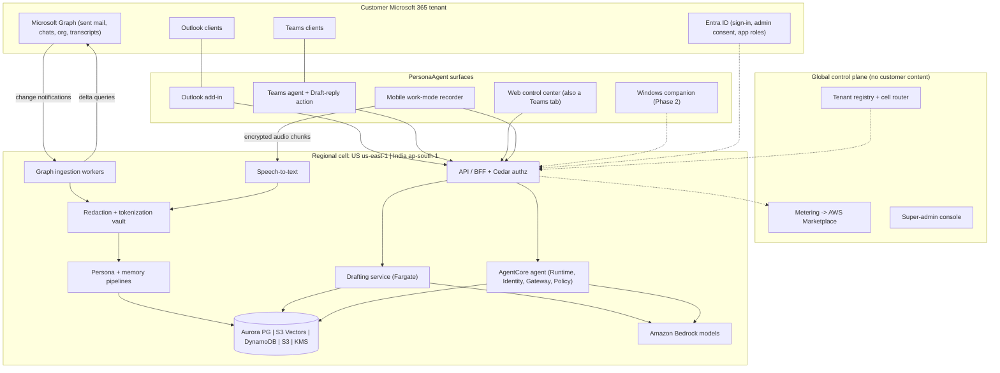
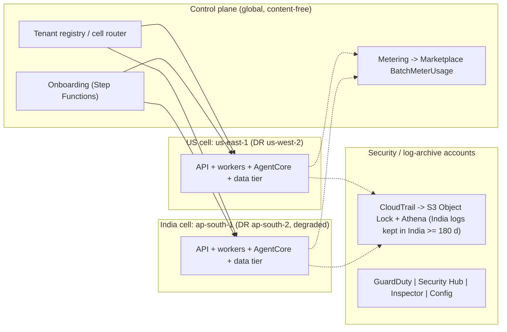

# PersonaAgent — Solution Architecture (v0.2)

> **Status:** research-backed proposal for the MVP and the 12–24-month target. **Date:** 2026-10-06. **v0.2 (2026-10-09):** India model routing in the MVP (founder decision F6, §0 #5, §9.1), user data controls — exclusions and never-send words (F7, §6.5, invariant #8). **2026-10-11:** graph decision F8 — the MVP keeps plain relationship tables; company-level shared context and graph come in later phases (§8.6, invariant #9).
> **2026-10-12 — solo build (F9/F10, `03-mvp-plan-and-roadmap.md` §0):** the target architecture below is unchanged; the first build differs in five ways — **one India cell** first (the US cell is configuration, added later); **one single-tenant Entra app** in the organisation's own tenant (split into Read + Compose before external customers); **Teams meeting memory in the MVP**, with recall Q&A in the web control center / Teams tab because the Teams personal agent moves to v1.5; light EA mode moves to v1.5; the super-admin console is replaced by operator scripts until there are external tenants.
> **2026-10-19 (F11, `03` §0.1):** while the MVP runs on synthetic data, it is deployed on **one EC2 instance** (Docker Compose), not the production cell; the application, redaction and gates are unchanged. **Amazon Comprehend** (S5) and **Bedrock Guardrails** (model input/output) are switched on in the MVP; ~~Macie waits for the production cell~~ *(amended 2026-10-19: **Amazon Macie** is on too, over a daily L1 snapshot bucket — S13 below, `03` §0.1)*.
> **Scope decisions (founders):** Microsoft 365 mid-market & enterprise buyers · US + India in v1 · 3–6 engineers, ~3-month MVP · work-only, company-governed recorder · Phase-1 redaction precise to US + Indian regulation.
> **Sources:** research tracks in `docs/research/` — cited as **[R01]…[R12]**. Numbers are estimates unless a source is cited; confidence levels and URLs are in the research files. Where this document makes its own call between conflicting track recommendations, it says **"Decision"**.

---

## 0. The architecture on one page

| # | Decision | Why (evidence) |
|---|---|---|
| 1 | **No Outlook/Teams clone.** PersonaAgent lives *inside* Outlook (add-in + optional server-side drafts) and Teams (agent + "Draft reply" message action). Our web app is the **control center and memory surface** (also embedded as a Teams tab). Windows companion in Phase 2. | A credible mail+chat client is 6–12+ engineer-months, kills adoption in M365 shops, multiplies breach blast radius and fights Microsoft's UI churn; in-place surfaces are ~22–30 engineer-weeks [R02 §E.1]. |
| 2 | **One backend, many thin surfaces.** Every surface calls the same `draft` and `ask` APIs with a *context envelope* (surface, thread IDs, recipients + relationship labels, instruction, selection). | Keeps persona/memory logic in one place [R02]. |
| 3 | **Two regional cells from day 1:** US (`us-east-1`, DR `us-west-2`) and India (`ap-south-1` Mumbai, DR `ap-south-2` Hyderabad). Identical stacks from one CDK app; tenants pinned at onboarding; content is **stored** only in its cell; the global control plane holds no content. **MVP exception (founder decision F6, 2026-10-09):** India tenants' model calls use Bedrock global cross-Region inference (decision 5). | Retrofitting residency is expensive; M365 already keeps India/US tenant content in-country [R01 §E, R04 §8]. |
| 4 | **Drafting is a deterministic workflow** on a warm ECS Fargate service (retrieve → one streaming Bedrock call → checks). **The conversational assistant and memory Q&A run as an Amazon Bedrock AgentCore agent** (Runtime, Identity, Gateway, Policy, Observability). | Drafting needs p95 first-token ≤ 2.5 s and predictable cost; AgentCore earns its keep for tool-using Q&A, Entra/Graph OBO tokens and Cedar policies [R03 §9]. |
| 5 | **Models (router from day 1):** **Haiku 4.5 by default**, with **Sonnet 5.5 for "premium" drafts** — new emails, long replies, external-client/executive audiences — within each tier's premium-draft quota. US tenants use the US-geo profiles. **India tenants in the MVP use the same router on Bedrock *global* profiles — no India model residency in the MVP (founder decision F6, 2026-10-09)**; this is disclosed as a cross-border transfer, and Indian BFSI/regulated tenants are not onboarded until the residency option ships. **Phase 2 "India residency" option:** since 29 Sep 2026 Bedrock runs **Claude Haiku 4.5, Sonnet 5 and Opus 5 in-country** (geographic cross-Region inference across Mumbai + Hyderabad); Sonnet/Opus 5.5 remain global-only from India. | Pricing and margin math assume Haiku-default routing (`01-product-strategy.md` §5.4); global routing is list price (geo profiles add 10%) and removes an India-only model path and its evals from the MVP; DPDP has no general localisation rule but RBI/SEBI/IRDAI do [R03 §3, R07 §6.5, R09 §6.4; AWS What's New, 29 Sep 2026]. |
| 6 | **Persona = retrieval + style cards + edit-learned rules.** No per-user fine-tuning in v1. | Retrieval +14.9% vs per-user PEFT +1.1%; Claude can't be fine-tuned on Bedrock [R05 §2, R03 §4]. |
| 7 | **We own a thin memory layer** on Aurora PostgreSQL + S3 Vectors (per-tenant bucket, per-user index). Graph modelled as Postgres tables; Neptune/OpenSearch deferred. **Later phases (founder decision F8):** company-level shared context — opt-in team spaces and a company graph with GraphRAG-style summaries (§8.6). AgentCore Memory only for the assistant's own chat memory. | AgentCore Memory would cost $12.50–37.50/user-month for 50k messages and takes ~58 days to load 1k seats (10 TPS) [R05 §4]; per-user S3 Vectors indexes are ~170× cheaper per query than a shared index [R04 §2]. |
| 8 | **Derivatives-only storage by default ("Mode A")**; optional encrypted raw vault ("Mode B") for enterprises that ask. | Founders asked for a raw store; security & legal tracks recommend not holding raw M365 content [R10 §11, R07 G8]. **Decision:** both, with Mode A default (§8.1). |
| 9 | **Multi-level redaction (L0–L3)** with our **own US + India detector library** (checksum validators + NER ensemble + M365-directory gazetteer + contextual classifier), fail-closed. AWS Guardrails/Comprehend/Macie are backstops, not the foundation. | No AWS or Microsoft service covers Indian passport, GSTIN, UPI, IFSC or US EIN; Guardrails has no Indian types; Comprehend is English/Spanish only [R03 §5, R01 §E, R10 §6]. |
| 10 | **Humans send; the agent drafts.** The model that reads untrusted content has no tools, no egress and no memory-write rights; every draft passes an output gate. | PersonaAgent has all three legs of the "lethal trifecta"; 2025–26 zero-click exfiltration hit nearly every major assistant [R10 §2]. |
| 11 | **Consent-first capture.** Internal Teams meetings via Microsoft's own transcription (banner) pulled through Graph; phone "work-mode recorder" that the user starts (policy can pause, never start); external-company meetings and in-person capture **OFF by default**. | Neither iOS nor Android can start the mic from the background [R06 §2–3]; *In re Otter.AI* (13 Aug 2026) and *Chamberlain v. Granola* (Jul 2026) target exactly host-only-consent and bot-free capture [R07 §3]. |
| 12 | **Speech:** MVP = Amazon Transcribe batch in-region behind an `AsrEngine` interface; self-hosted NVIDIA Parakeet + Nemotron diarization from month 4 (US first); **no voiceprints**. | Transcribe = $0.36/h → $11.88/typical user-month; self-hosted ≈ $0.13–0.64 [R06 §9]; BIPA/SPDI biometric exposure [R07 §4]. |

---

## 1. Principles and invariants

**Product principles**
- **P1 — Meet users where they work.** Outlook and Teams stay the user's tools; we add a voice and a memory.
- **P2 — The human sends.** Drafts, prefills and clipboard only; "send as me" is always an explicit, previewed click (later phases).
- **P3 — Privacy is a feature we sell.** A published redaction-quality statement, trust centre, consent ledger and visible indicators are part of the product, not paperwork.
- **P4 — Region-pinned by design.** Tenant → cell at onboarding; vectors, logs and backups stay in-country, and so does inference for US tenants. *MVP exception:* India tenants' inference is global-routed until the Phase-2 India residency option (founder decision F6).
- **P5 — Managed and serverless first.** Add OpenSearch, Neptune, Kafka, Kubernetes or silo accounts only when a named trigger fires (§14).
- **P6 — Measure from week 1.** Minimal-edit send rate (persona), leakage tests (privacy) and recall gates (redaction) block releases.
- **P7 — Everything per-tenant is created by code.** No hand-built tenant resources.

**Security invariants** (test them; they are release gates) [R10 §11.1]
1. **No raw content at rest** (Mode A): Microsoft 365 is the system of record; raw content lives only in memory during processing.
2. **Regulated identifiers (Tier R) are irreversibly masked at first touch**, never stored, never shown to an LLM.
3. **No model output leaves the system without a human gesture.**
4. **The model that reads untrusted content has no tools, no egress and no memory-write rights.**
5. **Style is learned only from what the user sent.** Everything else is a low-trust fact with provenance and an audience ACL.
6. **One tenant, one key, one index.** An isolation failure should yield ciphertext, not data.
7. **Nobody at PersonaAgent can read customer content without the customer's approval**, and every such access is visible to the customer.
8. **What a user excludes is never used, and their never-send words never reach a model, a store or a draft** — enforced at fetch, privacy gate, retrieval and output, and verified by canaries (§6.5). *(Added 2026-10-09.)*
9. **No context crosses from one user to another** unless the receiving user can already open that item in Microsoft 365, both joined the same opt-in team space, or — in delegate mode — Microsoft 365 delegate access exists and the principal enabled it. Manager status alone grants nothing (§8.6). *(Added 2026-10-11; true by construction in the MVP, where memory is per user.)*

---

## 2. System context and actors

| Actor | Who | Primary interactions |
|---|---|---|
| **End user** | Knowledge worker (consultant, sales, manager, exec) | Drafts in Outlook/Teams; memory Q&A; persona studio; recorder; privacy center |
| **Delegate / EA** | Executive assistant | Drafts *in the principal's voice* only where Exchange/Teams delegate access already exists **and** the principal enabled it; activity visible to the principal |
| **Tenant admin** | Customer IT | Admin consent, enrolment (Entra groups), surfaces on/off, capture policies, retention, region, redaction presets & dictionaries, audit, billing |
| **Compliance auditor** | Customer legal/compliance | Audit logs, consent ledger, DLP/redaction QA samples, legal hold & eDiscovery export (with admin) |
| **Team manager** | Customer line manager | Team-level adoption aggregates only (k ≥ 10); **no individual content, no per-employee performance analytics** [R07 G11]; later, opt-in team spaces their team joins (§8.6) |
| **Platform super-admin** | PersonaAgent staff | Tenant lifecycle, plans, feature flags, model/config, health, sub-processor registry — **no standing content access** |
| **Platform support / security** | PersonaAgent staff | Break-glass only, with customer approval, time-boxed and recorded |
| **External systems** | Microsoft Entra ID & Graph, Outlook/Teams clients, iOS/Android, AWS (Bedrock, AgentCore, Transcribe…), optional STT vendor | — |

---

## 3. Client surfaces

### 3.1 The direct answer to "do we build an identical UI?"

**No.** Build the agent and backend once, then integrate *in place*:
- **Outlook:** add-in for interactive drafting + (opt-in) server-side drafts that appear in the user's Drafts folder on every client, including mobile.
- **Teams:** a personal agent (Microsoft 365 Agents SDK, hosted on AWS) for chat-style requests and memory Q&A, plus a "Draft reply" message action.
- **Web control center:** onboarding, persona studio, drafts queue, memory timeline, recordings, privacy center, tenant-admin and super-admin consoles — the place to *see and govern* what the agent learned, not a mailbox. Show a minimal redacted snippet with an "Open in Outlook/Teams" deep link when evidence is needed [R02 §E].
- **Windows companion (Phase 2):** write-anywhere (hotkey, UI Automation, clipboard) and bot-free recording of any call.

### 3.2 Surface matrix

| Surface | What it does | Phase | Hard constraint to design around | Effort (ew, est.) [R02] |
|---|---|---|---|---|
| **Outlook add-in** (XML manifest; task pane + one-click command; nested app auth SSO) | Reads the thread, recipients and compose type; inserts at cursor / replaces selection; audience chip ("writing to: your manager") | **MVP** | Mobile add-ins can't compose; `body.setAsync` in web/new Outlook wipes the quoted thread — insert, don't replace; unified manifest lacks Mac/mobile → keep XML for MVP | 4–6 |
| **Server-side drafts** (Graph `createReply` → Drafts) | Proactive "reply ready" drafts for reply-likely mail; covers iOS/Android | **MVP, opt-in** (separate "Compose" app registration with `Mail.ReadWrite`) | Broader permission → security review; draft clutter → only high-confidence threads, auto-delete stale drafts | 3–4 |
| **Teams personal agent** (Agents SDK on AWS; Azure Bot registration) | "Draft a reply to Priya about the SOW", "what did the client ask for last Tuesday?" | **MVP** | 5 s invoke budget; the Bot Framework SDK lost support in Dec 2025 — use the Microsoft 365 Agents SDK | 3–4 |
| **Teams "Draft reply" message action** | Dialog with **Copy** / **Open chat with prefilled text** / (later) **Send as me** | **MVP** | **No API puts editable plain text into the Teams compose box** (cards only) → validate deep-link prefill in week 1 | 2–3 |
| **Web control center** (React/Next.js; also a Teams tab) | See §3.3 | **MVP** | — | 8–12 total |
| **Mobile app** (iOS/Android) | Work-mode recorder + recall chat + daily digest | **MVP alpha only with a dedicated mobile engineer (team of 6); otherwise Phase 2** (`03-mvp-plan-and-roadmap.md` §2.2) | OS can't auto-start the mic; Android OEM background killers; Play "monitoring tool" risk → recordings private to the user | 10–14 (incl. STT pipeline) |
| Copilot Chat exposure (same custom engine agent) | Discovery inside Microsoft 365 Copilot Chat — **no Copilot licence needed** | Phase 2 | Agent Store policies | 1–2 |
| **Windows companion** (Electron/Tauri; MSIX via Intune; signed) | Write-anywhere + bot-free recorder (mic + WASAPI process loopback: mic = user, loopback = others) | Phase 2 (stretch: MVP if a design partner needs external-meeting capture) | EDR/DLP may flag accessibility/clipboard hooks; consent UX (*Granola* suit) | 6–10 (+6–8 recorder in-house, or 2–4 via Recall Desktop SDK) |
| Mac companion, local MCP server, Copilot connector | Persona/memory as a tool for other agents | Phase 3 | Prerelease platforms; data exposure | — |
| ~~Full mail/chat client~~ | — | **Not recommended** | 26–52+ ew | — |

### 3.3 Web control center modules

| Module | MVP | Later |
|---|---|---|
| **Onboarding & admin-consent wizard** | Entra admin consent; records the customer's **"express and specific" persona-learning grant** (Microsoft API Terms §3(c)); deploy add-in + Teams app via Integrated Apps; **live health checks** (Transcript API access, speaker attribution, application access policy); data region (US/India); capture policy choices | SCIM / group mapping |
| **Persona studio** ("My writing profile") | Per-audience personas with evidence snippets; formality/length/warmth sliders; phrase do/don't lists; exclusions (links to *My data controls*); **test bench**; learned-rules digest to confirm | Per-language personas (en-IN / Hinglish / Hindi), A/B analytics |
| **My data controls** (also the onboarding review step — §6.5) | **Search-and-exclude** people, email addresses/domains, 1:1 and group chats (by name) and email threads (meetings too, with meeting memory), with an impact preview and metadata-only pre-flags; **never-send words** (Never send by default / Allow in my drafts) | Redaction preview ("see what the AI sees"); weekly "new sources" card; channels; transliteration and fuzzy word variants; finer scopes (e.g. memory yes, style no); team-shared exclusion lists |
| **Drafts queue** | Threads needing a reply with ready drafts, "Open in Outlook", feedback | Follow-up nudges, delegation tracking |
| **Memory timeline & search** | Day view of meetings/captures; ask questions with cited spans and audio snippets; commitments and action items | Cross-source entity views |
| **Team spaces** (later — §8.6, F8) | — | Opt-in sub-contexts per team, per manager and direct reports, and per client account; visible membership; client walls; leaving ends access (Phase 3 pilot → Year 2) |
| **Recordings** | Playback (within retention), retention countdown, delete | Access-controlled clip sharing |
| **Privacy center** | Mute schedules, exclusions, one-click delete/export (DSAR/DPDP), consent ledger, "delete last N minutes" | Participant-objection workflow |
| **Tenant admin console** | Enrolment, surface toggles, capture policies, retention, redaction preset + dictionaries, client/account scoping, audit log, usage & billing, legal hold | India-only processing flag (with the Phase-2 India residency option), SIEM export, Purview/DLP integration |
| **Platform super-admin console** | Tenant lifecycle, health, feature flags, model routing config, sub-processor registry, **JIT-approved, recorded support access** | Cell management |

---

## 4. AWS deployment topology

### 4.1 Accounts and regions
- **AWS Organizations + Control Tower**, ≈ 8–10 accounts: management · security tooling · log archive · shared services/CI · control plane · **prod-US cell** · **prod-IN cell** · staging · per-cell **vault** accounts (tokenization vault isolated from the data plane) [R04 §6, R10 §7].
- **Region-deny SCPs per cell OU.** US cell may use only `us-east-1` + `us-west-2`; India cell only `ap-south-1` + `ap-south-2`. *Note:* SCPs restrict where API calls are made, not where Bedrock cross-region/global inference processes data — inference residency is enforced by the router's per-tenant model allow-list (§9.1).
- **Global control plane is content-free:** tenant registry and cell router, onboarding/offboarding (Step Functions + EventBridge), metering aggregation → AWS Marketplace, super-admin console (separate staff IdP + phishing-resistant MFA).

### 4.2 Inside a cell (identical stacks)
- **Edge:** CloudFront (web app) · API Gateway + WAF (API, webhooks).
- **Ingestion:** webhook Lambda (validates `clientState`, returns 202 within 3 s) → **SQS fair queues** (message group = tenant) → **Fargate Graph workers** with fixed NAT egress IPs (published for customers' Conditional Access) → redaction/chunk/embed workers; Step Functions for backfill, deletion and re-index; DynamoDB for cursors and idempotency [R04 §8].
- **Serving:** API/BFF (Lambda) with Verified Permissions (Cedar) · Drafting service (warm Fargate) · AgentCore Runtime/Identity/Gateway/Policy/Observability · speech workers.
- **Data tier:** Aurora PostgreSQL Serverless v2 (RLS) · S3 Vectors · DynamoDB · S3 · ElastiCache Serverless (Valkey) · KMS (per-tenant CMKs).
- **Network:** **no internet egress from the data plane.** VPC endpoints for AWS services; Graph reachable only through an egress allow-list (Network Firewall / DNS Firewall); LLM-calling tasks reach only Bedrock [R10 §7].
- **Audit:** org CloudTrail → S3 Object Lock + Athena (CloudTrail Lake and Audit Manager are closed to new customers); hash-chained, KMS-signed application audit log [R04 §6].

### 4.3 Disaster recovery
- AWS Backup copies **stay in-country**; S3 cross-region replication in-country; nightly vector export (S3 Vectors has no documented CRR/Backup support).
- **India DR is "data recovery + degraded service"** until Mumbai returns: Hyderabad lacks Transcribe, Comprehend, Macie, MemoryDB, Neptune Analytics and (per the Sep 2026 price list) AgentCore Runtime/Memory [R04 §4, R03 §1]. State this in contracts.

### 4.4 Scale path
Multiple cells per region (capped ~10k–30k users or ~1–2k tenants each) behind the cell router; EU cell (Frankfurt) later; silo accounts for Enterprise+; Aurora Global Database / DynamoDB global tables to in-country DR; BYOC container only for deals large enough to fund it [R04 §8.2].

---

## 5. Identity, tenancy and authorization

### 5.1 Entra app registrations (tiered consent) [R01 §H1]

| Registration | Delegated scopes | When | Notes |
|---|---|---|---|
| **PersonaAgent — Read** (MVP default) | `openid profile email User.Read offline_access Mail.Read Chat.Read User.ReadBasic.All` (+ optional `User.Read.All` for manager chain/job titles) | MVP | Admin consent required in practice (Microsoft-managed policy since late 2025); "assignment required" + pilot group |
| **PersonaAgent — Compose** (opt-in) | `Mail.ReadWrite` (server-side drafts); later `ChatMessage.Send` (explicit user-click sends) | MVP opt-in / Phase 2 | **Decision:** offered as a separate toggle so security teams can approve the Read app first [reconciles R01 vs R02] |
| **PersonaAgent — Meetings** | `OnlineMeetings.Read`, `OnlineMeetingTranscript.Read.All` / `CallTranscripts.Read.All`, **`Calendars.ReadBasic`** (resolves "the 4 pm meeting" and meeting exclusions — added 2026-10-09 [R12 §4]) + Teams **application access policy**; or per-meeting RSC for bottom-up pilots | MVP | Admin must enable **Teams "Transcript API access" + speaker attribution** (default OFF since ~29 Jul 2026) [R02 §D] |
| Enterprise app-only tier (optional) | `Mail.Read` (application) scoped via **Exchange RBAC for Applications**; `Chat.Read.All` for fast Teams export | Phase 2+, large tenants | Backfill of a 1,000-user tenant: 1–3 h vs 2–4 days delegated |

Trust package (week 1): verified publisher in Partner Center, Publisher Attestation, scope-by-scope justification sheet, static egress IPs + Conditional Access guidance, expected Graph volumes; Microsoft 365 Certification from ~month 3–4 (≈ $15–40k/yr, est.) [R01 §D].

### 5.2 Sign-in, tokens and secrets
- **Users sign in with Entra ID directly** (multi-tenant OIDC; app roles assigned by the customer's admin). No Cognito for Microsoft-only buyers [R04 §5].
- **AgentCore Identity** validates the inbound Entra JWT and performs the **Microsoft on-behalf-of (OBO) exchange** for delegated Graph tokens [R03 §1]. Week-1 spike: inbound tokens with custom claims are rejected; multi-tenant issuer handling; refresh-token custody for offline sync.
- **Background sync** uses refresh tokens in a token vault encrypted with the tenant CMK; only the ingestion role can decrypt; superseded tokens deleted; per-tenant revoke-all.
- **No client secrets:** AWS workload identity federation to Entra (federated identity credential); fallback certificate key held in KMS (`kms:Sign`) [R10 SR-03]. *The stored token set is the crown jewel* (cf. Salesloft-Drift, Aug 2025) [R10 §2].

### 5.3 Authorization model
- **Amazon Verified Permissions (Cedar)** — one policy store per cell; ABAC session tags gate every data-plane call; **Aurora `FORCE ROW LEVEL SECURITY`** on `tenant_id` and `owner_user_id`; Cedar `forbid` invariants mirrored in SCPs and KMS key policies [R04 §5].

| Role | Can | Cannot |
|---|---|---|
| **Platform super-admin** | Tenant lifecycle, plans/billing, feature flags, model routing, health, sub-processors, L3 metrics | Read content. Emergency access = 2 internal approvers **+ tenant-admin approval**, time-boxed, recorded, L2 view by default; vault keys deny all humans |
| **Platform support** | Tickets; break-glass on named item IDs with **user + tenant-admin approval**, ≤ 4 h, recorded | Vault reveal; tokens |
| **Platform security / IR** | Declared incident with legal sign-off; forensic account; tenant notified | Standing access |
| **Tenant admin** | Consent, enrolment, surface toggles, capture policies, retention, region, India-only flag (Phase 2), redaction presets/dictionaries, client/account scoping, audit log, billing, legal hold; eDiscovery export with dual approval | Browse users' content by default; read users' exclusion lists or never-send words (counts only) |
| **Compliance auditor** | Audit logs, consent ledger, sampled redaction-QA spans, DLP incidents; formal investigation co-approved by tenant admin | Browse content |
| **Team manager** | Team aggregates (k ≥ 10); later, opt-in team spaces their team joins (§8.6) | Individual content — manager status alone never grants access to a report's data; per-employee performance analytics (prohibited by AUP) |
| **End user** | Everything about their own persona, memories, recordings, drafts; delete/export; exclusions and never-send words (§6.5); pause | Others' data; undo a tenant-level exclusion |
| **Delegate / EA** | Draft as principal where delegate access exists and principal enabled it; actions visible to principal | Modify principal's persona; PRIVATE memories; recordings |
| **Service roles** (ingestion, persona learner, drafting, re-hydrator, analytics) | One IAM role per pipeline stage; least privilege (e.g., only ingestion decrypts refresh tokens; only the re-hydrator reveals tokens, and only those present in the request) | Cross-stage access |

Full matrices: role × data level [R10 §8]; 8 roles × 12 actions [R04 §5].

---

## 6. Ingestion pipelines

### 6.1 Outlook sent mail and Teams messages [R01 §A–C, §H]
- **Backfill newest-first** so the persona is useful within the first hour. Reference user (50k sent emails + 100k sent Teams messages): mail ≈ 10–40 min (bodies in delta pages) to 50–90 min (with per-message enrichment); Teams ≈ 15–45 min per user delegated.
- **Tenant scale:** Outlook limits are per mailbox (10,000 requests / 10 min, 4 concurrent) so mail parallelises; Teams delegated reads share **20 rps per tenant and 1 rps per chat** → a 1,000-user tenant takes ~2–4 days → **onboard in waves of 100–300 users/day** (or the app-only export option: ~1–3 h).
- **Incremental sync:** Graph subscriptions (Outlook sent items; Teams `getAllMessages` delegated with encrypted resource data), renewal service with lifecycle notifications, hourly mail-delta safety net, nightly 7-day Teams re-scan for edits/deletes; **delete cascade ≤ 24 h**.
- **Thread semantics on every sample:** `uniqueBody` (the user's own words) vs `body` (context); `conversationIndex` length + `In-Reply-To`/`References` + subject prefixes → *new thread / reply / reply-all / forward / delegation*; Teams turn segmentation + `messageReference` quotes. Week-1 spike: `uniqueBody` availability in delta responses (fallback quote-stripper ready).
- **Relationship labelling:** deterministic first — manager chain, direct reports, job title, department (if `User.Read.All`), verified domains (internal vs external), guests; Haiku 4.5 classifies intent and external relationship type; **the user confirms their top 20–30 contacts**; unknown relationship → formal slice [R05 §8].
- **Pre-ingestion privacy gate (before anything persists):** `MSIP_Labels` header (skip "Highly Confidential" and RMS-encrypted mail), Teams `policyViolation` flag, US + India detectors, secrets dropped, third-party content (colleagues' and clients' text) minimised to short redacted context windows [R01 §E].
- **Client/account scoping (for IT-services customers bound by their own client contracts):** tenant admins can exclude specific client domains, accounts or Teams chats from ingestion, memory and drafting — or allow-list only approved accounts — and attach per-client Tier C dictionaries (red-team finding RT-C1, `06-red-team-review.md`). Same rule engine and enforcement points as the user-level controls in §6.5.
- **User exclusions and never-send words** (§6.5): applied from the first fetch; the content backfill waits for the user's review step.

### 6.2 Teams meetings via Graph [R02 §D]
- Post-meeting **transcripts and recordings** for in-tenant scheduled meetings, ad-hoc and PSTN calls (`adhocCalls`, partly beta); **$0** (unmetered since 25 Aug 2025).
- **Prerequisites the onboarding wizard must check live:** admin enabled *Transcript API access* and *speaker attribution* (detect `GraphAccessToTranscriptsDisabled` / `SpeakerAttributionNotAllowed`); application access policy for enrolled users; transcription allowed (optionally auto-transcribe for enrolled organizers); subscriptions created **at enrolment** (they must exist before transcription starts).
- **Never available for meetings organised by other companies** → those need desktop or phone capture (§6.4).
- Microsoft's own banner informs every participant — the strongest consent posture available [R07 §2].

### 6.3 Phone "work-mode recorder" [R06]
- **Three capture modes:** *Work session* (one tap; runs within admin-set hours) · *Meeting capture* (calendar prompt, one tap) · *Quick capture* (Control Center / Action button / Quick Settings tile) · plus **share-sheet import** of native call recordings. Policy can **auto-pause** (outside hours, sensitive calendar tags, locations) but cannot auto-start.
- **iOS:** `.playAndRecord` + `audio` background mode; interruption/resumption manager (iOS 26 API + iOS 27 `resumptionRecommendationNotification`); Live Activity with pause/resume/stop refreshed before its 8 h cap; orange mic dot always visible; App Review 2.5.14 consent + indicator.
- **Android:** one `microphone` foreground service started from the foreground; `VOICE_RECOGNITION` source; gap logging; **per-OEM onboarding wizard** (Xiaomi, Vivo, Oppo, realme, Samsung, OnePlus — most of the Indian market); server heartbeat + "capture stopped" nudges; Play FGS declaration + prominent-disclosure screen.
- **Recordings are private to the user**; admins govern policy, not content (keeps us out of Play's "monitoring tool" class); Intune app configuration binds the tenant and policies; admins can MDM-deny the mic as a kill switch.
- **On-device:** Silero VAD → 60 s Opus 16 kbps chunks → AES-GCM → upload to the tenant's in-region S3 every 2–5 min (≈ 0.55 GB/heavy user-month, ≈ $0.05). No continuous on-device ASR (battery; Apple's on-device transcriber lacks Hindi).
- **Server:** calendar-bounded session assembly → batch ASR + diarization → our redaction → memory extraction. **De-duplicate** against Graph transcripts (Graph wins for internal Teams meetings) — this also cuts STT volume and cost.

### 6.4 Desktop capture (Phase 2)
Mic + WASAPI process loopback (mic = user, loopback = others); works for any app incl. other companies' Teams/Zoom/Meet, Slack huddles, softphones. **Mandatory:** automatic disclosure (chat message/spoken notice), persistent on-screen indicator, consent-ledger entry, one-click delete; external meetings OFF by default per tenant. Build in-house (6–8 ew) or via Recall Desktop SDK (2–4 ew; Recall regions US/EU/JP — not India) [R02 Matrix 2, R07 §3].

### 6.5 User data controls — exclusions and never-send words (founder requirement F7, 2026-10-09)
Users decide — before anything is learned, and at any time afterwards — **which conversations PersonaAgent may use, and which words it must never send**. This is the user-level layer under the tenant's client/account scoping (§6.1): tenant and user rules apply together, **any exclusion wins**, and users can add rules but never lift a tenant rule. It also serves data minimisation (DPDP, CPRA, Microsoft API Terms). Verified API facts, edge cases and effort: [R12].

**The promise, as shown in the product:** *"Conversations you exclude are never used — not to learn your style, not for memory, not as context. Never-send words are never stored by PersonaAgent and never sent to any AI model. One exception: speech-to-text hears what is recorded, so the words are removed from the transcript before anything is stored."* Microsoft's own processing inside Microsoft 365 (for example, Teams transcription) is outside this promise.

**Exclusions — "do not use this at all"**

| The user searches for… | How we find it (metadata only, never message text) | What is excluded | MVP? |
|---|---|---|---|
| **A person** (name or email address) | Our own index of Sent Items headers plus chat rosters — Graph has no "list my correspondents" API | Everywhere they take part: sender, To/Cc/Bcc, chat member, meeting attendee. The preview lists every affected chat and thread, and the user can untick big team chats | ✅ |
| **An email address or domain** | The same header index | All mail to or from it (a domain includes its subdomains) | ✅ |
| **A 1:1 or group chat** — group chats by name, unnamed ones by member names, as Teams labels them | A cached list from `GET /me/chats` with members (no message text). Graph has no chat search, so the portal searches this cached list | That chat, including future messages and later membership changes | ✅ |
| **An email thread** (by subject) | `conversationId` from the header index | The whole conversation, including replies into it | ✅ |
| **A meeting or recurring series** | `calendarView` (needs `Calendars.ReadBasic`, §5.1) | Its transcript, meeting chat and any linked recorder session; audio is deleted *before* transcription | With meeting memory |
| A Teams channel | Joined teams and channels | Channel posts | Later — channel posts aren't ingested in the MVP |

- "Excluded" means **not at all**: no style learning (exemplars, style cards, rule evidence), no memory (episodes, atoms, commitments, relationship facts), no retrieval, no drafting context, never in evals or caches. No stub is kept — only the rule itself.
- **Impact preview** before confirming ("214 emails in 37 threads, 1 chat, 3 meetings"), computed from the header index.
- **Pre-flagged for review** from metadata alone: chats hidden in Teams, consumer email domains, calendar events marked private, tenant-excluded domains. Nothing is excluded silently.
- Excluding a person removes the conversations they are in, not mentions of them elsewhere; the screen offers to add their name to the never-send words too.
- **Drafting inside a conversation the user excluded** is refused by default. The user may ask for a one-off draft that is processed in memory and never stored; tenant exclusions never allow this.

**Never-send words (Tier U, §7.1)**
- The user lists words and phrases — project codenames, client nicknames, family names, internal figures — and confirms simple variants: plurals and possessives, separator forms (`project-falcon` = `projectfalcon`), and any spellings they type themselves, Roman or Devanagari. **MVP variants are rule-based; no machine-learning transliteration model**, which keeps the "no AI model" promise simple.
- A preview before saving: "appears in N stored items", with a warning for common words (masking them weakens the persona).
- Every match is replaced by a random placeholder (`⟦NS_id⟧`) in memory, **before NER, embeddings or any model sees the text** — in message bodies and in metadata (subjects, chat names, display names), in the live thread, in the user's own instructions and in portal search queries.
- **Default — Never send:** drafts show `[removed]` where the word would be, and PersonaAgent never fills it in. **Per-word opt-in — Allow in my drafts:** the placeholder is restored only on the owner's own screen. A final check on every draft also catches the word if the model produces it by itself.
- The list lives in the vault, encrypted under the user's own key; workers hold it only in memory; nobody else can read it (admins see counts only). Deleting a word crypto-shreds its mapping, and history stays masked.
- **Adding a word later** scrubs already-stored data within 24 h (re-redact L1 text, re-embed, rewrite memory atoms, rebuild style cards); until the scrub finishes, prompt assembly re-checks retrieved text.
- **Why our own matcher:** Bedrock Guardrails word filters can't hold per-user lists (100 guardrails per account and Region, block-only, phrases of up to 3 words, no plurals) and only see text that has already reached Bedrock; Transcribe vocabulary filters take single words only, with 100 filters per account [R12 §5]. So we run an in-memory multi-pattern (Aho–Corasick) matcher on normalised text: strip zero-width and bidi characters → NFKC → case-fold → Devanagari digits to ASCII → **ICU word segmentation** (Python's `re` word boundaries split Hindi words apart) [R12 §6]. Later: look-alike-character detection (Unicode UTS #39), transliteration variants, fuzzy matching for speech-to-text spellings.

**Onboarding — the human in the loop before content ingestion**
1. The account starts as **review pending**: the scheduler refuses to fetch any message bodies.
2. **Header pass** (minutes): chat list with members; Sent Items headers through the delta query with a body-less `$select`; the calendar if meeting memory is on → a per-user **Sources index**.
3. The user reviews it in **"Choose what PersonaAgent learns from"** and selects **Finish** or **Skip** (reminders at 24 h and 48 h). Nothing is backfilled before that.
4. **Backfill fetches bodies only for allowed sources**, newest first. *(v1.5: a weekly "new since your last review" card.)*

**Enforcement — a security control, tested like one**

| # | Point | Exclusions | Never-send words |
|---|---|---|---|
| X1 | Notification intake | Teams notifications carry the chat ID in clear text, so excluded chats are dropped **before decryption**. Mail notifications carry only the message ID, so headers are checked first | — |
| X2 | Fetch | Two-phase: headers → decision → body, for allowed IDs only. Transcripts and audio of excluded meetings are never fetched or transcribed | — |
| X3 | Parse (§7.2 S2–S2.5) | Quoted history whose header names an excluded participant is dropped | **Never-send gate (S2.5)** right after parsing — before NER, embeddings or any model |
| X4 | Persist | Rules re-checked against a per-user version number, so a rule added mid-flight wins; every stored item records its source IDs (lineage) | Re-checked at S9; any hit blocks the item |
| X5 | Retrieval and prompt assembly | **Every hit is post-filtered** against the live exclusion set. S3 Vectors filters allow at most 100 conditions, so they only narrow the search | Re-check text that didn't come through the pipeline: instructions, search queries, memory edits |
| X6 | Live drafting and output | Excluded threads refused (one-off in-memory draft only under user rules); drafts may not cite excluded items | `[removed]` unless "Allow in my drafts"; final check for model-produced words |
| X7 | Purge | **Logical exclusion ≤ 1 min; physical purge ≤ 24 h**, driven by lineage because S3 Vectors has no delete-by-filter (`DeleteVectors` takes keys, ≤ 500 per call); then style cards are rebuilt and the user gets a receipt. A legal hold defers only the physical purge | Scrub on add (≤ 24 h) |
| X8 | Logs, caches, exports, evals | Rule IDs and counts only; caches invalidated; exports and backups expire; excluded items never enter gold sets | The matcher never logs its input |

**Release gate:** daily canaries in a test tenant — an excluded person, chat and thread (and a meeting, with meeting memory), plus never-send words in Latin and Devanagari, zero-width-split and Hinglish spellings — must show **zero hits** in any store, vector, memory, prompt, draft or log (`03-mvp-plan-and-roadmap.md` §5).

**Data model:** `ExclusionRule` (kind: person · address · domain · chat · thread · meeting · series · channel *(later)*; keyed by a keyed hash of the identifier, so rules don't store raw addresses; scope; status active → purging → purged, or held / revoked; created by user or admin) and `NeverSendTerm` (vault-encrypted term + confirmed variants; `allow_in_drafts`, off by default). The tenant's client/account scoping uses the same table with tenant-wide scope — **one engine for admins and users**.

---

## 7. Multi-level redaction and privacy pipeline

### 7.1 Data levels and who may consume them [R10 §6–8]

| Level | Content | Stored? | Consumers |
|---|---|---|---|
| **L0 — Raw** | Original Graph content / audio | **Mode A: in memory only.** Mode B: encrypted raw vault (customer key, Object Lock, legal hold). Audio: deleted after transcription by default; tenant opt-in short retention (§8.4) | Ingestion & redaction service only. Live threads on the draft path are converted to L1 *before* the prompt |
| **L1 — Pseudonymised** | Tier R irreversibly masked; person names/emails/phones → consistent reversible tokens | Yes (per-tenant keys) | Persona learner, memory extractor, drafting/agent prompts (ACL-filtered), search |
| **L2 — Company-sensitive masked** | L1 + tenant-defined Tier C/S masked | Views derived on demand | Break-glass support (default view), auditor samples, any cross-user/team feature |
| **L3 — Anonymised aggregates** | Metrics only (k ≥ 10) | Yes | Analytics, billing, product evals (synthetic or consented data only) |
| **Display** | L1 re-hydrated for the owning user | **Never stored** | The owning user's client, via the re-hydrator |

> **Pseudonymised is not anonymous.** L1 text is still personal data under DPDP, CCPA/CPRA and GDPR — surrounding context can re-identify people even after tokenisation. It stays subject to access/correction/deletion requests, breach-notification rules and customer contracts. Never market Mode A or L1 as "anonymised"; only L3 aggregates are.

**Detection tiers**
- **Tier R — regulated identifiers → irreversible mask (never tokenised, never to an LLM).** US: SSN (area/group/serial rules), ITIN, EIN (IRS prefixes), passport, driver's licence (top states), ABA routing (checksum) + account numbers, payment cards (Luhn + BIN), Medicare MBI, NPI, DEA, HIPAA Safe Harbor identifiers. India: Aadhaar (Verhoeff checksum; UIDAI masking — show at most last 4) and VID, PAN (structure), voter ID/EPIC, passport, driving licence, GSTIN (checksum), UPI VPA, IFSC + account numbers, CKYC, ABHA. Plus secrets/credentials/API keys/passwords and card data — which also keeps us out of PCI storage scope (confirm with a QSA) [R10 §6.4, R07 §11].
- **Tier P — personal identifiers → reversible tokens** (names, emails, phones, addresses).
- **Tier S — special categories** (health, biometrics, sexual orientation, children, SPDI "sensitive personal data", financial details) → excluded from persona/memory or masked.
- **Tier C — company-sensitive (tenant-defined)** — client names, project codenames, unreleased financials, M&A, pricing, legal-privileged, HR → masked at L2 or excluded per tenant policy; tenant dictionaries + LLM contextual classifier.
- **Tier U — user never-send words (user-defined, §6.5)** → replaced by random placeholders in memory at stage S2.5, before NER, embeddings or any model, so no model, store or log ever sees them; drafts show `[removed]` unless the user allows the word in their own drafts. Matched deterministically, never by an AI model; added 2026-10-09.
- **Signals:** Microsoft Purview sensitivity labels (`MSIP_Labels`), Teams DLP `policyViolation`.

### 7.2 Pipeline stages (condensed from [R10 §7])

| Stage | What happens | Failure behaviour |
|---|---|---|
| S0 Intake | Validate notification; enqueue IDs only; per-tenant rate limits | Drop invalid; DLQ |
| S1 Fetch | Delegated token (ingestion role only) → Graph GET of selected fields; **in memory** | Mark tenant degraded; no fallback storage |
| S2 Parse | MIME/HTML → text; quotes/signatures/disclaimers split; **hidden-content & Unicode-tag detection**; NFKC; Devanagari digits; language/script ID | Skip + metric |
| **S2.5 Never-send** (added 2026-10-09) | User never-send words (Tier U, §6.5) → random placeholders in bodies and metadata, before any NER, embedding or model; quoted history naming an excluded participant dropped | Matcher error ⇒ **block (fail-closed)** |
| S3 Pre-policy | Labels, sender trust, size caps (denial-of-wallet), recorder rules, privileged markers, **tenant + user exclusion rules (§6.5)** | Metadata-only stub; excluded ⇒ drop |
| S4 Deterministic | US + India validators + secrets rules → **Tier R masked immediately** | Detector crash ⇒ **block (fail-closed)** |
| S5 NER ensemble *(MVP, F12 2026-10-19: names are replaced only for users who turn it on, off by default; identifiers, addresses and contact details always)* | Presidio + spaCy · GLiNER · IndicNER (Devanagari) · **M365 directory/header gazetteer** (best fix for Indian-name recall) · optional Comprehend (English) — *on in the MVP (F11, 2026-10-19): every item at synthetic volume, switchable to flagged items only. It sees only text our own stages already masked; its names become person tokens, its identifiers and addresses typed slots. MVP outage behaviour: the item is blocked and a learning run, scan or meeting read stops and retries later — nothing is skipped or marked done* | Endpoint down ⇒ queue, no bypass |
| S6 Contextual | Small Bedrock model + Guardrails classifies Tier C/S on selected items | Timeout ⇒ stricter default |
| S7 Decide | Span merge (R > S > C/U > P), tenant policy → action per span per level | Missing policy ⇒ strictest preset |
| S8 Tokenise | Vault service (separate account; DynamoDB + Database Encryption SDK hierarchical keyring; tenant CMK → per-user branch keys) | Vault down ⇒ block |
| S9 Verify | Second-pass detectors on L1; any Tier R or never-send residual ⇒ **block item + alert**; sampling to tenant review queue | — |
| S10 Persist | L1 to Aurora (RLS), S3 (SSE-KMS tenant key), S3 Vectors (tenant bucket / user index); lineage record (Graph immutable ID → artefacts) | Compensating delete |
| S11 Memory | Quarantined reader extracts → memory-write validation (provenance, trust, imperative rejection) → store with audience ACL | Suspicious ⇒ quarantine |
| S12 Draft path | Live thread **and the user's instruction** → fast path S2–S9 (≤ 1–1.5 s est.) → generator → output gate (incl. never-send words) → re-hydrator → plain text to client | Any gate failure ⇒ no draft + reason |
| S13 Backstops | Macie scans of L1 buckets (custom Aadhaar/PAN/UPI identifiers) · CloudWatch Logs data protection · canary recall jobs · GuardDuty/Security Hub · *MVP (F11, 2026-10-19): Bedrock Guardrails `ApplyGuardrail` on every model input and output; ~~Macie waits for the production cell (nothing in S3 yet)~~ (amended the same day) Macie scans a daily L1 snapshot per user (`l1/<tenant>/<user>.jsonl`, SSE-S3, readable only by Macie, no versions, 3-day expiry; a purge job deletes it at once and any other deletion or change of L1 makes it due for rewrite within minutes; unchanged snapshots aren't re-uploaded) with custom ~~PAN/GSTIN/IFSC/UPI identifiers and Aadhaar/voter-ID next to a keyword~~ Aadhaar/PAN/GSTIN/IFSC/UPI identifiers (bare numbers, no keyword; F12 same day) and voter ID next to a keyword, plus Macie's managed ones; snapshot lines carry no row IDs (the manifest maps lines to rows), so nothing Vanimo writes looks like an Aadhaar number; a finding is recorded content-free with the rows it names (from the export's manifest) and pauses the tenant until an admin removes those rows and resumes; offline stand-in scans the same snapshot in process* | Findings ⇒ pause tenant pipeline |

### 7.3 Tokens that preserve the persona [R05 §6, R10 §6]
- Deterministic per-tenant tokens (e.g., `⟦PERSON_7⟧`) so style learning keeps structure.
- **Tokens carry persona attributes:** name form (first/full/nickname), script (Latin/Devanagari), fused honorifics kept *outside* the token ("Sharma-ji" → `⟦PERSON_7⟧-ji`), grammatical gender learned only from the user's own usage (Hindi verb agreement), all user-correctable.
- **Regulated values are only ever fill-in slots** in drafts (`[account number]`), never re-inserted.
- The re-hydrator reveals only tokens already present in that request's context (token-spoofing defence). Format-preserving encryption, if ever needed, uses **FF1** (NIST withdrew FF3/FF3-1).
- Enterprise: operator-blind **Nitro Enclaves** vault; BYOK, then XKS (HYOK) for buyers who demand it.

### 7.4 Policy presets and quality gates
- **Presets:** `US-Default`, `US-HIPAA`, `US-GLBA-FI`, `PCI-Strict`, `India-DPDP`, `India-BFSI` (MVP: 2–3 presets, dry-run mode) [R10 SR-19].
- **Launch gates (validate on our own labelled sets; publish a redaction-quality statement; never claim "100% PII removal"):** ≥ 99.9% recall on checksum-validated IDs · ≥ 95% on Indian names in English email (**India launch gate**) · ≥ 93% on Hinglish · ≤ 0.1% of documents leaking a Tier R identifier [R10 §6.12].
- **AWS service roles in the stack:** Bedrock Guardrails `ApplyGuardrail` = in-region PII backstop + free custom regex (no Indian entity types; **don't log its traces — they contain raw PII**); Amazon Comprehend = second opinion on English items with Aadhaar/PAN/voter/NREGA (Mumbai only); Macie = at-rest detective control; Transcribe PII = first pass for en-US/en-IN only (no Hindi; not HIPAA de-identification) [R03 §5, R06 §12]. *MVP (F11, 2026-10-19): Guardrails and Comprehend are on; ~~Macie and~~ Transcribe ~~are~~ is not used (amended the same day: Macie is on, over L1 snapshots). Comprehend is an AWS "AI service": before any real data, the account needs the AWS Organizations AI-services opt-out policy so AWS doesn't keep content to improve the service.*
- The implementable **regulation → data element → treatment** map is in [R07 §11]; the detector catalogue with validation logic is in [R10 §6.4].

---

## 8. Knowledge base and data stores

### 8.1 Storage modes — the founders' "raw database" requirement
| Mode | What we keep | Who it's for | Trade-offs |
|---|---|---|---|
| **A — Derivatives only (default)** | L1 redacted text chunks, labels, embeddings, memory atoms, style cards + **lineage pointers** to Graph immutable IDs; re-fetch originals from Graph on demand | Every tenant | Smallest breach blast radius; aligns with Microsoft API Terms minimisation; needs live Graph access to show originals; deleted-in-M365 = gone for us |
| **B — Encrypted raw vault (opt-in)** | Mode A **plus** raw MIME/text in S3 with customer-managed key, Object Lock (WORM) and legal hold | Enterprises that need replay/re-processing, regulated recordkeeping | Larger exposure, PCI/HIPAA scope questions, higher cost (+$0.03–0.05/user-month storage) [R04 §9] |

### 8.2 Stores

| Store | Holds | Isolation | Phase |
|---|---|---|---|
| **Aurora PostgreSQL Serverless v2** (per cell, writer + reader) | Tenants, users, people/contacts, **relationship graph tables with validity ranges**, thread/message metadata, L1 chunks, labels, style cards, rules, drafts & outcomes, episodes, **bi-temporal memory atoms**, commitments, consent ledger, policies, legal holds, **exclusion rules** (never-send words live in the vault, §6.5); `tstzrange` time index; Postgres FTS for keywords | `FORCE ROW LEVEL SECURITY` (`tenant_id`, `owner_user_id`) | MVP |
| **S3 Vectors** | Embeddings (Titan Text Embeddings V2, 1,024-d) for sent-message exemplars, L1 chunks, memory atoms, transcript chunks | **Per-tenant vector bucket (own KMS key) → per-user index**; buckets created after 30 Sep 2026 get metadata pre-filtering by default | MVP |
| **DynamoDB** | Graph subscriptions, delta cursors, idempotency keys, message index, sync health | Tenant-prefixed keys | MVP |
| **S3** | Audio (per-tenant prefix, short TTL), L1 transcripts, exports, optional Mode B vault | Per-tenant keys; bucket keys on | MVP |
| **ElastiCache Serverless (Valkey)** | Rate limits, sessions, persona-pack cache | Tenant-scoped keys | MVP |
| **KMS** | Per-tenant CMKs; per-user data keys (crypto-shredding); token-vault key | Key policies deny humans on vault keys | MVP |
| OpenSearch Serverless (NextGen, scale-to-zero) | Hybrid BM25 + vector for enterprise tenants | Collection per tenant | Trigger: retrieval evals show hybrid lift |
| Neptune Analytics | Company graph for level 4 (§8.6): GraphRAG-style account summaries, "who knows whom" | Graph per enterprise tenant ($350/mo US, $403 Mumbai; none in Hyderabad) | Triggers in §8.6: a paying add-on plus algorithms or scale Postgres can't serve [R05 §8, R11 §9] |

**Why per-user vector indexes:** query cost scales with index size — ≈ $0.00002 per query on a per-user index vs ≈ $0.0035 on a shared 2B-vector tenant index (~170×), and a shared index serialises backfill writes (2,500 vectors/s cap → ~9 days for a 10k-user tenant) [R04 §2].

### 8.3 Core entities (schemas in [R05 §7.12])
`Tenant` · `User` · `Person` (contact; tokenised) · `Relationship` (user↔person: manager/report/peer/external-client/vendor, confidence, source, validity range) · `Thread` · `MessageRef` (Graph immutable ID, timestamps, direction, labels: intent/relationship/channel/language mode) · `Chunk` (L1 text, lineage) · `StyleCard` (slice = relationship × intent × channel × language mode; greeting/sign-off/length distributions, formality, phrases, anti-patterns) · `Exemplar` (pointer + scope) · `StyleRule` (edit-derived, evidence count, status) · `Draft` + `DraftOutcome` (sent-text diff, edit distance, accepted spans) · `Episode` (meeting/session: time range, calendar link, participants) · `MemoryAtom` (type: idea/decision/action item/commitment/requirement/question/fact-about-person; speaker; valid-time + record-time; evidence spans; audience ACL; trust level) · `ConsentLedgerEntry` · `RetentionPolicy` · `LegalHold` · `AuditEvent` · `ExclusionRule` · `NeverSendTerm` (§6.5).

### 8.4 Retention defaults (tenant-configurable) — Decision
| Data | Default | Range / override |
|---|---|---|
| Raw M365 content | Not stored (Mode A) | Mode B per enterprise contract |
| Raw audio | **Deleted immediately after transcription and QA** — no retention by default [R07 G8, R10 SR-39] | Tenant opt-in 1–30 days for audio-snippet playback, with PII spans muted using word timestamps [R06 §12]; legal hold overrides |
| Transcripts (L1) | **30 days** [R07 G8] | Up to 12+ months for enterprise; legal hold overrides |
| Memory atoms & summaries | **By tier:** Lite 6 months · Persona 12 months · Pro/Enterprise configurable (up to unlimited) — matches `01-product-strategy.md` §5 | User can delete anytime; cite transcript spans while they exist; legal hold overrides |
| Style cards & rules | Life of the account | Frozen at offboarding, deleted after 30 days [R07 G13] |
| Drafts & outcomes | 90 days (learning loop), then aggregated to L3 | — |
| Audit logs | 1 year | **India: ≥ 180 days kept in India** (CERT-In) [R07, R10 SR-45] |

### 8.5 Deletion and legal hold
Mirror M365 deletions via delta within 24 h; **user and tenant exclusions use the same purge machinery (≤ 24 h, §6.5 X6)**; per-user crypto-shredding; delete everything on uninstall/"abandonment" (Microsoft API Terms); **a legal hold overrides all deletion including TTL and crypto-shredding** (tenant-level in MVP, per-custodian later); eDiscovery export with metadata (source, time, model version, AI flag); DSAR tooling and a third-party request intake ("Were you recorded or mentioned?") routed to the controller tenant [R07 G14–G15, G20].

### 8.6 Company-level shared context and graph — later phases (founder decision F8, 2026-10-11)
**MVP: no graph database and no GraphRAG.** Relationship-shaped needs — per-person style, org chart, commitments ledger, client scoping, briefs — use the plain relationship tables and SQL joins above (option A in [R11 §3]).

**Later: shared context at company level, where a graph and GraphRAG pay off.** Today every user's memory is private, so a group chat or meeting with six enrolled members is read and processed six times. Once several people from the same company use PersonaAgent, shared content can be processed once and — within strict boundaries — power team and company context. That is also where the research finds real value for a graph and GraphRAG-style summaries (company-wide account context, "who knows whom"), and where their cost is shared across the company instead of paid per user [R11 §0, §7, §9].

| Level | What it is | Phase | Graph / GraphRAG |
|---|---|---|---|
| **1 — Personal** | Each user's own items, memory and writing style; private | MVP (today) | None — tables + SQL |
| **2 — Shared by access** | Chats and meetings that several enrolled people already share are processed **once per company** (redaction, extraction, embeddings), and the results are **copied into each member's own private index**. There is no shared index, so nothing new is exposed — it is a cost and speed saving | Phase 2 (months 4–9) | None needed |
| **3 — Team spaces** | **Opt-in** shared spaces with sub-contexts per team, per manager and their direct reports, and per client account: team decisions, open commitments, client requirements — with citations | Phase 3 pilot → Year 2 | Simple Postgres graph (nodes + edges, [R11 §5.2]) built from the space's content |
| **4 — Company graph** (option D at company level) | A graph of people, clients, projects and conversations, built once per company from level 2–3 content; **GraphRAG-style account summaries** ("what's going on with Acme this quarter?"); consented, metadata-only **"who knows whom"** | Year 2, Enterprise add-on | Postgres graph first; **Neptune Analytics per enterprise tenant only on the triggers below** |

**Boundaries — non-negotiable for levels 2–4** (security invariant #9):
1. **Mirror Microsoft 365 access.** A shared item can inform someone's AI only if that person can already open it in Microsoft 365 — a member of the chat, an attendee of the meeting, someone on the email thread. Losing access in Microsoft 365 removes it from their context. Microsoft 365 Copilot follows the same rule.
2. **Manager status grants nothing by itself.** Microsoft 365 doesn't let a manager read a report's mailbox either. A manager and their reports automatically share only what they already share (their 1:1 chat, meetings both attended, threads both are on); anything more goes through an opt-in team space.
3. **Team spaces are opt-in.** A manager or member creates one; people join by choice; membership is visible to every member; leaving or being removed ends access; every space is audited.
4. **Personal stays personal.** Writing style (persona), never-send words, private notes and anything only one person can open are never shared. Each user's exclusions (§6.5) are honoured in every shared layer.
5. **Client walls.** Admin-defined walls, building on client/account scoping (§6.1), keep teams on different client accounts apart; shared context never crosses a wall.
6. **Company-wide views are metadata-only and consented.** "Who knows whom" uses counts and recency of contact, not message content; anything about groups is aggregated (k ≥ 10); no per-employee monitoring (legal guardrail G11).

**Why the graph money goes to company level:** shared processing divides extraction cost — and speech-to-text cost for recordings — by the number of enrolled people in each shared conversation, the **sharing factor**, which the MVP instruments from day one (`03-mvp-plan-and-roadmap.md` §8). Sent mail barely overlaps (each message is sent once), so the savings come from chats and meetings. Per-user GraphRAG indexing would cost an estimated $170–750+ per user one-off [R11 §7]; at company level the shared part of that is paid once. Neptune Analytics adds at least $350/month per company ($403 in Mumbai; not offered in Hyderabad — and Bedrock Knowledge Bases GraphRAG is in neither India region) [R11 §6, §9], so level 4 is priced as an Enterprise add-on.

**Neptune triggers (level 4)** [R11 §9]: a paying driver (the add-on sold to ≥ 2 enterprise tenants or a signed design partner) **and** at least one of: graph algorithms SQL can't serve at interactive speed (centrality, communities, warm paths beyond 2 hops); Postgres traversals above p95 300 ms at production size; quality misses only such algorithms fix. Postgres stays the system of record — Neptune would hold a per-tenant projection rebuilt from it and purged within the same 24-hour window.

**Before building levels 2–4:** the open questions — Microsoft 365 access mirroring, client walls, employee-notice rules, sharing-factor economics, purge across users, graph technology, pricing and evaluation — are parked as a **research backlog** in `05-decisions-and-open-questions.md` §7, to be researched by an agent before level 2 starts (not now, by founder choice).

---

## 9. AI layer

### 9.1 Workload map

| Workload | Runtime | Models (US / India — India uses global profiles in the MVP, F6) | Target |
|---|---|---|---|
| **Interactive drafting** (add-in, Teams action, test bench) | Drafting service on warm Fargate: deterministic retrieval → **one streaming call** with cached persona prefix → checks → re-hydration | Router: **Haiku 4.5 by default**; Sonnet 5.5 for premium drafts within tier quotas — US-geo profiles / **global profiles** (Phase-2 residency option: Haiku 4.5 + Sonnet 5 in-country) | p95 first token ≤ 2.5 s (measure week 1); ≈ $0.008 (Haiku) – $0.015 (Sonnet) per draft [R03 §8] |
| **Proactive drafts** (server-side) | Step Functions + drafting service; only for reply-likely inbound mail | same | Async; cost-capped per tenant |
| **Assistant + memory Q&A** | **AgentCore Runtime** (Strands Agents or LangGraph), Gateway tools, Policy, Identity | Sonnet 5.5 (US geo / global); Haiku for one-turn lookups | Cap tool-loop depth; abstain without evidence |
| **Backfill labelling** (intent, relationship, language mode) | Step Functions + Bedrock batch | gpt-oss-20b (or Nova Micro) + Haiku re-check of the uncertain 5–10% / in-region open-weight + Haiku (global) | ≈ $3–6/user one-off (+$2–9 re-check) |
| **Style-card & rule building** | Batch, nightly | Sonnet 5.5 (US geo / global) | Offline |
| **Transcript extraction & daily digest** | Batch per session/day | gpt-oss-120b or Haiku chunking + Sonnet digest (US geo / global) | ≈ $0.35–2.50/user-month chunking + $0.78 digest |
| **Embeddings / rerank** | Inline + batch | Titan Text Embeddings V2 (both cells) / Cohere Rerank 3.5 (US only — no rerank in India) | ≈ $0.40–1.10/user-month total |
| **Contextual redaction classifier** | Inline (selected items) + batch | Small model + Guardrails | Folded into labelling |
| **Evals / judges** | Offline CI | Cross-family judge + human calibration | Release gates |

**Rules:** **India tenants in the MVP (founder decision F6):** every Bedrock call uses global cross-Region profiles. That is a cross-border transfer to unspecified regions, so record it in the DPA, sub-processor list and transfer register, say it plainly in the trust centre ("data stored in India; AI processing may occur outside India"), and do not onboard Indian BFSI/RBI/SEBI/IRDAI-regulated tenants until the Phase-2 India residency option ships. The router already keeps **per-tenant model allow-lists** (region-deny SCPs do not stop cross-region inference from moving data), so switching a tenant to the India geographic profile later is a configuration change plus an eval run, not a rebuild. No Claude Fable for customer content (30-day retention + possible human review on Bedrock) [R03 §10]; disable Bedrock model-invocation logging in production; for residency tenants (Phase 2), skip AgentCore built-in Memory strategies, natural-language policy authoring and built-in evaluators unless overridden to in-region models (they otherwise route across APAC/global) [R03 §1].

### 9.2 Persona engine — "write exactly like me" [R05 §7–8]
- **Slices:** relationship (manager/skip-level · direct report · peer · external client · vendor · unknown) × intent (delegating new work · new topic · reply · follow-up · escalation · decline · thanks · scheduling) × channel (email · Teams chat · channel post) × **language mode (en-US · en-IN · Hinglish-Roman · Hindi-Devanagari)**, with back-off to coarser slices when data is thin.
- **Style card per slice:** greeting/sign-off/length distributions, formality, directness, hedging, emoji/punctuation habits, signature phrases, "never says" list, Indian-English keep-list (PFA, revert, prepone, kindly, ji, lakh/crore).
- **Exemplars:** top-k past *sent* messages by recipient > relationship > intent > channel > recency. Same-scope exemplars verbatim; **cross-scope exemplars only as structure skeletons** (stops facts leaking between audiences).
- **Prompt order (cache-friendly):** stable system rules → persona pack (global card + slice cards; padded to ≥ 4,096 tokens so Haiku caches) → audience card (ACL-filtered history with this person) → exemplars → ACL-filtered memory atoms → **the thread as untrusted, spotlighted L1 data** → user instruction.
- **Control the controllable in code:** greeting, sign-off and target length are *sampled from the user's own distributions*; deterministic style checks run first, and the LLM revises only on failure; anti-pattern list suppresses "AI tells"; a "polish level" keeps the voice but fixes typos.
- **Guardrails specific to drafting:** never switch to Hinglish with an external recipient unless the user already has; flag invented commitments/dates not present in the thread or instruction; payment-detail-change requests trigger BEC warnings and disable one-click insert.
- **Edit-feedback loop:** match each draft to the message the user actually sent (Sent Items / Teams ingestion — the only reliable signal because Teams and Outlook mobile hide compose-box edits), diff it, propose rules, **promote a rule only after ≥ 3 observations plus held-out support** (PROSE-style), and show learned rules to the user weekly for confirmation [R05 §2, §7.7].
- **Cold start:** global style card + onboarding questionnaire + 20–30 contact confirmations; personas improve as edits accumulate.
- **v2 gate for fine-tuning:** only if evals show ≥ 10% fewer edits, zero canary leaks, ≤ +$2/user-month and the other gates in [R05 §7.11]; candidates are in-region open-weight LoRA adapters (India) or per-tenant adapters. **Any adapter is trained only on that tenant's L1 data, on the customer's documented instruction (contract + admin toggle), is never pooled across tenants or used for a shared/global model, and is deleted with the tenant** — otherwise we break guardrail G1 and risk losing processor status (the *Otter* theory) [R07 §13].

### 9.3 Memory engine — "what was that idea at 2 pm?" [R05 §5, §7.9]
- **Episodes:** calendar-first segmentation (meeting boundaries), then silence gaps, speaker-set changes and topic shifts for unscheduled sessions.
- **Typed, bi-temporal memory atoms** with speaker, absolute time, evidence spans (transcript offsets / message IDs), audience ACL and trust level; commitments carry owner → counterparty → due date.
- **Time resolution in code, not by the model:** "2 pm today" → `[13:30, 14:30]` in the user's timezone; "the 4 pm meeting" → calendar lookup → episode ID; then hybrid retrieval inside that window.
- **Structured atoms + SQL** answer list/aggregate/"when did we last…" questions; vectors answer fuzzy recall.
- **Answers cite sources** (and a playable audio snippet while audio is retained) and **abstain** when there is no evidence. Speaker attribution carries confidence and is user-correctable.

### 9.4 Agent design on AgentCore
- **Tools (via AgentCore Gateway, MCP):** `search_memory(query, time_range, people)` · `get_episode(id)` · `list_commitments(filter)` · `get_thread_summary(ref)` (L1) · `get_person_profile(token)` · `draft_message(envelope)` (calls the drafting service; returns text; **never sends**) · Phase 2: calendar, tasks/CRM/Jira connectors.
- **Cedar policies (AgentCore Policy):** tenant and user scoping on every tool call; no send tools in the MVP; Phase 2 "approval-before-send" temporal rule, taint tracking (recipients/links derived from untrusted content ⇒ no send).
- **Quarantined reader:** untrusted inbound content and transcripts are summarised/extracted by a **tool-less** model whose structured output is validated before the agent sees it.
- **Output gate (every draft and answer):** plain text only, URL allow-list, Tier R block, audience-ACL check, **user exclusions and never-send words (§6.5)**, BEC heuristics, secrets scan.
- **Observability:** OTEL traces with prompt content redacted; CloudWatch Logs data-protection policies; short retention.

### 9.5 Evaluation harness (weeks 1–2, before the drafting UI) [R05 §3]
- Brief-conditioned reconstruction of time-split held-out sent messages per user.
- Metrics: stylometrics, style embeddings (StyleDistance/mStyleDistance), per-user authorship verifier, uncertainty-filtered LLM judge, user "which one did you write?" tests (~150 answers to separate 60% from 50%).
- **North star: minimal-edit send rate (MESR).** **Contextual-integrity leakage tests are release-blocking.**
- An 800-message US + India gold set (weeks 2–4); **L0-vs-L1 persona A/B by week 8** to measure the "pseudonymisation tax"; India slices (en-IN, Hinglish) are evaluated on the same global router as the US. **Before offering the Phase-2 India residency option**, measure the gap between Sonnet 5.5 (global) and Sonnet 5 / Haiku 4.5 (in-country) on the India gold set and publish it to customers who choose residency.

---

## 10. Security architecture (summary of [R10])

| Threat | Example | Primary controls |
|---|---|---|
| Indirect prompt injection → exfiltration | EchoLeak (M365 Copilot, CVSS 9.3), ForcedLeak (Agentforce, 9.4) | Quarantined reader; no egress; output gate; plain-text drafts; CSP with no remote content in add-in/Teams app |
| Memory poisoning | ZombieAgent; Microsoft found 31 companies planting memory instructions (Feb 2026) | Memory writes only via validated pipeline; reject imperatives; provenance + trust; quarantine payment/contact changes |
| Cross-audience leakage | Models leak private details in 26–39% of contextual-privacy cases | Code-enforced audience ACLs; skeleton exemplars; post-generation leakage judge; release-blocking tests |
| Persona misuse / BEC | 50–100 emails make a convincing clone | Persona usable only by its owner (MFA/Conditional Access); no autonomous send; payment guard; anomaly detection; offboarding freeze |
| OAuth token theft | Salesloft-Drift (Aug 2025) | Secretless federation; CMK-encrypted vault; ingestion-only decrypt; revoke-all |
| Cross-tenant leakage | Shared indexes/caches | Per-tenant key + bucket, per-user index, RLS, tenant-scoped caches, canary tenants in CI |
| Insider access | Staff browsing data | No standing access; customer-approved break-glass; vault keys deny humans |
| Denial of wallet | Inbox floods | Size caps, per-tenant budgets, circuit breakers, cost alarms |
| Exclusion / never-send bypass | An excluded chat resurfaces through a forward, a renamed chat or a stale vector; a never-send word slips in through the user's own instruction or a transcript | Eight enforcement points (§6.5 X1–X8); post-filter on every retrieval hit; lineage-driven purge; canary release gates |
| Cross-user leakage (later phases, F8) | A colleague's private chat reaches someone outside it through shared processing, stale membership or a team space that crosses a client wall | Mirror Microsoft 365 access (§8.6 rule 1); level 2 copies results into private indexes; membership sync; client walls; cross-user canaries as release gates (invariant #9) |
| Supply chain | Malicious packages / MCP servers | Hash-pinned deps, registry cool-down, no third-party MCP servers in the data plane, no vendor keys in clients (Rabbit R1 lesson) |

The full threat table (30 threats), MVP-vs-Enterprise checklist (SR-01…SR-53) and 29 pre-launch tests (ST-01…ST-29) are in [R10 §4, §9, §10]. **Staffing:** one named engineer owns security and redaction full-time from day 1; external pentest before the first paying tenant [R10 §11].

---

## 11. Compliance by design

### 11.1 Legal guardrails mapped to components [R07 §13]
| Guardrail | Where it lives |
|---|---|
| G1 No training or independent use of customer content | Code + IAM (no data path to training), contracts, trust centre |
| G2 Express and specific persona-learning grant | Admin-consent wizard + MSA/DPA clause |
| G3–G5 Never record silently; consent ledger; strict all-party defaults; external meetings and in-person capture OFF by default | Recorder, Teams ingestion, desktop capture, policy engine |
| G6 Wearer-only option | Recorder (heuristic, non-biometric) |
| G7 Auto-pause & hard blocks (privileged/HR/medical/interview tags, "off the record" cues) | Policy engine + recorder |
| G8 Derivatives-only + TTLs | Storage modes, retention service |
| G9 Phase-1 US + India redaction | Redaction pipeline (§7) |
| G10 No voiceprints in MVP | Diarization uses calendar/Teams metadata + manual tags |
| G11 No emotion inference from voice; no per-employee analytics | Model policy + AUP |
| G12–G13 Persona anti-impersonation; offboarding freeze/delete | Drafting service, identity, lifecycle jobs |
| G14–G15 Deletion propagation; legal hold overrides deletion | Ingestion, retention service, eDiscovery export |
| G16 AI disclosure (UI disclaimer, invisible `X-AI-Assisted` marker, optional footer) | Surfaces + drafting service |
| G17 Employee notice pack | Onboarding wizard |
| G18 Residency + **India-only processing flag** (mandatory for BFSI) | Cell pinning, model router. *MVP:* storage residency only for India; the India-only processing flag ships with the Phase-2 India residency option, and BFSI tenants wait for it (F6) |
| G19 Incident response (CERT-In 6 h, DPDP 72 h from May 2027, US state laws) | Runbooks, on-call |
| G20 Third-party request intake + DSAR tooling | Privacy center, admin tooling |
| G21 Tenant eligibility (no consumer accounts; no healthcare until BAA; no public sector/defence/schools in v1) | Sales + onboarding gate |

### 11.2 Capture-consent flows (Decision — reconciles [R06] and [R07])
1. **Internal Teams meetings:** Microsoft transcription (banner to all participants) → Graph. Default ON once the admin enables it.
2. **Meetings organised by other companies:** OFF by default; admin can enable; user-initiated on desktop/phone with automatic disclosure (chat message and/or spoken notice), visible indicator, consent-ledger entry, one-click delete.
3. **In-person conversations (phone work session):** OFF until the admin enables it. When the user starts a session with others present, the app asks *"Has everyone here agreed to be recorded?"* → **Yes** = full capture + ledger entry; **No/unsure** = **self-only mode** (keep only the wearer's speech, non-biometric heuristics). Calendar invites can carry a notice + consent link. Counsel to confirm the BIPA "filtering paradox" before any enrolment-based mode [R07 §16].

---

## 12. Operations, observability and quotas
- **Logging:** content-free by default; CloudWatch Logs data-protection policies; Guardrails traces never logged; invocation logging off in prod.
- **Audit:** hash-chained app audit log (reveals, break-glass, policy changes, exports, deletions, delegate actions) → Firehose → S3 Object Lock.
- **Incident response:** CERT-In 6-hour path and India log copies; DPDP 72-hour (from 13 May 2027); US state laws; customer contractual SLAs; MSRC notice [R07 G19].
- **Quotas to raise early:** AgentCore new-session TPS (25/s/account) and active sessions in Mumbai; Bedrock TPM/RPM per model per region; Teams subscription caps (10/user, 10,000/org shared across vendors) [R03 §10, R01 §H4].
- **Per-tenant cost attribution:** tag everything with `tenant_id` (application inference profiles); usage events → Firehose → S3 Parquet + Athena → Marketplace metering.

---

## 13. Unit economics (COGS per active user-month, estimates)

Inputs: LLM + AI platform [R03 §8], speech-to-text [R06 §9], infrastructure [R04 §9]. "Typical" = 22 drafts/day, 10 memory questions/day, ~33 speech-hours/month of phone capture (internal Teams meetings use free Graph transcripts).

| Configuration | LLM + AI platform | Speech-to-text | Infra (at scale) | **Total (typical)** |
|---|---|---|---|---|
| **US, MVP stack** (Sonnet-heavy, Transcribe batch), 1k users | $23.46 | $11.88 | $3.10 | **≈ $38** |
| **US, optimised** (60/40 Haiku/Sonnet router, Q&A depth caps, open-weight chunking; self-hosted Parakeet), 10k users | ≈ $16–17 (est.) | ≈ $0.6–0.8 | $1.16 | **≈ $18–19** |
| **US, "Write" only** (no recorder; Teams meetings via Graph), optimised | ≈ $13–15 (est.) | $0 | $1.16 | **≈ $14–16** |
| **India, MVP stack** (Haiku-default router, Transcribe Mumbai), 1k users — *modelled on Haiku `in.` (+10% geo price); the MVP's global routing removes that 10% while capped Sonnet 5.5 premium drafts add some back — re-run* | $13.03 | $11.88 | $3.10 | **≈ $28** |
| **India, optimised** (English → self-hosted; Hindi/Hinglish → Transcribe/Azure Central India), 10k users | ≈ $11–13 (est.) | ≈ $3–6 (mix) | $1.16 | **≈ $15–20** |
| One-time onboarding per user | ≈ $24 (labelling + Guardrails + embeddings) | — | ≈ $0.7–1.0 | **≈ $25** |

> The "US, MVP stack" row is a worst case (Sonnet-heavy, managed STT, 1k users) and exceeds the $35 Persona price — so **the router (Haiku default + premium-draft quotas) must ship in the MVP**, and the Persona tier excludes recording. The pricing in `01-product-strategy.md` §5 assumes exactly this [R09 §6.4].

**Levers, in order of impact:** (1) route easy drafts to Haiku (−30% drafting); (2) cap Q&A depth / one-turn answers; (3) open-weight models for chunk extraction and labelling; (4) self-host STT from ~10–25 heavy users per region; (5) de-duplicate phone capture against Graph transcripts; (6) fair-use limits on recording hours; (7) Bedrock private offer once usage history exists; (8) later phases: process shared chats and meetings once per company (§8.6). Pricing and margin targets are set in `01-product-strategy.md`.

---

## 14. Technology choices and revisit triggers

| Component | Choice (MVP) | Alternatives considered | Revisit when |
|---|---|---|---|
| Surfaces | Outlook add-in (XML manifest), Graph drafts (opt-in), Teams agent (M365 Agents SDK) + message action, React/Next.js web app (also a Teams tab), native-module mobile apps | Full mail client; unified manifest | Unified manifest supports Mac/mobile; Teams compose API appears |
| Agent runtime | AgentCore Runtime/Identity/Gateway/Policy | Self-hosted LangGraph on ECS; Managed Agents via Claude Platform on AWS | AgentCore limits/prices hurt; need features only on P-AWS (never for India tenants) |
| Drafting | Warm ECS Fargate service, one streaming call | Agent loop | Never for the hot path |
| Models | Bedrock: Haiku 4.5 + Sonnet 5.5 (US-geo profiles for US tenants; global profiles for India tenants in the MVP), gpt-oss for batch | Fine-tuned per-user models; India geographic profile (Haiku 4.5 / Sonnet 5 / Opus 5 in-country, available since 29 Sep 2026) | v2 gates pass; first Indian design partner that requires in-country inference (pull the Phase-2 residency option forward); an in-India Sonnet 5.5-class profile ships |
| Relational | Aurora PostgreSQL Serverless v2 + RLS | Aurora DSQL (no pgvector, 3k-row txn limit, not in Hyderabad) | Write scale per cell |
| Vectors | S3 Vectors (per-tenant bucket, per-user index) | OpenSearch Serverless, pgvector | Hybrid-search lift proven |
| Graph | MVP: Postgres tables with validity ranges — no graph database, no GraphRAG (F8) | Neptune Analytics, Neo4j, Graphiti, Bedrock Knowledge Bases GraphRAG (not in India regions) [R11] | Later phases (§8.6): a simple Postgres graph for team spaces; Neptune Analytics for the company graph only on its triggers |
| Identity | Entra ID direct + Verified Permissions | Cognito, WorkOS | Non-Entra IdPs / SCIM in RFPs |
| STT | Transcribe batch (in-region) behind `AsrEngine` | Deepgram, AssemblyAI, Sarvam, Azure Central India, self-hosted Parakeet/Nemotron | Bake-off results (weeks 2–6); ≥ 10–25 heavy users per region |
| Pipelines | Step Functions, SQS fair queues, Fargate, Lambda | Kinesis, MSK, EKS | Wearable audio streams; sustained throughput limits |
| Audit | CloudTrail → S3 Object Lock + Athena; hash-chained app log | CloudTrail Lake (closed to new customers) | Security Lake/SIEM requirement |

---

## 15. Open technical questions and week-1 spikes
1. Teams deep-link **prefill in existing chats** (else Copy-first UX) [R02].
2. Add-in insert/read behaviour across new Outlook, classic, OWA and Mac, incl. quoted-thread handling [R02].
3. Graph: `uniqueBody` in delta; `MSIP_Labels` on Sent Items copies; Sent Items subscriptions; pagination depth of multi-year chats; encrypted-mail behaviour [R01].
4. Transcript pipeline with Transcript API access + speaker attribution ON/OFF in a test tenant [R02].
5. `createReply` draft visibility on iOS/Android Outlook [R02].
6. AgentCore Identity with Entra multi-tenant tokens and refresh-token custody for offline sync [R03].
7. Sonnet 5.5 p95 latency on Bedrock (US geo), and global-profile latency from Mumbai for India tenants [R03].
8. iOS background resume after calls/AirPods route changes; Android per-OEM survival; battery %/h [R06].
9. 12-hour consented STT bake-off: US English, Indian English, Hinglish, Hindi, noisy rooms [R06].
10. Redaction recall on US + India labelled sets; L0-vs-L1 persona A/B [R10, R05].
11. **User data controls (§6.5):** header-pass time for a heavy user; a header-only rich subscription on Sent Items (documented only for Drafts); `chatType`/`topic` filters on `/me/chats`; whether forwards start a new `conversationId`; non-organiser access to transcripts; S3 Vectors `$nin` on list metadata; ICU segmentation on Hinglish/Devanagari samples [R12 §11].
