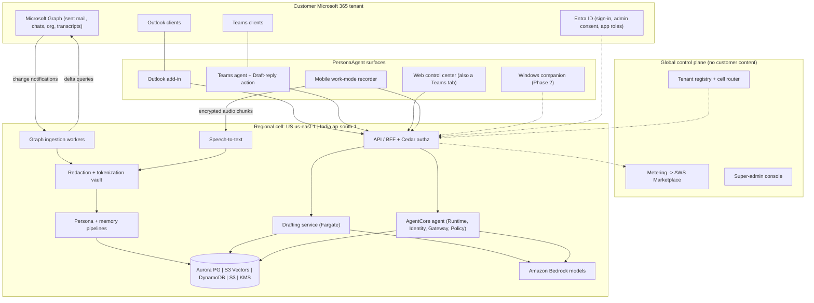
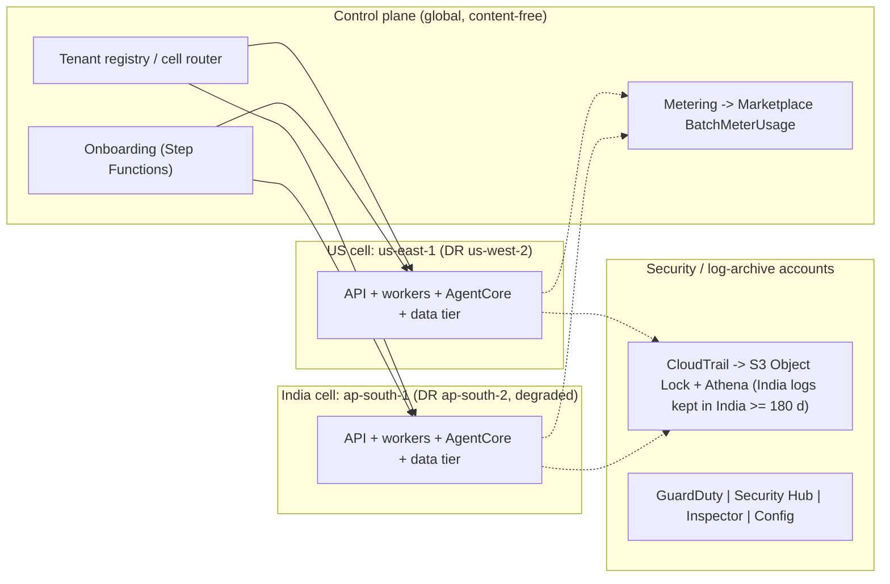

# PersonaAgent — Solution Architecture (v0.1)

> **Status:** research-backed proposal for the MVP and the 12–24-month target. **Date:** 2026-10-06.
> **Scope decisions (founders):** Microsoft 365 mid-market & enterprise buyers · US + India in v1 · 3–6 engineers, ~3-month MVP · work-only, company-governed recorder · Phase-1 redaction precise to US + Indian regulation.
> **Sources:** research tracks in `docs/research/` — cited as **[R01]…[R10]**. Numbers are estimates unless a source is cited; confidence levels and URLs are in the research files. Where this document makes its own call between conflicting track recommendations, it says **"Decision"**.

---

## 0. The architecture on one page

| # | Decision | Why (evidence) |
|---|---|---|
| 1 | **No Outlook/Teams clone.** PersonaAgent lives *inside* Outlook (add-in + optional server-side drafts) and Teams (agent + "Draft reply" message action). Our web app is the **control center and memory surface** (also embedded as a Teams tab). Windows companion in Phase 2. | A credible mail+chat client is 6–12+ engineer-months, kills adoption in M365 shops, multiplies breach blast radius and fights Microsoft's UI churn; in-place surfaces are ~22–30 engineer-weeks [R02 §E.1]. |
| 2 | **One backend, many thin surfaces.** Every surface calls the same `draft` and `ask` APIs with a *context envelope* (surface, thread IDs, recipients + relationship labels, instruction, selection). | Keeps persona/memory logic in one place [R02]. |
| 3 | **Two regional cells from day 1:** US (`us-east-1`, DR `us-west-2`) and India (`ap-south-1` Mumbai, DR `ap-south-2` Hyderabad). Identical stacks from one CDK app; tenants pinned at onboarding; content never leaves its cell; the global control plane holds no content. | Retrofitting residency is expensive; M365 already keeps India/US tenant content in-country [R01 §E, R04 §8]. |
| 4 | **Drafting is a deterministic workflow** on a warm ECS Fargate service (retrieve → one streaming Bedrock call → checks). **The conversational assistant and memory Q&A run as an Amazon Bedrock AgentCore agent** (Runtime, Identity, Gateway, Policy, Observability). | Drafting needs p95 first-token ≤ 2.5 s and predictable cost; AgentCore earns its keep for tool-using Q&A, Entra/Graph OBO tokens and Cedar policies [R03 §9]. |
| 5 | **Models (router from day 1):** US → **Haiku 4.5 by default**, with **Sonnet 5.5 (US-geo) for "premium" drafts** — new emails, long replies, external-client/executive audiences — within each tier's premium-draft quota; India → **Haiku 4.5 via the in-India `in.` profile** (+ Opus 5 `in.` for offline jobs and a capped premium quota). Global-routed Sonnet 5.5 for India only by tenant-admin opt-in (a documented cross-border transfer), **never** for BFSI. | Pricing and margin math assume Haiku-default routing (`01-product-strategy.md` §5.4); Sonnet/Opus 5.5 have no in-India inference profile; DPDP has no general localisation rule but RBI/SEBI/IRDAI do [R03 §3, R07 §6.5, R09 §6.4]. |
| 6 | **Persona = retrieval + style cards + edit-learned rules.** No per-user fine-tuning in v1. | Retrieval +14.9% vs per-user PEFT +1.1%; Claude can't be fine-tuned on Bedrock [R05 §2, R03 §4]. |
| 7 | **We own a thin memory layer** on Aurora PostgreSQL + S3 Vectors (per-tenant bucket, per-user index). Graph modelled as Postgres tables; Neptune/OpenSearch deferred. AgentCore Memory only for the assistant's own chat memory. | AgentCore Memory would cost $12.50–37.50/user-month for 50k messages and takes ~58 days to load 1k seats (10 TPS) [R05 §4]; per-user S3 Vectors indexes are ~170× cheaper per query than a shared index [R04 §2]. |
| 8 | **Derivatives-only storage by default ("Mode A")**; optional encrypted raw vault ("Mode B") for enterprises that ask. | Founders asked for a raw store; security & legal tracks recommend not holding raw M365 content [R10 §11, R07 G8]. **Decision:** both, with Mode A default (§8.1). |
| 9 | **Multi-level redaction (L0–L3)** with our **own US + India detector library** (checksum validators + NER ensemble + M365-directory gazetteer + contextual classifier), fail-closed. AWS Guardrails/Comprehend/Macie are backstops, not the foundation. | No AWS or Microsoft service covers Indian passport, GSTIN, UPI, IFSC or US EIN; Guardrails has no Indian types; Comprehend is English/Spanish only [R03 §5, R01 §E, R10 §6]. |
| 10 | **Humans send; the agent drafts.** The model that reads untrusted content has no tools, no egress and no memory-write rights; every draft passes an output gate. | PersonaAgent has all three legs of the "lethal trifecta"; 2025–26 zero-click exfiltration hit nearly every major assistant [R10 §2]. |
| 11 | **Consent-first capture.** Internal Teams meetings via Microsoft's own transcription (banner) pulled through Graph; phone "work-mode recorder" that the user starts (policy can pause, never start); external-company meetings and in-person capture **OFF by default**. | Neither iOS nor Android can start the mic from the background [R06 §2–3]; *In re Otter.AI* (13 Aug 2026) and *Chamberlain v. Granola* (Jul 2026) target exactly host-only-consent and bot-free capture [R07 §3]. |
| 12 | **Speech:** MVP = Amazon Transcribe batch in-region behind an `AsrEngine` interface; self-hosted NVIDIA Parakeet + Nemotron diarization from month 4 (US first); **no voiceprints**. | Transcribe = $0.36/h → $11.88/typical user-month; self-hosted ≈ $0.13–0.64 [R06 §9]; BIPA/SPDI biometric exposure [R07 §4]. |

---

## 1. Principles and invariants

**Product principles**
- **P1 — Meet users where they work.** Outlook and Teams stay the user's tools; we add a voice and a memory.
- **P2 — The human sends.** Drafts, prefills and clipboard only; "send as me" is always an explicit, previewed click (later phases).
- **P3 — Privacy is a feature we sell.** A published redaction-quality statement, trust centre, consent ledger and visible indicators are part of the product, not paperwork.
- **P4 — Region-pinned by design.** Tenant → cell at onboarding; inference, vectors, logs and backups stay in-country.
- **P5 — Managed and serverless first.** Add OpenSearch, Neptune, Kafka, Kubernetes or silo accounts only when a named trigger fires (§14).
- **P6 — Measure from week 1.** Minimal-edit send rate (persona), leakage tests (privacy) and recall gates (redaction) block releases.
- **P7 — Everything per-tenant is created by code.** No hand-built tenant resources.

**Security invariants** (test them; they are release gates) [R10 §11.1]
1. **No raw content at rest** (Mode A): Microsoft 365 is the system of record; raw content lives only in memory during processing.
2. **Regulated identifiers (Tier R) are irreversibly masked at first touch**, never stored, never shown to an LLM.
3. **No model output leaves the system without a human gesture.**
4. **The model that reads untrusted content has no tools, no egress and no memory-write rights.**
5. **Style is learned only from what the user sent.** Everything else is a low-trust fact with provenance and an audience ACL.
6. **One tenant, one key, one index.** An isolation failure should yield ciphertext, not data.
7. **Nobody at PersonaAgent can read customer content without the customer's approval**, and every such access is visible to the customer.

---

## 2. System context and actors

| Actor | Who | Primary interactions |
|---|---|---|
| **End user** | Knowledge worker (consultant, sales, manager, exec) | Drafts in Outlook/Teams; memory Q&A; persona studio; recorder; privacy center |
| **Delegate / EA** | Executive assistant | Drafts *in the principal's voice* only where Exchange/Teams delegate access already exists **and** the principal enabled it; activity visible to the principal |
| **Tenant admin** | Customer IT | Admin consent, enrolment (Entra groups), surfaces on/off, capture policies, retention, region, redaction presets & dictionaries, audit, billing |
| **Compliance auditor** | Customer legal/compliance | Audit logs, consent ledger, DLP/redaction QA samples, legal hold & eDiscovery export (with admin) |
| **Team manager** | Customer line manager | Team-level adoption aggregates only (k ≥ 10); **no individual content, no per-employee performance analytics** [R07 G11] |
| **Platform super-admin** | PersonaAgent staff | Tenant lifecycle, plans, feature flags, model/config, health, sub-processor registry — **no standing content access** |
| **Platform support / security** | PersonaAgent staff | Break-glass only, with customer approval, time-boxed and recorded |
| **External systems** | Microsoft Entra ID & Graph, Outlook/Teams clients, iOS/Android, AWS (Bedrock, AgentCore, Transcribe…), optional STT vendor | — |

---

## 3. Client surfaces

### 3.1 The direct answer to "do we build an identical UI?"

**No.** Build the agent and backend once, then integrate *in place*:
- **Outlook:** add-in for interactive drafting + (opt-in) server-side drafts that appear in the user's Drafts folder on every client, including mobile.
- **Teams:** a personal agent (Microsoft 365 Agents SDK, hosted on AWS) for chat-style requests and memory Q&A, plus a "Draft reply" message action.
- **Web control center:** onboarding, persona studio, drafts queue, memory timeline, recordings, privacy center, tenant-admin and super-admin consoles — the place to *see and govern* what the agent learned, not a mailbox. Show a minimal redacted snippet with an "Open in Outlook/Teams" deep link when evidence is needed [R02 §E].
- **Windows companion (Phase 2):** write-anywhere (hotkey, UI Automation, clipboard) and bot-free recording of any call.

### 3.2 Surface matrix

| Surface | What it does | Phase | Hard constraint to design around | Effort (ew, est.) [R02] |
|---|---|---|---|---|
| **Outlook add-in** (XML manifest; task pane + one-click command; nested app auth SSO) | Reads the thread, recipients and compose type; inserts at cursor / replaces selection; audience chip ("writing to: your manager") | **MVP** | Mobile add-ins can't compose; `body.setAsync` in web/new Outlook wipes the quoted thread — insert, don't replace; unified manifest lacks Mac/mobile → keep XML for MVP | 4–6 |
| **Server-side drafts** (Graph `createReply` → Drafts) | Proactive "reply ready" drafts for reply-likely mail; covers iOS/Android | **MVP, opt-in** (separate "Compose" app registration with `Mail.ReadWrite`) | Broader permission → security review; draft clutter → only high-confidence threads, auto-delete stale drafts | 3–4 |
| **Teams personal agent** (Agents SDK on AWS; Azure Bot registration) | "Draft a reply to Priya about the SOW", "what did the client ask for last Tuesday?" | **MVP** | 5 s invoke budget; the Bot Framework SDK lost support in Dec 2025 — use the Microsoft 365 Agents SDK | 3–4 |
| **Teams "Draft reply" message action** | Dialog with **Copy** / **Open chat with prefilled text** / (later) **Send as me** | **MVP** | **No API puts editable plain text into the Teams compose box** (cards only) → validate deep-link prefill in week 1 | 2–3 |
| **Web control center** (React/Next.js; also a Teams tab) | See §3.3 | **MVP** | — | 8–12 total |
| **Mobile app** (iOS/Android) | Work-mode recorder + recall chat + daily digest | **MVP alpha only with a dedicated mobile engineer (team of 6); otherwise Phase 2** (`03-mvp-plan-and-roadmap.md` §2.2) | OS can't auto-start the mic; Android OEM background killers; Play "monitoring tool" risk → recordings private to the user | 10–14 (incl. STT pipeline) |
| Copilot Chat exposure (same custom engine agent) | Discovery inside Microsoft 365 Copilot Chat — **no Copilot licence needed** | Phase 2 | Agent Store policies | 1–2 |
| **Windows companion** (Electron/Tauri; MSIX via Intune; signed) | Write-anywhere + bot-free recorder (mic + WASAPI process loopback: mic = user, loopback = others) | Phase 2 (stretch: MVP if a design partner needs external-meeting capture) | EDR/DLP may flag accessibility/clipboard hooks; consent UX (*Granola* suit) | 6–10 (+6–8 recorder in-house, or 2–4 via Recall Desktop SDK) |
| Mac companion, local MCP server, Copilot connector | Persona/memory as a tool for other agents | Phase 3 | Prerelease platforms; data exposure | — |
| ~~Full mail/chat client~~ | — | **Not recommended** | 26–52+ ew | — |

### 3.3 Web control center modules

| Module | MVP | Later |
|---|---|---|
| **Onboarding & admin-consent wizard** | Entra admin consent; records the customer's **"express and specific" persona-learning grant** (Microsoft API Terms §3(c)); deploy add-in + Teams app via Integrated Apps; **live health checks** (Transcript API access, speaker attribution, application access policy); data region (US/India); capture policy choices | SCIM / group mapping |
| **Persona studio** ("My writing profile") | Per-audience personas with evidence snippets; formality/length/warmth sliders; phrase do/don't lists; exclusions (contacts, threads, domains); **test bench**; learned-rules digest to confirm | Per-language personas (en-IN / Hinglish / Hindi), A/B analytics |
| **Drafts queue** | Threads needing a reply with ready drafts, "Open in Outlook", feedback | Follow-up nudges, delegation tracking |
| **Memory timeline & search** | Day view of meetings/captures; ask questions with cited spans and audio snippets; commitments and action items | Cross-source entity views |
| **Recordings** | Playback (within retention), retention countdown, delete | Access-controlled clip sharing |
| **Privacy center** | Mute schedules, exclusions, one-click delete/export (DSAR/DPDP), consent ledger, "delete last N minutes" | Participant-objection workflow |
| **Tenant admin console** | Enrolment, surface toggles, capture policies, retention, redaction preset + dictionaries, India-only processing flag, audit log, usage & billing, legal hold | SIEM export, Purview/DLP integration |
| **Platform super-admin console** | Tenant lifecycle, health, feature flags, model routing config, sub-processor registry, **JIT-approved, recorded support access** | Cell management |

---

## 4. AWS deployment topology

### 4.1 Accounts and regions
- **AWS Organizations + Control Tower**, ≈ 8–10 accounts: management · security tooling · log archive · shared services/CI · control plane · **prod-US cell** · **prod-IN cell** · staging · per-cell **vault** accounts (tokenization vault isolated from the data plane) [R04 §6, R10 §7].
- **Region-deny SCPs per cell OU.** US cell may use only `us-east-1` + `us-west-2`; India cell only `ap-south-1` + `ap-south-2`. *Note:* SCPs restrict where API calls are made, not where Bedrock cross-region/global inference processes data — inference residency is enforced by the router's per-tenant model allow-list (§9.1).
- **Global control plane is content-free:** tenant registry and cell router, onboarding/offboarding (Step Functions + EventBridge), metering aggregation → AWS Marketplace, super-admin console (separate staff IdP + phishing-resistant MFA).

### 4.2 Inside a cell (identical stacks)
- **Edge:** CloudFront (web app) · API Gateway + WAF (API, webhooks).
- **Ingestion:** webhook Lambda (validates `clientState`, returns 202 within 3 s) → **SQS fair queues** (message group = tenant) → **Fargate Graph workers** with fixed NAT egress IPs (published for customers' Conditional Access) → redaction/chunk/embed workers; Step Functions for backfill, deletion and re-index; DynamoDB for cursors and idempotency [R04 §8].
- **Serving:** API/BFF (Lambda) with Verified Permissions (Cedar) · Drafting service (warm Fargate) · AgentCore Runtime/Identity/Gateway/Policy/Observability · speech workers.
- **Data tier:** Aurora PostgreSQL Serverless v2 (RLS) · S3 Vectors · DynamoDB · S3 · ElastiCache Serverless (Valkey) · KMS (per-tenant CMKs).
- **Network:** **no internet egress from the data plane.** VPC endpoints for AWS services; Graph reachable only through an egress allow-list (Network Firewall / DNS Firewall); LLM-calling tasks reach only Bedrock [R10 §7].
- **Audit:** org CloudTrail → S3 Object Lock + Athena (CloudTrail Lake and Audit Manager are closed to new customers); hash-chained, KMS-signed application audit log [R04 §6].

### 4.3 Disaster recovery
- AWS Backup copies **stay in-country**; S3 cross-region replication in-country; nightly vector export (S3 Vectors has no documented CRR/Backup support).
- **India DR is "data recovery + degraded service"** until Mumbai returns: Hyderabad lacks Transcribe, Comprehend, Macie, MemoryDB, Neptune Analytics and (per the Sep 2026 price list) AgentCore Runtime/Memory [R04 §4, R03 §1]. State this in contracts.

### 4.4 Scale path
Multiple cells per region (capped ~10k–30k users or ~1–2k tenants each) behind the cell router; EU cell (Frankfurt) later; silo accounts for Enterprise+; Aurora Global Database / DynamoDB global tables to in-country DR; BYOC container only for deals large enough to fund it [R04 §8.2].

---

## 5. Identity, tenancy and authorization

### 5.1 Entra app registrations (tiered consent) [R01 §H1]

| Registration | Delegated scopes | When | Notes |
|---|---|---|---|
| **PersonaAgent — Read** (MVP default) | `openid profile email User.Read offline_access Mail.Read Chat.Read User.ReadBasic.All` (+ optional `User.Read.All` for manager chain/job titles) | MVP | Admin consent required in practice (Microsoft-managed policy since late 2025); "assignment required" + pilot group |
| **PersonaAgent — Compose** (opt-in) | `Mail.ReadWrite` (server-side drafts); later `ChatMessage.Send` (explicit user-click sends) | MVP opt-in / Phase 2 | **Decision:** offered as a separate toggle so security teams can approve the Read app first [reconciles R01 vs R02] |
| **PersonaAgent — Meetings** | `OnlineMeetings.Read`, `OnlineMeetingTranscript.Read.All` / `CallTranscripts.Read.All` + Teams **application access policy**; or per-meeting RSC for bottom-up pilots | MVP | Admin must enable **Teams "Transcript API access" + speaker attribution** (default OFF since ~29 Jul 2026) [R02 §D] |
| Enterprise app-only tier (optional) | `Mail.Read` (application) scoped via **Exchange RBAC for Applications**; `Chat.Read.All` for fast Teams export | Phase 2+, large tenants | Backfill of a 1,000-user tenant: 1–3 h vs 2–4 days delegated |

Trust package (week 1): verified publisher in Partner Center, Publisher Attestation, scope-by-scope justification sheet, static egress IPs + Conditional Access guidance, expected Graph volumes; Microsoft 365 Certification from ~month 3–4 (≈ $15–40k/yr, est.) [R01 §D].

### 5.2 Sign-in, tokens and secrets
- **Users sign in with Entra ID directly** (multi-tenant OIDC; app roles assigned by the customer's admin). No Cognito for Microsoft-only buyers [R04 §5].
- **AgentCore Identity** validates the inbound Entra JWT and performs the **Microsoft on-behalf-of (OBO) exchange** for delegated Graph tokens [R03 §1]. Week-1 spike: inbound tokens with custom claims are rejected; multi-tenant issuer handling; refresh-token custody for offline sync.
- **Background sync** uses refresh tokens in a token vault encrypted with the tenant CMK; only the ingestion role can decrypt; superseded tokens deleted; per-tenant revoke-all.
- **No client secrets:** AWS workload identity federation to Entra (federated identity credential); fallback certificate key held in KMS (`kms:Sign`) [R10 SR-03]. *The stored token set is the crown jewel* (cf. Salesloft-Drift, Aug 2025) [R10 §2].

### 5.3 Authorization model
- **Amazon Verified Permissions (Cedar)** — one policy store per cell; ABAC session tags gate every data-plane call; **Aurora `FORCE ROW LEVEL SECURITY`** on `tenant_id` and `owner_user_id`; Cedar `forbid` invariants mirrored in SCPs and KMS key policies [R04 §5].

| Role | Can | Cannot |
|---|---|---|
| **Platform super-admin** | Tenant lifecycle, plans/billing, feature flags, model routing, health, sub-processors, L3 metrics | Read content. Emergency access = 2 internal approvers **+ tenant-admin approval**, time-boxed, recorded, L2 view by default; vault keys deny all humans |
| **Platform support** | Tickets; break-glass on named item IDs with **user + tenant-admin approval**, ≤ 4 h, recorded | Vault reveal; tokens |
| **Platform security / IR** | Declared incident with legal sign-off; forensic account; tenant notified | Standing access |
| **Tenant admin** | Consent, enrolment, surface toggles, capture policies, retention, region, India-only flag, redaction presets/dictionaries, audit log, billing, legal hold; eDiscovery export with dual approval | Browse users' content by default |
| **Compliance auditor** | Audit logs, consent ledger, sampled redaction-QA spans, DLP incidents; formal investigation co-approved by tenant admin | Browse content |
| **Team manager** | Team aggregates (k ≥ 10) | Individual content; per-employee performance analytics (prohibited by AUP) |
| **End user** | Everything about their own persona, memories, recordings, drafts; delete/export; exclusions; pause | Others' data |
| **Delegate / EA** | Draft as principal where delegate access exists and principal enabled it; actions visible to principal | Modify principal's persona; PRIVATE memories; recordings |
| **Service roles** (ingestion, persona learner, drafting, re-hydrator, analytics) | One IAM role per pipeline stage; least privilege (e.g., only ingestion decrypts refresh tokens; only the re-hydrator reveals tokens, and only those present in the request) | Cross-stage access |

Full matrices: role × data level [R10 §8]; 8 roles × 12 actions [R04 §5].

---

## 6. Ingestion pipelines

### 6.1 Outlook sent mail and Teams messages [R01 §A–C, §H]
- **Backfill newest-first** so the persona is useful within the first hour. Reference user (50k sent emails + 100k sent Teams messages): mail ≈ 10–40 min (bodies in delta pages) to 50–90 min (with per-message enrichment); Teams ≈ 15–45 min per user delegated.
- **Tenant scale:** Outlook limits are per mailbox (10,000 requests / 10 min, 4 concurrent) so mail parallelises; Teams delegated reads share **20 rps per tenant and 1 rps per chat** → a 1,000-user tenant takes ~2–4 days → **onboard in waves of 100–300 users/day** (or the app-only export option: ~1–3 h).
- **Incremental sync:** Graph subscriptions (Outlook sent items; Teams `getAllMessages` delegated with encrypted resource data), renewal service with lifecycle notifications, hourly mail-delta safety net, nightly 7-day Teams re-scan for edits/deletes; **delete cascade ≤ 24 h**.
- **Thread semantics on every sample:** `uniqueBody` (the user's own words) vs `body` (context); `conversationIndex` length + `In-Reply-To`/`References` + subject prefixes → *new thread / reply / reply-all / forward / delegation*; Teams turn segmentation + `messageReference` quotes. Week-1 spike: `uniqueBody` availability in delta responses (fallback quote-stripper ready).
- **Relationship labelling:** deterministic first — manager chain, direct reports, job title, department (if `User.Read.All`), verified domains (internal vs external), guests; Haiku 4.5 classifies intent and external relationship type; **the user confirms their top 20–30 contacts**; unknown relationship → formal slice [R05 §8].
- **Pre-ingestion privacy gate (before anything persists):** `MSIP_Labels` header (skip "Highly Confidential" and RMS-encrypted mail), Teams `policyViolation` flag, US + India detectors, secrets dropped, third-party content (colleagues' and clients' text) minimised to short redacted context windows [R01 §E].
- **Client/account scoping (for IT-services customers bound by their own client contracts):** tenant admins can exclude specific client domains, accounts or Teams chats from ingestion, memory and drafting — or allow-list only approved accounts — and attach per-client Tier C dictionaries (red-team finding RT-C1, `06-red-team-review.md`).

### 6.2 Teams meetings via Graph [R02 §D]
- Post-meeting **transcripts and recordings** for in-tenant scheduled meetings, ad-hoc and PSTN calls (`adhocCalls`, partly beta); **$0** (unmetered since 25 Aug 2025).
- **Prerequisites the onboarding wizard must check live:** admin enabled *Transcript API access* and *speaker attribution* (detect `GraphAccessToTranscriptsDisabled` / `SpeakerAttributionNotAllowed`); application access policy for enrolled users; transcription allowed (optionally auto-transcribe for enrolled organizers); subscriptions created **at enrolment** (they must exist before transcription starts).
- **Never available for meetings organised by other companies** → those need desktop or phone capture (§6.4).
- Microsoft's own banner informs every participant — the strongest consent posture available [R07 §2].

### 6.3 Phone "work-mode recorder" [R06]
- **Three capture modes:** *Work session* (one tap; runs within admin-set hours) · *Meeting capture* (calendar prompt, one tap) · *Quick capture* (Control Center / Action button / Quick Settings tile) · plus **share-sheet import** of native call recordings. Policy can **auto-pause** (outside hours, sensitive calendar tags, locations) but cannot auto-start.
- **iOS:** `.playAndRecord` + `audio` background mode; interruption/resumption manager (iOS 26 API + iOS 27 `resumptionRecommendationNotification`); Live Activity with pause/resume/stop refreshed before its 8 h cap; orange mic dot always visible; App Review 2.5.14 consent + indicator.
- **Android:** one `microphone` foreground service started from the foreground; `VOICE_RECOGNITION` source; gap logging; **per-OEM onboarding wizard** (Xiaomi, Vivo, Oppo, realme, Samsung, OnePlus — most of the Indian market); server heartbeat + "capture stopped" nudges; Play FGS declaration + prominent-disclosure screen.
- **Recordings are private to the user**; admins govern policy, not content (keeps us out of Play's "monitoring tool" class); Intune app configuration binds the tenant and policies; admins can MDM-deny the mic as a kill switch.
- **On-device:** Silero VAD → 60 s Opus 16 kbps chunks → AES-GCM → upload to the tenant's in-region S3 every 2–5 min (≈ 0.55 GB/heavy user-month, ≈ $0.05). No continuous on-device ASR (battery; Apple's on-device transcriber lacks Hindi).
- **Server:** calendar-bounded session assembly → batch ASR + diarization → our redaction → memory extraction. **De-duplicate** against Graph transcripts (Graph wins for internal Teams meetings) — this also cuts STT volume and cost.

### 6.4 Desktop capture (Phase 2)
Mic + WASAPI process loopback (mic = user, loopback = others); works for any app incl. other companies' Teams/Zoom/Meet, Slack huddles, softphones. **Mandatory:** automatic disclosure (chat message/spoken notice), persistent on-screen indicator, consent-ledger entry, one-click delete; external meetings OFF by default per tenant. Build in-house (6–8 ew) or via Recall Desktop SDK (2–4 ew; Recall regions US/EU/JP — not India) [R02 Matrix 2, R07 §3].

---

## 7. Multi-level redaction and privacy pipeline

### 7.1 Data levels and who may consume them [R10 §6–8]

| Level | Content | Stored? | Consumers |
|---|---|---|---|
| **L0 — Raw** | Original Graph content / audio | **Mode A: in memory only.** Mode B: encrypted raw vault (customer key, Object Lock, legal hold). Audio: deleted after transcription by default; tenant opt-in short retention (§8.4) | Ingestion & redaction service only. Live threads on the draft path are converted to L1 *before* the prompt |
| **L1 — Pseudonymised** | Tier R irreversibly masked; person names/emails/phones → consistent reversible tokens | Yes (per-tenant keys) | Persona learner, memory extractor, drafting/agent prompts (ACL-filtered), search |
| **L2 — Company-sensitive masked** | L1 + tenant-defined Tier C/S masked | Views derived on demand | Break-glass support (default view), auditor samples, any cross-user/team feature |
| **L3 — Anonymised aggregates** | Metrics only (k ≥ 10) | Yes | Analytics, billing, product evals (synthetic or consented data only) |
| **Display** | L1 re-hydrated for the owning user | **Never stored** | The owning user's client, via the re-hydrator |

> **Pseudonymised is not anonymous.** L1 text is still personal data under DPDP, CCPA/CPRA and GDPR — surrounding context can re-identify people even after tokenisation. It stays subject to access/correction/deletion requests, breach-notification rules and customer contracts. Never market Mode A or L1 as "anonymised"; only L3 aggregates are.

**Detection tiers**
- **Tier R — regulated identifiers → irreversible mask (never tokenised, never to an LLM).** US: SSN (area/group/serial rules), ITIN, EIN (IRS prefixes), passport, driver's licence (top states), ABA routing (checksum) + account numbers, payment cards (Luhn + BIN), Medicare MBI, NPI, DEA, HIPAA Safe Harbor identifiers. India: Aadhaar (Verhoeff checksum; UIDAI masking — show at most last 4) and VID, PAN (structure), voter ID/EPIC, passport, driving licence, GSTIN (checksum), UPI VPA, IFSC + account numbers, CKYC, ABHA. Plus secrets/credentials/API keys/passwords and card data — which also keeps us out of PCI storage scope (confirm with a QSA) [R10 §6.4, R07 §11].
- **Tier P — personal identifiers → reversible tokens** (names, emails, phones, addresses).
- **Tier S — special categories** (health, biometrics, sexual orientation, children, SPDI "sensitive personal data", financial details) → excluded from persona/memory or masked.
- **Tier C — company-sensitive (tenant-defined)** — client names, project codenames, unreleased financials, M&A, pricing, legal-privileged, HR → masked at L2 or excluded per tenant policy; tenant dictionaries + LLM contextual classifier.
- **Signals:** Microsoft Purview sensitivity labels (`MSIP_Labels`), Teams DLP `policyViolation`.

### 7.2 Pipeline stages (condensed from [R10 §7])

| Stage | What happens | Failure behaviour |
|---|---|---|
| S0 Intake | Validate notification; enqueue IDs only; per-tenant rate limits | Drop invalid; DLQ |
| S1 Fetch | Delegated token (ingestion role only) → Graph GET of selected fields; **in memory** | Mark tenant degraded; no fallback storage |
| S2 Parse | MIME/HTML → text; quotes/signatures/disclaimers split; **hidden-content & Unicode-tag detection**; NFKC; Devanagari digits; language/script ID | Skip + metric |
| S3 Pre-policy | Labels, sender trust, size caps (denial-of-wallet), recorder rules, privileged markers | Metadata-only stub |
| S4 Deterministic | US + India validators + secrets rules → **Tier R masked immediately** | Detector crash ⇒ **block (fail-closed)** |
| S5 NER ensemble | Presidio + spaCy · GLiNER · IndicNER (Devanagari) · **M365 directory/header gazetteer** (best fix for Indian-name recall) · optional Comprehend (English) | Endpoint down ⇒ queue, no bypass |
| S6 Contextual | Small Bedrock model + Guardrails classifies Tier C/S on selected items | Timeout ⇒ stricter default |
| S7 Decide | Span merge (R > S > C > P), tenant policy → action per span per level | Missing policy ⇒ strictest preset |
| S8 Tokenise | Vault service (separate account; DynamoDB + Database Encryption SDK hierarchical keyring; tenant CMK → per-user branch keys) | Vault down ⇒ block |
| S9 Verify | Second-pass detectors on L1; any Tier R residual ⇒ **block item + alert**; sampling to tenant review queue | — |
| S10 Persist | L1 to Aurora (RLS), S3 (SSE-KMS tenant key), S3 Vectors (tenant bucket / user index); lineage record (Graph immutable ID → artefacts) | Compensating delete |
| S11 Memory | Quarantined reader extracts → memory-write validation (provenance, trust, imperative rejection) → store with audience ACL | Suspicious ⇒ quarantine |
| S12 Draft path | Live thread → fast path S2–S9 (≤ 1–1.5 s est.) → generator → output gate → re-hydrator → plain text to client | Any gate failure ⇒ no draft + reason |
| S13 Backstops | Macie scans of L1 buckets (custom Aadhaar/PAN/UPI identifiers) · CloudWatch Logs data protection · canary recall jobs · GuardDuty/Security Hub | Findings ⇒ pause tenant pipeline |

### 7.3 Tokens that preserve the persona [R05 §6, R10 §6]
- Deterministic per-tenant tokens (e.g., `⟦PERSON_7⟧`) so style learning keeps structure.
- **Tokens carry persona attributes:** name form (first/full/nickname), script (Latin/Devanagari), fused honorifics kept *outside* the token ("Sharma-ji" → `⟦PERSON_7⟧-ji`), grammatical gender learned only from the user's own usage (Hindi verb agreement), all user-correctable.
- **Regulated values are only ever fill-in slots** in drafts (`[account number]`), never re-inserted.
- The re-hydrator reveals only tokens already present in that request's context (token-spoofing defence). Format-preserving encryption, if ever needed, uses **FF1** (NIST withdrew FF3/FF3-1).
- Enterprise: operator-blind **Nitro Enclaves** vault; BYOK, then XKS (HYOK) for buyers who demand it.

### 7.4 Policy presets and quality gates
- **Presets:** `US-Default`, `US-HIPAA`, `US-GLBA-FI`, `PCI-Strict`, `India-DPDP`, `India-BFSI` (MVP: 2–3 presets, dry-run mode) [R10 SR-19].
- **Launch gates (validate on our own labelled sets; publish a redaction-quality statement; never claim "100% PII removal"):** ≥ 99.9% recall on checksum-validated IDs · ≥ 95% on Indian names in English email (**India launch gate**) · ≥ 93% on Hinglish · ≤ 0.1% of documents leaking a Tier R identifier [R10 §6.12].
- **AWS service roles in the stack:** Bedrock Guardrails `ApplyGuardrail` = in-region PII backstop + free custom regex (no Indian entity types; **don't log its traces — they contain raw PII**); Amazon Comprehend = second opinion on English items with Aadhaar/PAN/voter/NREGA (Mumbai only); Macie = at-rest detective control; Transcribe PII = first pass for en-US/en-IN only (no Hindi; not HIPAA de-identification) [R03 §5, R06 §12].
- The implementable **regulation → data element → treatment** map is in [R07 §11]; the detector catalogue with validation logic is in [R10 §6.4].

---

## 8. Knowledge base and data stores

### 8.1 Storage modes — the founders' "raw database" requirement
| Mode | What we keep | Who it's for | Trade-offs |
|---|---|---|---|
| **A — Derivatives only (default)** | L1 redacted text chunks, labels, embeddings, memory atoms, style cards + **lineage pointers** to Graph immutable IDs; re-fetch originals from Graph on demand | Every tenant | Smallest breach blast radius; aligns with Microsoft API Terms minimisation; needs live Graph access to show originals; deleted-in-M365 = gone for us |
| **B — Encrypted raw vault (opt-in)** | Mode A **plus** raw MIME/text in S3 with customer-managed key, Object Lock (WORM) and legal hold | Enterprises that need replay/re-processing, regulated recordkeeping | Larger exposure, PCI/HIPAA scope questions, higher cost (+$0.03–0.05/user-month storage) [R04 §9] |

### 8.2 Stores

| Store | Holds | Isolation | Phase |
|---|---|---|---|
| **Aurora PostgreSQL Serverless v2** (per cell, writer + reader) | Tenants, users, people/contacts, **relationship graph tables with validity ranges**, thread/message metadata, L1 chunks, labels, style cards, rules, drafts & outcomes, episodes, **bi-temporal memory atoms**, commitments, consent ledger, policies, legal holds; `tstzrange` time index; Postgres FTS for keywords | `FORCE ROW LEVEL SECURITY` (`tenant_id`, `owner_user_id`) | MVP |
| **S3 Vectors** | Embeddings (Titan Text Embeddings V2, 1,024-d) for sent-message exemplars, L1 chunks, memory atoms, transcript chunks | **Per-tenant vector bucket (own KMS key) → per-user index**; buckets created after 30 Sep 2026 get metadata pre-filtering by default | MVP |
| **DynamoDB** | Graph subscriptions, delta cursors, idempotency keys, message index, sync health | Tenant-prefixed keys | MVP |
| **S3** | Audio (per-tenant prefix, short TTL), L1 transcripts, exports, optional Mode B vault | Per-tenant keys; bucket keys on | MVP |
| **ElastiCache Serverless (Valkey)** | Rate limits, sessions, persona-pack cache | Tenant-scoped keys | MVP |
| **KMS** | Per-tenant CMKs; per-user data keys (crypto-shredding); token-vault key | Key policies deny humans on vault keys | MVP |
| OpenSearch Serverless (NextGen, scale-to-zero) | Hybrid BM25 + vector for enterprise tenants | Collection per tenant | Trigger: retrieval evals show hybrid lift |
| Neptune Analytics | Org graph / GraphRAG (Graphiti-style temporal KG) | Graph per enterprise tenant ($350/mo US, $403 Mumbai) | Trigger: measured multi-hop failures [R05 §8] |

**Why per-user vector indexes:** query cost scales with index size — ≈ $0.00002 per query on a per-user index vs ≈ $0.0035 on a shared 2B-vector tenant index (~170×), and a shared index serialises backfill writes (2,500 vectors/s cap → ~9 days for a 10k-user tenant) [R04 §2].

### 8.3 Core entities (schemas in [R05 §7.12])
`Tenant` · `User` · `Person` (contact; tokenised) · `Relationship` (user↔person: manager/report/peer/external-client/vendor, confidence, source, validity range) · `Thread` · `MessageRef` (Graph immutable ID, timestamps, direction, labels: intent/relationship/channel/language mode) · `Chunk` (L1 text, lineage) · `StyleCard` (slice = relationship × intent × channel × language mode; greeting/sign-off/length distributions, formality, phrases, anti-patterns) · `Exemplar` (pointer + scope) · `StyleRule` (edit-derived, evidence count, status) · `Draft` + `DraftOutcome` (sent-text diff, edit distance, accepted spans) · `Episode` (meeting/session: time range, calendar link, participants) · `MemoryAtom` (type: idea/decision/action item/commitment/requirement/question/fact-about-person; speaker; valid-time + record-time; evidence spans; audience ACL; trust level) · `ConsentLedgerEntry` · `RetentionPolicy` · `LegalHold` · `AuditEvent`.

### 8.4 Retention defaults (tenant-configurable) — Decision
| Data | Default | Range / override |
|---|---|---|
| Raw M365 content | Not stored (Mode A) | Mode B per enterprise contract |
| Raw audio | **Deleted immediately after transcription and QA** — no retention by default [R07 G8, R10 SR-39] | Tenant opt-in 1–30 days for audio-snippet playback, with PII spans muted using word timestamps [R06 §12]; legal hold overrides |
| Transcripts (L1) | **30 days** [R07 G8] | Up to 12+ months for enterprise; legal hold overrides |
| Memory atoms & summaries | **By tier:** Lite 6 months · Persona 12 months · Pro/Enterprise configurable (up to unlimited) — matches `01-product-strategy.md` §5 | User can delete anytime; cite transcript spans while they exist; legal hold overrides |
| Style cards & rules | Life of the account | Frozen at offboarding, deleted after 30 days [R07 G13] |
| Drafts & outcomes | 90 days (learning loop), then aggregated to L3 | — |
| Audit logs | 1 year | **India: ≥ 180 days kept in India** (CERT-In) [R07, R10 SR-45] |

### 8.5 Deletion and legal hold
Mirror M365 deletions via delta within 24 h; per-user crypto-shredding; delete everything on uninstall/"abandonment" (Microsoft API Terms); **a legal hold overrides all deletion including TTL and crypto-shredding** (tenant-level in MVP, per-custodian later); eDiscovery export with metadata (source, time, model version, AI flag); DSAR tooling and a third-party request intake ("Were you recorded or mentioned?") routed to the controller tenant [R07 G14–G15, G20].

---

## 9. AI layer

### 9.1 Workload map

| Workload | Runtime | Models (US / India) | Target |
|---|---|---|---|
| **Interactive drafting** (add-in, Teams action, test bench) | Drafting service on warm Fargate: deterministic retrieval → **one streaming call** with cached persona prefix → checks → re-hydration | Router: **Haiku 4.5 by default**; Sonnet 5.5 (US geo) for premium drafts within tier quotas / **Haiku 4.5 `in.`** (+ capped Opus 5 `in.`) | p95 first token ≤ 2.5 s (measure week 1); ≈ $0.008 (Haiku) – $0.015 (Sonnet) per draft [R03 §8] |
| **Proactive drafts** (server-side) | Step Functions + drafting service; only for reply-likely inbound mail | same | Async; cost-capped per tenant |
| **Assistant + memory Q&A** | **AgentCore Runtime** (Strands Agents or LangGraph), Gateway tools, Policy, Identity | Sonnet 5.5 (US geo) / Haiku 4.5 `in.`; Haiku for one-turn lookups | Cap tool-loop depth; abstain without evidence |
| **Backfill labelling** (intent, relationship, language mode) | Step Functions + Bedrock batch | gpt-oss-20b (or Nova Micro) + Haiku re-check of the uncertain 5–10% / in-region open-weight + Haiku `in.` | ≈ $3–6/user one-off (+$2–9 re-check) |
| **Style-card & rule building** | Batch, nightly | Sonnet 5.5 / **Opus 5 `in.`** | Offline |
| **Transcript extraction & daily digest** | Batch per session/day | gpt-oss-120b or Haiku chunking + Sonnet (US) / Haiku (IN) digest | ≈ $0.35–2.50/user-month chunking + $0.78 digest |
| **Embeddings / rerank** | Inline + batch | Titan Text Embeddings V2 (both cells) / Cohere Rerank 3.5 (US only — no rerank in India) | ≈ $0.40–1.10/user-month total |
| **Contextual redaction classifier** | Inline (selected items) + batch | Small model + Guardrails | Folded into labelling |
| **Evals / judges** | Offline CI | Cross-family judge + human calibration | Release gates |

**Rules:** India's global-routing opt-in is a cross-border transfer to unspecified regions — enforce it with per-tenant model allow-lists in the router (region-deny SCPs do not stop cross-region inference from moving data), record it in the DPA/transfer register, and never enable it for BFSI; no Claude Fable for customer content (30-day retention + possible human review on Bedrock) [R03 §10]; disable Bedrock model-invocation logging in production; skip AgentCore built-in Memory strategies, natural-language policy authoring and built-in evaluators in the India cell unless overridden to in-region models (they otherwise route across APAC/global) [R03 §1].

### 9.2 Persona engine — "write exactly like me" [R05 §7–8]
- **Slices:** relationship (manager/skip-level · direct report · peer · external client · vendor · unknown) × intent (delegating new work · new topic · reply · follow-up · escalation · decline · thanks · scheduling) × channel (email · Teams chat · channel post) × **language mode (en-US · en-IN · Hinglish-Roman · Hindi-Devanagari)**, with back-off to coarser slices when data is thin.
- **Style card per slice:** greeting/sign-off/length distributions, formality, directness, hedging, emoji/punctuation habits, signature phrases, "never says" list, Indian-English keep-list (PFA, revert, prepone, kindly, ji, lakh/crore).
- **Exemplars:** top-k past *sent* messages by recipient > relationship > intent > channel > recency. Same-scope exemplars verbatim; **cross-scope exemplars only as structure skeletons** (stops facts leaking between audiences).
- **Prompt order (cache-friendly):** stable system rules → persona pack (global card + slice cards; padded to ≥ 4,096 tokens so Haiku caches) → audience card (ACL-filtered history with this person) → exemplars → ACL-filtered memory atoms → **the thread as untrusted, spotlighted L1 data** → user instruction.
- **Control the controllable in code:** greeting, sign-off and target length are *sampled from the user's own distributions*; deterministic style checks run first, and the LLM revises only on failure; anti-pattern list suppresses "AI tells"; a "polish level" keeps the voice but fixes typos.
- **Guardrails specific to drafting:** never switch to Hinglish with an external recipient unless the user already has; flag invented commitments/dates not present in the thread or instruction; payment-detail-change requests trigger BEC warnings and disable one-click insert.
- **Edit-feedback loop:** match each draft to the message the user actually sent (Sent Items / Teams ingestion — the only reliable signal because Teams and Outlook mobile hide compose-box edits), diff it, propose rules, **promote a rule only after ≥ 3 observations plus held-out support** (PROSE-style), and show learned rules to the user weekly for confirmation [R05 §2, §7.7].
- **Cold start:** global style card + onboarding questionnaire + 20–30 contact confirmations; personas improve as edits accumulate.
- **v2 gate for fine-tuning:** only if evals show ≥ 10% fewer edits, zero canary leaks, ≤ +$2/user-month and the other gates in [R05 §7.11]; candidates are in-region open-weight LoRA adapters (India) or per-tenant adapters. **Any adapter is trained only on that tenant's L1 data, on the customer's documented instruction (contract + admin toggle), is never pooled across tenants or used for a shared/global model, and is deleted with the tenant** — otherwise we break guardrail G1 and risk losing processor status (the *Otter* theory) [R07 §13].

### 9.3 Memory engine — "what was that idea at 2 pm?" [R05 §5, §7.9]
- **Episodes:** calendar-first segmentation (meeting boundaries), then silence gaps, speaker-set changes and topic shifts for unscheduled sessions.
- **Typed, bi-temporal memory atoms** with speaker, absolute time, evidence spans (transcript offsets / message IDs), audience ACL and trust level; commitments carry owner → counterparty → due date.
- **Time resolution in code, not by the model:** "2 pm today" → `[13:30, 14:30]` in the user's timezone; "the 4 pm meeting" → calendar lookup → episode ID; then hybrid retrieval inside that window.
- **Structured atoms + SQL** answer list/aggregate/"when did we last…" questions; vectors answer fuzzy recall.
- **Answers cite sources** (and a playable audio snippet while audio is retained) and **abstain** when there is no evidence. Speaker attribution carries confidence and is user-correctable.

### 9.4 Agent design on AgentCore
- **Tools (via AgentCore Gateway, MCP):** `search_memory(query, time_range, people)` · `get_episode(id)` · `list_commitments(filter)` · `get_thread_summary(ref)` (L1) · `get_person_profile(token)` · `draft_message(envelope)` (calls the drafting service; returns text; **never sends**) · Phase 2: calendar, tasks/CRM/Jira connectors.
- **Cedar policies (AgentCore Policy):** tenant and user scoping on every tool call; no send tools in the MVP; Phase 2 "approval-before-send" temporal rule, taint tracking (recipients/links derived from untrusted content ⇒ no send).
- **Quarantined reader:** untrusted inbound content and transcripts are summarised/extracted by a **tool-less** model whose structured output is validated before the agent sees it.
- **Output gate (every draft and answer):** plain text only, URL allow-list, Tier R block, audience-ACL check, BEC heuristics, secrets scan.
- **Observability:** OTEL traces with prompt content redacted; CloudWatch Logs data-protection policies; short retention.

### 9.5 Evaluation harness (weeks 1–2, before the drafting UI) [R05 §3]
- Brief-conditioned reconstruction of time-split held-out sent messages per user.
- Metrics: stylometrics, style embeddings (StyleDistance/mStyleDistance), per-user authorship verifier, uncertainty-filtered LLM judge, user "which one did you write?" tests (~150 answers to separate 60% from 50%).
- **North star: minimal-edit send rate (MESR).** **Contextual-integrity leakage tests are release-blocking.**
- An 800-message US + India gold set (weeks 2–4); **L0-vs-L1 persona A/B by week 8** to measure the "pseudonymisation tax"; **Haiku-vs-Sonnet gap for India by week 8** (if MESR drops ≥ 10 points, offer the governed global-routing opt-in).

---

## 10. Security architecture (summary of [R10])

| Threat | Example | Primary controls |
|---|---|---|
| Indirect prompt injection → exfiltration | EchoLeak (M365 Copilot, CVSS 9.3), ForcedLeak (Agentforce, 9.4) | Quarantined reader; no egress; output gate; plain-text drafts; CSP with no remote content in add-in/Teams app |
| Memory poisoning | ZombieAgent; Microsoft found 31 companies planting memory instructions (Feb 2026) | Memory writes only via validated pipeline; reject imperatives; provenance + trust; quarantine payment/contact changes |
| Cross-audience leakage | Models leak private details in 26–39% of contextual-privacy cases | Code-enforced audience ACLs; skeleton exemplars; post-generation leakage judge; release-blocking tests |
| Persona misuse / BEC | 50–100 emails make a convincing clone | Persona usable only by its owner (MFA/Conditional Access); no autonomous send; payment guard; anomaly detection; offboarding freeze |
| OAuth token theft | Salesloft-Drift (Aug 2025) | Secretless federation; CMK-encrypted vault; ingestion-only decrypt; revoke-all |
| Cross-tenant leakage | Shared indexes/caches | Per-tenant key + bucket, per-user index, RLS, tenant-scoped caches, canary tenants in CI |
| Insider access | Staff browsing data | No standing access; customer-approved break-glass; vault keys deny humans |
| Denial of wallet | Inbox floods | Size caps, per-tenant budgets, circuit breakers, cost alarms |
| Supply chain | Malicious packages / MCP servers | Hash-pinned deps, registry cool-down, no third-party MCP servers in the data plane, no vendor keys in clients (Rabbit R1 lesson) |

The full threat table (30 threats), MVP-vs-Enterprise checklist (SR-01…SR-53) and 29 pre-launch tests (ST-01…ST-29) are in [R10 §4, §9, §10]. **Staffing:** one named engineer owns security and redaction full-time from day 1; external pentest before the first paying tenant [R10 §11].

---

## 11. Compliance by design

### 11.1 Legal guardrails mapped to components [R07 §13]
| Guardrail | Where it lives |
|---|---|
| G1 No training or independent use of customer content | Code + IAM (no data path to training), contracts, trust centre |
| G2 Express and specific persona-learning grant | Admin-consent wizard + MSA/DPA clause |
| G3–G5 Never record silently; consent ledger; strict all-party defaults; external meetings and in-person capture OFF by default | Recorder, Teams ingestion, desktop capture, policy engine |
| G6 Wearer-only option | Recorder (heuristic, non-biometric) |
| G7 Auto-pause & hard blocks (privileged/HR/medical/interview tags, "off the record" cues) | Policy engine + recorder |
| G8 Derivatives-only + TTLs | Storage modes, retention service |
| G9 Phase-1 US + India redaction | Redaction pipeline (§7) |
| G10 No voiceprints in MVP | Diarization uses calendar/Teams metadata + manual tags |
| G11 No emotion inference from voice; no per-employee analytics | Model policy + AUP |
| G12–G13 Persona anti-impersonation; offboarding freeze/delete | Drafting service, identity, lifecycle jobs |
| G14–G15 Deletion propagation; legal hold overrides deletion | Ingestion, retention service, eDiscovery export |
| G16 AI disclosure (UI disclaimer, invisible `X-AI-Assisted` marker, optional footer) | Surfaces + drafting service |
| G17 Employee notice pack | Onboarding wizard |
| G18 Residency + **India-only processing flag** (mandatory for BFSI) | Cell pinning, model router |
| G19 Incident response (CERT-In 6 h, DPDP 72 h from May 2027, US state laws) | Runbooks, on-call |
| G20 Third-party request intake + DSAR tooling | Privacy center, admin tooling |
| G21 Tenant eligibility (no consumer accounts; no healthcare until BAA; no public sector/defence/schools in v1) | Sales + onboarding gate |

### 11.2 Capture-consent flows (Decision — reconciles [R06] and [R07])
1. **Internal Teams meetings:** Microsoft transcription (banner to all participants) → Graph. Default ON once the admin enables it.
2. **Meetings organised by other companies:** OFF by default; admin can enable; user-initiated on desktop/phone with automatic disclosure (chat message and/or spoken notice), visible indicator, consent-ledger entry, one-click delete.
3. **In-person conversations (phone work session):** OFF until the admin enables it. When the user starts a session with others present, the app asks *"Has everyone here agreed to be recorded?"* → **Yes** = full capture + ledger entry; **No/unsure** = **self-only mode** (keep only the wearer's speech, non-biometric heuristics). Calendar invites can carry a notice + consent link. Counsel to confirm the BIPA "filtering paradox" before any enrolment-based mode [R07 §16].

---

## 12. Operations, observability and quotas
- **Logging:** content-free by default; CloudWatch Logs data-protection policies; Guardrails traces never logged; invocation logging off in prod.
- **Audit:** hash-chained app audit log (reveals, break-glass, policy changes, exports, deletions, delegate actions) → Firehose → S3 Object Lock.
- **Incident response:** CERT-In 6-hour path and India log copies; DPDP 72-hour (from 13 May 2027); US state laws; customer contractual SLAs; MSRC notice [R07 G19].
- **Quotas to raise early:** AgentCore new-session TPS (25/s/account) and active sessions in Mumbai; Bedrock TPM/RPM per model per region; Teams subscription caps (10/user, 10,000/org shared across vendors) [R03 §10, R01 §H4].
- **Per-tenant cost attribution:** tag everything with `tenant_id` (application inference profiles); usage events → Firehose → S3 Parquet + Athena → Marketplace metering.

---

## 13. Unit economics (COGS per active user-month, estimates)

Inputs: LLM + AI platform [R03 §8], speech-to-text [R06 §9], infrastructure [R04 §9]. "Typical" = 22 drafts/day, 10 memory questions/day, ~33 speech-hours/month of phone capture (internal Teams meetings use free Graph transcripts).

| Configuration | LLM + AI platform | Speech-to-text | Infra (at scale) | **Total (typical)** |
|---|---|---|---|---|
| **US, MVP stack** (Sonnet-heavy, Transcribe batch), 1k users | $23.46 | $11.88 | $3.10 | **≈ $38** |
| **US, optimised** (60/40 Haiku/Sonnet router, Q&A depth caps, open-weight chunking; self-hosted Parakeet), 10k users | ≈ $16–17 (est.) | ≈ $0.6–0.8 | $1.16 | **≈ $18–19** |
| **US, "Write" only** (no recorder; Teams meetings via Graph), optimised | ≈ $13–15 (est.) | $0 | $1.16 | **≈ $14–16** |
| **India, MVP stack** (Haiku `in.`, Transcribe Mumbai), 1k users | $13.03 | $11.88 | $3.10 | **≈ $28** |
| **India, optimised** (English → self-hosted; Hindi/Hinglish → Transcribe/Azure Central India), 10k users | ≈ $11–13 (est.) | ≈ $3–6 (mix) | $1.16 | **≈ $15–20** |
| One-time onboarding per user | ≈ $24 (labelling + Guardrails + embeddings) | — | ≈ $0.7–1.0 | **≈ $25** |

> The "US, MVP stack" row is a worst case (Sonnet-heavy, managed STT, 1k users) and exceeds the $35 Persona price — so **the router (Haiku default + premium-draft quotas) must ship in the MVP**, and the Persona tier excludes recording. The pricing in `01-product-strategy.md` §5 assumes exactly this [R09 §6.4].

**Levers, in order of impact:** (1) route easy drafts to Haiku (−30% drafting); (2) cap Q&A depth / one-turn answers; (3) open-weight models for chunk extraction and labelling; (4) self-host STT from ~10–25 heavy users per region; (5) de-duplicate phone capture against Graph transcripts; (6) fair-use limits on recording hours; (7) Bedrock private offer once usage history exists. Pricing and margin targets are set in `01-product-strategy.md`.

---

## 14. Technology choices and revisit triggers

| Component | Choice (MVP) | Alternatives considered | Revisit when |
|---|---|---|---|
| Surfaces | Outlook add-in (XML manifest), Graph drafts (opt-in), Teams agent (M365 Agents SDK) + message action, React/Next.js web app (also a Teams tab), native-module mobile apps | Full mail client; unified manifest | Unified manifest supports Mac/mobile; Teams compose API appears |
| Agent runtime | AgentCore Runtime/Identity/Gateway/Policy | Self-hosted LangGraph on ECS; Managed Agents via Claude Platform on AWS | AgentCore limits/prices hurt; need features only on P-AWS (never for India tenants) |
| Drafting | Warm ECS Fargate service, one streaming call | Agent loop | Never for the hot path |
| Models | Bedrock: Sonnet 5.5 (US geo), Haiku 4.5 (+ `in.`), Opus 5 `in.` (offline India), gpt-oss for batch | Fine-tuned per-user models | v2 gates pass; `in.` Sonnet profile ships |
| Relational | Aurora PostgreSQL Serverless v2 + RLS | Aurora DSQL (no pgvector, 3k-row txn limit, not in Hyderabad) | Write scale per cell |
| Vectors | S3 Vectors (per-tenant bucket, per-user index) | OpenSearch Serverless, pgvector | Hybrid-search lift proven |
| Graph | Postgres tables with validity ranges | Neptune Analytics, Neo4j, Graphiti | Multi-hop failures measured; enterprise org-graph feature |
| Identity | Entra ID direct + Verified Permissions | Cognito, WorkOS | Non-Entra IdPs / SCIM in RFPs |
| STT | Transcribe batch (in-region) behind `AsrEngine` | Deepgram, AssemblyAI, Sarvam, Azure Central India, self-hosted Parakeet/Nemotron | Bake-off results (weeks 2–6); ≥ 10–25 heavy users per region |
| Pipelines | Step Functions, SQS fair queues, Fargate, Lambda | Kinesis, MSK, EKS | Wearable audio streams; sustained throughput limits |
| Audit | CloudTrail → S3 Object Lock + Athena; hash-chained app log | CloudTrail Lake (closed to new customers) | Security Lake/SIEM requirement |

---

## 15. Open technical questions and week-1 spikes
1. Teams deep-link **prefill in existing chats** (else Copy-first UX) [R02].
2. Add-in insert/read behaviour across new Outlook, classic, OWA and Mac, incl. quoted-thread handling [R02].
3. Graph: `uniqueBody` in delta; `MSIP_Labels` on Sent Items copies; Sent Items subscriptions; pagination depth of multi-year chats; encrypted-mail behaviour [R01].
4. Transcript pipeline with Transcript API access + speaker attribution ON/OFF in a test tenant [R02].
5. `createReply` draft visibility on iOS/Android Outlook [R02].
6. AgentCore Identity with Entra multi-tenant tokens and refresh-token custody for offline sync [R03].
7. Sonnet 5.5 p95 latency on Bedrock (US geo) and Haiku 4.5 `in.` latency in Mumbai [R03].
8. iOS background resume after calls/AirPods route changes; Android per-OEM survival; battery %/h [R06].
9. 12-hour consented STT bake-off: US English, Indian English, Hinglish, Hindi, noisy rooms [R06].
10. Redaction recall on US + India labelled sets; L0-vs-L1 persona A/B [R10, R05].
