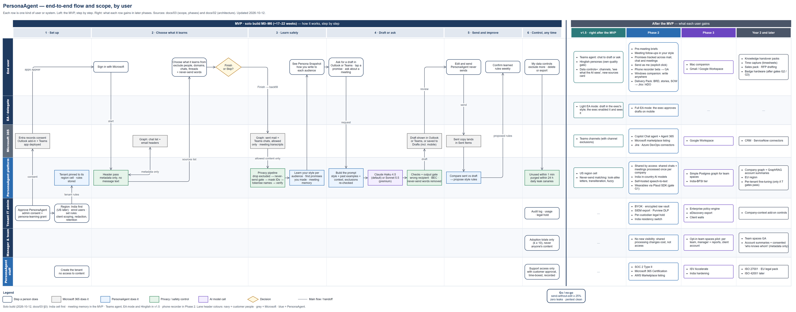

# PersonaAgent — Scope and Flows (MVP → end state)

> **Date:** 2026-10-12. **What this is:** the whole product — MVP and every later phase — in **one swimlane diagram, segmented by user**, plus what each person can do in the MVP. It **summarises** `03-mvp-plan-and-roadmap.md` (scope and phases) and `02-solution-architecture.md` (flows, in full detail); if they disagree, those two documents win, so update the diagram to match.
> **Editable by design:** the master is a draw.io file, [`diagrams/scope-and-flows.drawio`](diagrams/scope-and-flows.drawio); the picture below is an export of it. See [How to edit the diagram](#how-to-edit-the-diagram).
> **2026-10-12 — solo build (F10, `03` §0):** meeting memory is now **in** the MVP; the Teams personal agent, light EA mode and the phone recorder are **out** (v1.5 / Phase 2); India cell first. The table and the diagram below are updated to match.

---

## 1. The whole product in one diagram

**How to read it**
- **Rows (swimlanes) = who does the step:** end user · EA / delegate · Microsoft 365 · PersonaAgent platform · tenant IT admin · manager & team · PersonaAgent staff. Lane header colours: navy = customer people, grey = Microsoft, blue = PersonaAgent.
- **Left panel — the MVP, step by step:** 1 Set up → 2 Choose what it learns → 3 Learn safely → 4 Draft or ask → 5 Send and improve → 6 Control, any time. Every arrow that crosses a lane is a labelled handoff.
- **Right panel — after the MVP:** what each row gains in v1.5, Phase 2, Phase 3 and Year 2. The **go / no-go** gate between the panels is the MVP exit test (`03` §5).
- **Box shapes and colours** show who acts: rounded white = a person; grey = Microsoft 365; blue = PersonaAgent; green = a privacy or safety control; purple = an AI model call; amber diamond = a decision. The footnote under the legend summarises the solo-build scope (`03` §0).
- Design conventions: one lane per actor (seven, the usual maximum), lanes ordered so frequent handoffs sit next to each other, colour never the only signal (shape and a legend too), text contrast ≥ 4.5:1, 12 px minimum text, solid lines with open arrowheads.

**Never in scope (by design):** a full Outlook/Teams clone · autonomous sending · meeting bots · voiceprints · Slack (closed by its API terms) · one model trained on many customers' data · per-employee monitoring for managers.

---

## 2. What the end user can do in the MVP

**In plain words, an MVP user can:**

| # | Can do | Where | Notes |
|---|---|---|---|
| 1 | Decide what PersonaAgent may learn from **before** it reads anything: exclude people, email addresses and domains, 1:1 and group chats, and email threads | Web control center (onboarding step, then *My data controls*) | Excluded = not used at all: no style, memory, retrieval or drafting context |
| 2 | Keep a list of **never-send words** (codenames, client nicknames, family names) | *My data controls* | Never stored, never sent to an AI model; drafts show `[removed]` unless the user allows that word |
| 3 | See a **Persona Snapshot** — how they write to each kind of audience | Web control center | The onboarding "aha" |
| 4 | Tune their persona: per-audience profiles, formality/length/warmth sliders, phrases to use or avoid, a test bench, weekly learned-rule confirmations | Persona studio | |
| 5 | Get a **reply or new email in their own voice** inside Outlook, inserted at the cursor, with an audience chip ("writing to: your manager") | Outlook add-in | Not on Outlook mobile through the add-in — see #7 |
| 6 | Get a **Teams reply in their voice** from any message (Copy, or open the chat with text prefilled), ~~or ask the Teams agent to draft one~~ | Teams | Teams personal agent **moved to v1.5** (2026-10-12); the Draft reply action and new-message button stay (M5) |
| 7 | Find **ready drafts in their Outlook Drafts folder**, including on mobile | Outlook (all clients) | Uses `Mail.ReadWrite` — in the one internal Entra app for now (D8); a separate opt-in Compose app before external customers |
| 8 | Be warned before sending: invented commitments or dates, a wrong recipient, payment-change (BEC) requests, regulated identifiers | Every draft | |
| 9 | See the **promises they made** in email and chat and send a follow-up nudge drafted in their voice | Commitments page | |
| 10 | ~~Let their **EA draft in their voice** where delegate access already exists~~ | Outlook / Teams | **Moved to v1.5** (2026-10-12, solo build) |
| 11 | See a **drafts queue** of threads waiting for a reply | Web control center | |
| 12 | **Delete or export** their data, change exclusions at any time and get a receipt | Privacy center | |
| 13 | Ask "what did the client ask for in Tuesday's meeting?" and get an answer with citations | Web control center / Teams tab | **In the MVP (M6, D1, 2026-10-12)** — internal Teams meetings with Microsoft transcription on |
| 14 | ~~*(MVP stretch — alpha, a few users only)* Record a work session on their phone~~ | Mobile | **Not in the MVP — Phase 2** (2026-10-12, solo build) |

**What the MVP user cannot do yet:** let PersonaAgent send for them · use it outside Outlook and Teams (Windows/Mac companions are Phase 2–3) · capture external-company meetings · use Slack or Gmail · get pre-meeting briefs or meeting follow-ups (Phase 2) · share context with teammates (team spaces, Phase 3) · Hindi/Hinglish personas launch only behind their own quality gate.

---

## 3. What the tenant admin does in the MVP

Gives admin consent (which records the customer's persona-learning grant) and pins the data region (US or India — **India only at first**, 2026-10-12); runs the live health checks (transcript API access, speaker attribution, application access policy); enrols users through Entra groups and deploys the Outlook add-in and Teams app; sets surfaces on/off, client/account scoping, the redaction preset and dictionaries, retention and capture policy; decides whether to approve the opt-in Compose app (`Mail.ReadWrite`, for drafts in the Drafts folder and Outlook mobile); and runs the audit log, usage and billing and legal hold. Admins see adoption totals only (k ≥ 10) — never anyone's content or never-send words.

*(Solo build, 2026-10-12: the client/account scoping screen is built in M1; the super-admin console waits for external tenants — operator scripts until then.)*

Our own staff (platform super-admin) manage tenants, feature flags and model routing, with **no standing access to customer content** — support access is break-glass only, approved by the customer, time-boxed and recorded.

---

## How to edit the diagram

| Where | How |
|---|---|
| **draw.io in the browser** | Open <https://app.diagrams.net> → *File → Open from → Device* → pick `docs/diagrams/scope-and-flows.drawio` (or drag the file onto the page). Edit, then *File → Save* (or *Export as → PNG* to refresh the picture). |
| **draw.io desktop** | Install draw.io Desktop and open the `.drawio` file directly. |
| **VS Code** | Install the *Draw.io Integration* extension (`hediet.vscode-drawio`) and open the `.drawio` file — it edits inside the repo. |
| **Paste instead of open** | In draw.io: *Extras → Edit Diagram*, select all, paste the contents of the `.drawio` file, *OK*. |

**Tips**
- Each step box sits inside its lane, so dragging a lane moves its boxes with it.
- To move a feature to another phase, drag its text between the bullet cards in the right panel.
- To change who does a step, drag the box into another lane; arrows stay attached.
- Keep the colour meanings in the legend; add a legend entry if you add a new colour.
- After editing, export a fresh `scope-and-flows.png` (*File → Export as → PNG*, zoom 100%, border 10) so this page shows the latest version.
- When scope changes, update `03-mvp-plan-and-roadmap.md` first, then the diagram.
