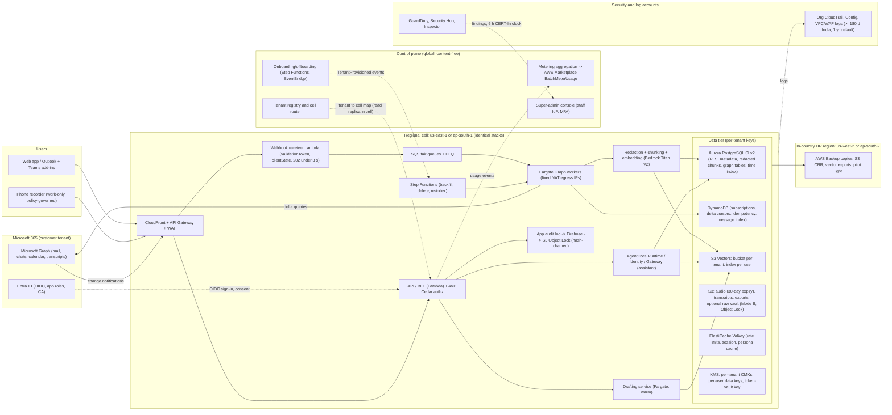
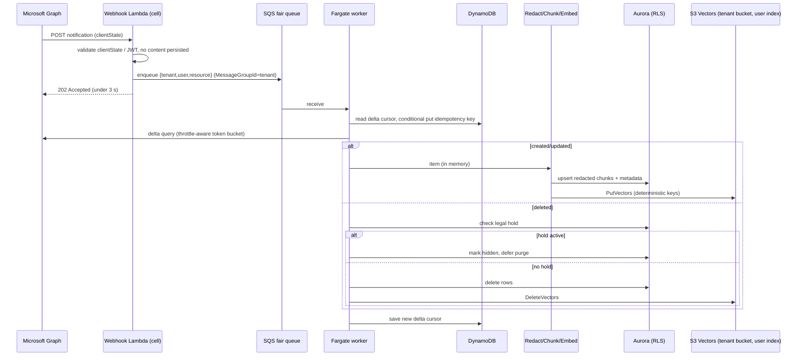

# 04 — AWS Data Layer, Multi-Tenant SaaS Architecture, Identity/RBAC, Security Baseline & AWS Go-To-Market Plumbing

*PersonaAgent research track 04 · prepared 2026-10-05/06 · audience: founders + founding engineers*

**Confidence legend:** **[H]** = verified against an AWS/Microsoft primary source (docs, pricing page, AWS Price List API files published Sep–Oct 2026, What's New/blog) · **[M]** = primary source is indirect, older, or a reputable secondary source · **[L]** = estimate or inference. Every estimate says so and shows its reasoning.

**Pricing basis:** us-east-1 on-demand list prices from the AWS Price List API (files published 2026-09-11 to 2026-10-02) unless stated. ap-south-1 (Mumbai) differs by service: S3 Standard is +9%, S3 Vectors storage +10%, and Aurora Serverless v2 **+50%**. Check each service in the target region before you commit to a budget.

---

## 0. Executive summary

**Architecture**
- **Shape:** two regional **cells** from day one, **us-east-1** (US) and **ap-south-1 Mumbai** (India). DR stays in-country: us-west-2 and ap-south-2 Hyderabad. A thin, content-free global control plane sits above them. Residency is *enforced* by region-deny SCPs per cell OU, not just promised.
- **Data stack, all serverless:**
  - **Aurora PostgreSQL Serverless v2** with row-level security: metadata, redacted chunks, graph-as-tables, time index.
  - **DynamoDB** for Graph sync state.
  - **S3 Vectors** with a **per-tenant vector bucket and per-user index**.
  - **S3** for audio (30-day expiry).
  - **ElastiCache Valkey**.
  - No OpenSearch, Neptune, DSQL, MSK or EKS in the MVP. [H prices; L design]

**S3 Vectors**
- **Facts:** GA 2 Dec 2025. **2B vectors/index, 10k indexes/bucket, 10k buckets/Region**; ~100 ms warm queries; per-index KMS keys. Pricing is **$0.06/GB-mo storage, $0.20/GB PUT, $2.50 per 1M queries**, plus a per-query charge on index size. [H]
- **Per-user indexes:** about **170× cheaper per query** than one shared tenant index, because query cost scales with index size. They also avoid a **~9-day serialized backfill** caused by the 2,500 vectors/s per-index write cap. [H limits; L arithmetic]
- **New feature:** vector buckets created **on or after 30 Sep 2026** get **ENHANCED pre-filtering**. It keeps recall high for time-window filters such as "2 pm today" queries. [H]

**OpenSearch and graph**
- OpenSearch Serverless **NextGen** (GA 28 May 2026) **scales to zero** after 10 min idle, with a 10–30 s cold start. Classic still bills a **2-OCU (~$350/mo) minimum**. Use it later as an enterprise hybrid-search hot tier, not as the primary store. [H]
- A **graph database is not justified for the MVP**. Model the people/threads/meetings/commitments graph in Postgres tables with `tstzrange` validity. Neptune Analytics starts at **$350/mo per graph** (US) or **$403** (Mumbai) and is **not offered in Hyderabad**. Reserve it for enterprise org-graph features. [H]

**India and US regions**
- **India costs more:** Aurora Serverless v2 is **$0.18 vs $0.12 per ACU-h (+50%)**. [H]
- **Hyderabad gaps:**
  - It lacks Transcribe, Comprehend, Macie, MemoryDB, DSQL and Neptune Analytics.
  - It prices **only AgentCore Gateway and Policy**: no Runtime and no Memory.
  - India DR is therefore **"data DR + degraded service"**. Contract RTOs accordingly and keep the agent container portable. [H/M]
- **Compliance gets cheaper when built in:**
  - **CERT-In:** 6-hour incident reporting; logs kept 180 days in India.
  - **DPDP Rules:** 72-hour breach reporting; 1-year logs; in force from 13 May 2027.
  - **RBI/SEBI/IRDAI:** India-only storage *and processing*, including LLM inference, plus audit rights.
  - India-cell defaults that cover these: in-country log archive with **1-year Object Lock**, in-region inference only, and in-country backups.

**Identity and security**
- **Identity:** **Entra ID multi-tenant app directly**, with customer-assigned app roles, instead of Cognito (federated MAU is **$0.015** [H]). Authorisation uses **Verified Permissions/Cedar** at **$5 per 1M decisions** [H] in a **shared policy store per cell**, with invariants mirrored as SCPs and KMS key policies. The report includes an 8-role × 12-action permission matrix with "zero standing access" break-glass.
- **Raw-content modes:**
  - Default **Mode A, derivatives only**: redacted chunks plus pointers, re-fetched from Graph.
  - Optional **Mode B, encrypted raw vault**: per-tenant CMK or BYOK/XKS, Object Lock, legal hold.
  - **Crypto-shredding** uses per-user data keys. Legal hold **defers** deletes rather than blocking the design.
- **Two AWS services you might plan on are closed to new customers.** **CloudTrail Lake (since 31 May 2026)** and **AWS Audit Manager** no longer onboard new customers, and QLDB has ended. Build audit on CloudTrail trails → S3 Object Lock + Athena, plus a hash-chained, KMS-signed application audit log. [H]
- **Microsoft Graph webhooks must ack within 3 s**, otherwise notifications are delayed or **dropped unrecoverably**. Ack 202 and enqueue to **SQS fair queues** (multi-tenant noisy-neighbour mitigation). Treat delta queries as truth. [H]

**Cost**
- **Infrastructure per user-month, excluding AI inference:** about **$0.13 (low) / $0.44 (typical) / $1.42 (heavy)** variable in the US; India about 5–7% more. Fixed cell floors bring the totals to **≈ $3.1/user at 1k users, ≈ $1.16 at 10k, ≈ $0.92 at 100k**. AI inference (other tracks) will dominate COGS. [L built on H prices]

**Go-to-market**
- **AWS Marketplace:** list as **SaaS contracts with pay-as-you-go**. Fees are **3% public, 3%/2%/1.5% private by TCV, 1.5% renewals, +0.5% CPPO**; server/BYOC products pay 20% on public offers. [H]
- **Partner path:**
  - **FTR** is free and valid 2 years; it accepts a SOC 2 Type II report as evidence.
  - **ISV Accelerate** requires ≥ 5 launched and ≥ 15 qualified ACE opportunities plus ≥ $2k AWS revenue. [H]
  - Whether Marketplace purchases count against customers' AWS commitments (EDP drawdown) was **not verified**.

---

## 1. Context, founder decisions and design assumptions

**Founder decisions this report is built around**

| # | Decision | What it means for the data, tenancy and security layer |
|---|---|---|
| 1 | First buyer: Microsoft 365 mid-market and enterprise teams, sold per seat | Entra ID is the identity of record. Tenant = customer's Entra tenant. Admin consent, SCIM-style lifecycle, audit exports and data-residency answers are needed at the first enterprise deal. |
| 2 | v1 regions: **United States** and **India** | Two regional cells from day one: **us-east-1** (US) and **ap-south-1 Mumbai** (India), with in-cell backups. Disaster recovery (DR) uses **us-west-2** for US tenants and **ap-south-2 Hyderabad** for India tenants, subject to the service gaps in §3.6. EU/UK come later. |
| 3 | 3–6 engineers, ~3-month MVP | Use serverless and managed services only. **Defer** Neptune, OpenSearch, BYOC, silo tiers, XKS, Nitro Enclaves, MSK and EKS until a paying customer needs them (§8). |
| 4 | Recorder is **work-only and company-governed** | Tenant-admin policies cover capture windows, mute rules, retention, and who can query what. Audio retention is short (default 30 days or less). Transcripts are retained by tenant policy. |
| 5 | Phase-1 redaction is precise to **US and Indian** regulatory identifiers | Irreversible masking at first sight for SSN/ITIN, Aadhaar/VID, PAN, card numbers, bank accounts, passports, licences and health IDs. The redaction design is covered by the security track. This report covers where redacted and pseudonymised data lives and how it is keyed. |

**Cross-track facts this report relies on (confirmed by other analysts):**
- Embeddings are Titan Text Embeddings V2, which is available in Mumbai.
- The persona corpus lives in *our* stores: S3 Vectors, with a per-tenant vector bucket, a per-tenant KMS key and a per-user index; Aurora holds structured data.
- AgentCore (Runtime/Identity/Gateway/Policy) runs the conversational assistant. Drafting runs on a warm ECS Fargate service.
- Hyderabad lacks AgentCore Memory, Comprehend, Macie and Transcribe.
- Graph throttling:
  - Outlook allows 10k requests per 10 minutes and 4 concurrent requests per app per mailbox.
  - Teams allows about 20 rps per tenant and 1 rps per chat, so a per-user backfill takes about 2–4 days in a 1,000-user tenant.
- Deletes must propagate within 24 h, and a legal-hold flag is required.

**Workload assumptions used for sizing (from the brief):**
- **Backfill:** 50k emails plus 100k Teams messages per user, about 5 GB raw including metadata, with no attachment binaries.
- **Vectors:** about 2M per *heavy* user after one year, including transcript chunks.
- **Audio:** 30-day retention at about 16 kbps Opus, which is 2 KB/s or 7.2 MB per recorded hour.
- **Transcripts:** kept indefinitely.

The work-only decision makes the always-listening 16 h/day profile an upper bound rather than the typical case.

## 2. Storage and databases

### 2.1 Raw content: "no raw store" default vs optional encrypted raw vault

The founders asked for a "raw data store". The security track's invariant (a) is to avoid storing raw M365 content. We design **both** modes and make the choice a per-tenant setting.

| | **Mode A: derivatives only (default, all tiers)** | **Mode B: encrypted raw vault (Enterprise option)** |
|---|---|---|
| What is persisted | Redacted, normalised text chunks; structured metadata (who/when/thread/audience class); embeddings; persona features; **pointers** (Graph IDs, `internetMessageId`, change keys/ETags). Raw bodies exist only in memory and in short-lived encrypted work queues. | Everything in Mode A, plus the raw Graph JSON/MIME of the user's own sent items and chats, written to a per-tenant encrypted vault. |
| Re-processing (new redaction rules, a better persona model, re-embedding) | Re-fetch from Graph. This is bounded by Graph throttling (a full re-pull is days per large tenant). It is impossible for items already deleted in M365, which is arguably correct behaviour. | Replay from the vault, with no Graph load. |
| Breach blast radius | Smaller. There is no verbatim corpus to steal; regulated identifiers are already irreversibly masked. | Larger. The vault is a second copy of the mailbox. |
| Deletion/DSAR | Delete derivatives. Graph is the system of record. | Must also purge the vault. Crypto-shredding is available (§6.3). |
| eDiscovery/legal hold | Microsoft Purview remains authoritative. We only *suspend purge* of derivatives. | We may become an eDiscovery custodian, which brings more legal exposure. Object Lock legal hold is available. |
| Cost per user | About $0 for raw storage. | About $0.02–0.12/month (5 GB, after tiering; see §9). |

**Mode B implementation (verified building blocks):**
- **Encryption:**
  - One per-tenant bucket (or a per-tenant prefix in a pooled bucket), encrypted with SSE-KMS under a **per-tenant customer-managed key**. The default account quota is **100,000 KMS keys per Region**, adjustable [H]. Keys cost $1/key-month and $0.03 per 10k requests [H].
  - Enable **S3 Bucket Keys** to cut KMS request volume and cost [M].
  - Require the `tenant_id` encryption context in the key policy.
- **Object Lock:**
  - Default to *governance* mode.
  - Enable *compliance* mode only for customers who contractually need WORM, such as US broker-dealers under SEC 17a-4. Object Lock compliance mode has third-party assessments for 17a-4 [M]. Compliance mode blocks deletion until retention expires, so it conflicts with crypto-shred-on-request. The conflict is resolved in §6.3.
- **Object layout:**
  - Do not write one object per message. Pack per-user, per-day bundles (compressed JSONL or Parquet, 1–64 MB).
  - At about 33 KB average (5 GB / 150k items), per-message objects fall below the 128 KB minimum that Intelligent-Tiering monitors. They never tier down, and each costs a $0.005/1k PUT [H].
  - Bundles make Glacier Instant Retrieval ($0.004/GB-mo [H]) usable after 30–90 days.
- **Storage classes (us-east-1) [H]:**

  | Class | Price |
  |---|---|
  | Standard | $0.023/GB-mo |
  | Intelligent-Tiering: frequent / infrequent / archive-instant tiers | $0.023 / $0.0125 / $0.004 per GB-mo |
  | Intelligent-Tiering monitoring fee (objects ≥128 KB) | $0.0025 per 1,000 objects/month |
  | Glacier Flexible Retrieval | $0.0036/GB-mo |
  | Glacier Deep Archive | $0.00099/GB-mo |

  Mumbai Standard is $0.025/GB-mo for the first 50 TB [H].

**Audio (Pillar 2):**
- Use a per-tenant prefix encrypted with the tenant key.
- Set the lifecycle **Expiration** to tenant policy (0–30 days; default 30).
- Do not use Object Lock on audio. We want it gone.
- Transcripts move to the derivative stores (Aurora plus S3 Vectors) and stay by tenant policy.
- Size: 16 kbps Opus is about 7.2 MB/h. An always-on 16 h/day user holds about 3.5 GB of rolling audio, about $0.08/month in S3 Standard. A work-only 8 h × 22 days user holds about 1.3 GB.

**S3 Tables (Apache Iceberg):**
- Use it for **analytics, not content**: usage and metering events, quality metrics, and de-identified aggregates.
- Prices (us-east-1) [H]:
  - Storage: $0.0265/GB-mo for the first 50 TB.
  - Monitoring: $0.025 per 1,000 objects.
  - Compaction: $0.002 per 1,000 objects plus $0.005/GB processed.
  - Replication: $0.01 per 1,000 table updates.
- It is priced in both Mumbai and Hyderabad.
- For the MVP, plain Parquet in S3 plus Athena is enough. Adopt S3 Tables when metering and analytics volume justifies managed compaction.

### 2.2 Relational and metadata: Aurora PostgreSQL Serverless v2 vs Aurora DSQL vs RDS; DynamoDB

| | **Aurora PostgreSQL Serverless v2** (recommended) | **Aurora DSQL** | **RDS PostgreSQL (provisioned)** |
|---|---|---|---|
| Price (us-east-1) [H] | **$0.12/ACU-h** (Standard) or $0.16/ACU-h (I/O-Optimized); storage $0.10/GB-mo plus $0.20 per 1M I/O (Standard) or $0.225/GB-mo with no I/O charge (I/O-Optimized); backup beyond 100% of cluster size $0.021/GB-mo | $8 per 1M DPU ($0.000008/DPU); storage $0.33/GB-mo; free tier 100k DPU and 1 GB-mo | Instance-hour based; cheapest for flat, steady load |
| Price (Mumbai / Hyderabad) [H] | **$0.18/ACU-h** (Standard), $0.24 (I/O-Opt.); storage $0.11/GB-mo. That is **50% more per ACU-h than the US.** | Mumbai: $0.000009/DPU, $0.36/GB-mo. **Not priced or available in Hyderabad.** | Varies |
| Scale | 0.5–256 ACU per instance [H]; scale-to-zero supported (announced Nov 2024) [M] | Serverless distributed, active-active multi-Region | Manual |
| pgvector | Yes (pgvector 0.8.x on current Aurora PostgreSQL versions) [M] | **No** [M]. Its feature set is reduced: no PL/pgSQL, no triggers, no temp tables, **max 3,000 rows modified per transaction**, connections time out after 1 h [H]. | Yes |
| Row-level security | Yes (native Postgres RLS) | Not documented as supported. Treat as unavailable [L]. | Yes |
| Verdict | **MVP system of record** for tenants, users, policies, message/segment metadata, redacted chunk text, the graph-in-tables (§2.4) and the time index (§2.5). | Skip. It is missing pgvector and RLS assurance, is absent in Hyderabad, and its transaction limits hurt backfills. | Revisit once load is steady and predictable (Database Savings Plans may change the maths; not verified). |

**Tenant isolation in Aurora (pool model):**
- Every content table carries `tenant_id`, and for personal content also `owner_user_id`.
- Enable **`ALTER TABLE … ENABLE/FORCE ROW LEVEL SECURITY`**, with policies like `USING (tenant_id = current_setting('app.tenant_id')::uuid AND (owner_user_id = current_setting('app.user_id')::uuid OR current_setting('app.role') IN ('tenant_compliance')))`.
- The application connects as a non-owner role that has no `BYPASSRLS`.
- Set `SET LOCAL app.tenant_id = …` per transaction. This stays safe behind RDS Proxy or PgBouncer in transaction-pooling mode.
- Add a CI test that fails if any table lacks a policy.
- Content is personal even inside a tenant. **Tenant admins see usage and metadata, not other users' content**, unless an audited compliance-officer flow is invoked (§5).
- Silo/enterprise tenants get their own cluster (or their own account) with the same schema and the same RLS. Keeping RLS on in silos means one code path for every tier.

**DynamoDB: the high-throughput sync spine (on-demand, us-east-1) [H]:**
- **Prices:** $0.625 per 1M write request units; $0.125 per 1M read request units; storage $0.25/GB-mo (Standard-IA table class $0.10); PITR $0.20/GB-mo; global-table replicated writes $0.625 per 1M; Streams $0.02 per 100k reads.
- **Tables:**
  1. `graph_subscriptions`: id, resource, expiry, per-subscription `clientState` hash, owner, cell.
  2. `delta_cursors`: deltaLink per mailbox folder and per chat.
  3. `idempotency`: key = subscriptionId + resource id + changeType + changeKey, with a 48 h TTL.
  4. `ingest_jobs` / `backfill_progress`.
  5. `message_index`: Graph immutable id → our chunk ids and vector keys. It drives deletes and edits within the 24 h propagation SLO.
- **Isolation:** partition keys start with `T#<tenant>#U#<user>`. The IAM condition `dynamodb:LeadingKeys` is bound to the `tenant_id` session tag (§3.3).
- **Cost:** at roughly 10–30k writes per user-month after backfill, DynamoDB costs about $0.01–0.03 per user-month [L].

### 2.3 Vector search at large scale with strict isolation

**Key verified facts on Amazon S3 Vectors (GA 2 December 2025) [H]:**
- **Scale limits:**
  - Up to **2 billion vectors per index**.
  - **10,000 indexes per vector bucket**.
  - **10,000 vector buckets per Region per account**.
  - Dimensions from 1 to 4,096.
- **Metadata limits:** 40 KB total per vector, of which at most **2 KB is filterable**. Up to 50 keys, and up to 10 keys can be non-filterable.
- **Write limits per index:** **1,000 PutVectors/DeleteVectors requests per second** and **2,500 vectors inserted or deleted per second**. Each call carries up to 500 vectors.
- **Query results:** top-K up to 10,000, paged 100 per page.
- **Latency:** about 100 ms or less for frequent queries; under 1 s for infrequent ones.
- **Encryption:** a per-index KMS key can override the bucket default.
- **IAM:** ARNs exist at index level (`arn:aws:s3vectors:<region>:<acct>:bucket/<b>/index/<i>`). Vector buckets support resource policies.
- **Filter operators:** `$eq/$ne/$gt/$gte/$lt/$lte/$in/$nin/$exists/$and/$or/$startsWith`.
- **ENHANCED index mode:**
  - It **pre-filters** before the ANN search, so recall stays high even when a filter matches a small fraction of vectors. Up to 100 filter constraints per query.
  - **Vector buckets created on or after 30 Sep 2026 create ENHANCED indexes**. Older indexes are CLASSIC: they filter during search and may return fewer than K results.
  - This matters for "time-window" queries (§2.5).
- **Regions:** priced in us-east-1, us-west-2, Mumbai and Hyderabad.

**S3 Vectors pricing (us-east-1) [H]:**

| Charge | Price |
|---|---|
| Storage | $0.06/GB-mo (Mumbai $0.066; Hyderabad $0.07) |
| PUT | $0.20 per logical GB (Mumbai $0.219) |
| Queries | **$2.50 per 1M** |
| Data processed (charged per query) | Index size (average vector incl. key and metadata × vector count), tiered at $0.004/TB for the first 100k vectors, $0.002/TB for 100k–10M, $0.0004/TB above 10M |
| Data returned | $0.01/GB beyond the first 512 KB per query |

**Comparison for our workload (2M vectors per heavy user; 1,024-dim float32 is about 4.6 KB per vector with key and metadata, about 8.8 GB per heavy user):**

| Option | Cost basis (verified prices) | What 2M vectors costs one heavy user | Isolation unit and limits | Role for PersonaAgent |
|---|---|---|---|---|
| **S3 Vectors** | As above | **≈ $0.53/mo storage**, ≈ $0.00002 per query (≈ $0.06/mo at 3k queries), ≈ $1.76 one-off PUT [H prices, L sizing] | Bucket per tenant; index per user; per-index KMS key | **Primary store** for the persona corpus and long-term memory (MVP) |
| **OpenSearch Serverless NextGen** (GA 28 May 2026) | $0.24 per OCU-h for indexing, search and GPU vector-index acceleration; S3-backed storage $0.024/GB-mo; a "hot storage" line at $0.30/GB-mo (semantics not verified) [H]. **No minimum OCU; scales to zero after 10 min idle**; first request after that takes **10–30 s** [H]. Mumbai search OCU $0.2472, Hyderabad $0.33; GPU acceleration not priced in India [H]. | Fp32 HNSW in memory needs roughly 9 GB RAM ≈ 2–4 OCUs ≈ **$350–700/mo** if kept warm [L]. Only viable with quantization or on-disk mode, a hot subset, and many users sharing a collection group. | 10,000 collections per NextGen group (adjustable); **300 groups per account**; **1,000 indexes per collection**; max 1,700 OCUs per account [H] | **Later:** hybrid BM25 + kNN hot tier for enterprise. Avoid Classic (minimum 2 OCUs ≈ $350/mo for production [H]). |
| **OpenSearch managed domain** | r7g.large.search $0.178/h; r8g.large $0.196/h; OR2.large $0.20/h; OM2.large $0.153/h; gp3 $0.122/GB-mo; managed storage $0.024/GB-mo [H] | Only economic at scale with disk-based or quantized vectors [L] | Domain per silo tenant; shards 1,000 per 16 GB heap, max 4,000 [H] | Silo enterprise tenants with heavy hybrid search |
| **Aurora pgvector** | ACU-h plus storage | 8.8 GB per heavy user lives in cluster storage plus buffer cache. 10k heavy users means about 88 TB, which is not sensible [L]. | RLS rows | Small hot sets only (recent transcript windows, control plane) |
| **ElastiCache/MemoryDB vector** | In-memory; Valkey Serverless $0.084/GB-h ≈ $61/GB-mo [H] | Prohibitive for a corpus | Key prefixes and ACLs | Semantic or response cache only |
| **Bedrock Knowledge Bases managed storage** | Price list shows "consumption-based" KB storage at **$5/GB-mo** plus $0.001 per retrieval ($0.004 agentic) [H price; M interpretation] | ≈ $44/mo per heavy user | Managed | Not for the bulk corpus |

**Recommended index layout: per-tenant vector bucket, per-user index.** This matches the AI-stack track. The justification is quantitative:

1. **Isolation by construction.** A query must name the index ARN. IAM policies built from session tags (`…:bucket/pa-${aws:PrincipalTag/tenant_id}-*/index/u-${aws:PrincipalTag/user_id}`) make cross-user reads fail closed, without relying on a filter clause that a bug could omit.
2. **Query cost scales with index size.** One query on a 2M-vector user index costs ≈ **$0.00002**. The same query on a shared 2B-vector tenant index costs ≈ **$0.0035**, about **170× more**, because data processed is charged on the whole index [H prices, L arithmetic].
3. **Write throughput is per index.** Backfilling a 10k-user tenant (200k vectors each = 2B vectors) into *one* index at 2,500 vectors/s takes **≈ 9.3 days**, and one noisy user blocks everyone. Per-user indexes parallelise this to about 80 s of index-write time per user. Graph throttling and embedding throughput then become the bottleneck, as they should [H limits, L arithmetic].
4. **Deletion and offboarding are trivial.** `DeleteIndex` removes a user, and deleting the bucket removes a tenant. Vectors are derived data and rebuildable, so no backup copy is needed.
5. **Limits fit.** 10,000 indexes per bucket allows 10k users per tenant bucket. Above that, shard a tenant across buckets (`pa-<tenant>-<n>`). 10,000 buckets per Region per account allows 10k tenants per cell account before sharding across accounts, which is what cells are for anyway.

**Metadata design (≤ 2 KB filterable):**
- **Filterable:** `src` (mail/teams/meeting/mic), `kind` (new_thread/reply/delegation/…), `aud` (manager/report/peer/client/vendor), `ts_start` and `ts_end` (epoch seconds), `thread_id`, `meeting_id`, `sens` (redaction level), `hold` (legal hold), `ver` (pipeline version).
- **Non-filterable:** a pointer to the Aurora row, plus optionally a ≤ 2 KB redacted snippet so that one call can serve RAG.
- Create all PersonaAgent vector buckets *after* 30 Sep 2026 so they default to **ENHANCED** pre-filtering, or migrate older indexes with `UpdateIndexMode`.

**Tiering pattern for later:** S3 Vectors stays the system of record for vectors. For enterprise tenants that need hybrid lexical + semantic search at low latency, project the *recent N days* (or a per-tenant hot set) into an OpenSearch Serverless NextGen collection per tenant, inside a per-cell collection group. AWS documents S3 Vectors ↔ OpenSearch integration at GA [H]. Until then, lexical search uses **Postgres full-text search** (`tsvector` + GIN) in Aurora over redacted chunks, fused with vector results by reciprocal-rank fusion in the app [L design].

### 2.4 Graph: Neptune Database vs Neptune Analytics vs alternatives

| | **Neptune Analytics** | **Neptune Database (Serverless)** | **Graph-in-Postgres** (tables + recursive CTEs) | Neo4j Aura (Marketplace) / Apache AGE |
|---|---|---|---|---|
| Price [H] | Memory-optimised graph: **16 m-NCU minimum = $0.48/h ≈ $350/mo** (us-east-1); $0.552/h ≈ $403/mo in Mumbai. **Not priced in Hyderabad.** Paused graphs bill at 10%; snapshots $0.021/GB-mo. Sizes range from 16 to 24,576 m-NCU. | **$0.1608/NCU-h** (us-east-1), $0.1848 in Mumbai, $0.1769 in Hyderabad; minimum 1 NCU ≈ $117/mo per instance; storage $0.10/GB-mo; I/O $0.20 per 1M | Included in Aurora | Not verified |
| Query | openCypher; built-in graph algorithms; vector similarity on the graph [M]. **Bedrock Knowledge Bases GraphRAG uses Neptune Analytics** (GA 2025) [M]. | Gremlin, openCypher, SPARQL | SQL, recursive CTEs, `tstzrange` validity | Cypher |
| Fit for the per-user persona/memory graph | Over-provisioned. Per-user graphs are small: thousands of people and threads, tens of thousands of edges. | Possible but adds a second database to operate. | **Good enough** and RLS-protected | AGE support on Aurora not verified; Aura adds a vendor and a residency question |

**Is a graph justified?** The *model* is: people ↔ organisations ↔ threads ↔ projects ↔ meetings ↔ commitments ↔ topics, with bi-temporal edges (valid-time plus record-time). The *database* is not justified for the MVP.

**MVP:**
- Implement the graph as Postgres tables with these columns:
  - `entities` (id, tenant, owner, type, canonical name, external ids)
  - `edges` (src, dst, type, `valid tstzrange`, `recorded tstzrange`, confidence, provenance chunk ids)
  - `commitments` (who, what, due, status, source)
- Answer "who is my manager", "what did I promise Acme last week" and "which meetings touched project X" with indexed joins and recursive CTEs.
- Per-user graph scope keeps every query small.

**Later (Phase 3+), when there is a paying driver:**
- Org-level network analytics for enterprise ("who knows whom", relationship strength across a tenant).
- Bedrock-managed GraphRAG over shared corpora.
- Multi-hop reasoning that measurably beats SQL plus vectors on an eval set.

At that point, run **Neptune Analytics per silo enterprise tenant**. It loads from S3 snapshots of the Postgres graph, can be paused, and its $350/mo floor fits enterprise pricing. Neptune Database Serverless is an alternative for shared cells. Note that **Hyderabad has no Neptune Analytics**, so India DR for that feature means a rebuild from S3 after failover.

### 2.5 Time-indexed lifelog retrieval ("2 pm today", "the 4 pm meeting")

Most Pillar-2 questions are **time-anchored first and semantic second**. Exploit that.

1. **Segment table in Aurora.** `segments(tenant_id, owner_user_id, segment_id, source {mic, teams_meeting, teams_call}, meeting_id, during tstzrange, tz, speakers, title, summary, redaction_level, transcript_ptr, hold)`.
   - Use a GiST index on `during`. With the `btree_gist` extension, also index `(owner_user_id, during)`.
   - Store UTC and keep the user's IANA time zone. Take the mailbox time zone from Graph and the device time zone from the phone.
2. **Calendar join.** Keep a lightweight `events` table populated from Graph `calendarView`/online-meeting metadata, with `during`, subject, organiser, attendees and join URL.
   - "The 4 pm meeting" resolves to an event in the user's local day. It then maps to segments via `meeting_id`, or by time overlap for in-room meetings captured by the phone.
3. **Query plan for "what was that good idea at 2 pm?"**
   1. Parse the time expression to a window, e.g. [13:40, 14:20] local.
   2. Run `SELECT … WHERE owner_user_id=$u AND during && $window`. This yields a few dozen chunks.
   3. Rank those chunks **exactly**: fetch their vectors with `GetVectors` (≤ 100 keys per call), or store a small 256-dim copy in Aurora, and compute cosine similarity in the app. No ANN is needed for 50 chunks.
   4. The LLM answers with citations (segment and timestamp).
4. **Broad queries** ("when did we last discuss pricing with Acme?") go to S3 Vectors with a pre-filter, e.g. `{"$and":[{"src":{"$in":["meeting","mic"]}},{"ts_start":{"$gte":…}}]}`, on an **ENHANCED** index. Then expand to neighbouring segments in Aurora.
5. **OpenSearch alternative (later):** one query can combine a `range` filter on `ts` with `knn` and BM25 in a hybrid query. It is useful when lexical precision matters, e.g. names and product codes, but it is not needed for the MVP.

This design keeps Pillar 2 cheap: about 50 KB of transcript text per spoken hour, and maybe 60 chunks per hour [L]. It also makes **legal hold and deletion** simple row and index operations.

### 2.6 Pipelines: webhooks, queues, streams, orchestration, backfills

**Microsoft Graph webhook contract (Microsoft Learn, updated Apr 2026) [H]:**
- **Validation:** the endpoint must be public HTTPS. On subscription creation, echo the URL-decoded `validationToken` as `text/plain` with **200 within 10 s**. This applies to the `lifecycleNotificationUrl` too.
- **Delivery:** a notification counts as delivered on any **2xx within 3 s**. Microsoft recommends you **validate, persist to a queue and return 202**.
  - Failures are retried with exponential backoff for **up to 4 h**, with a 10 s timeout on retries.
  - If more than 10% of responses exceed 3 s within 10 min, the endpoint is marked **"slow"** and all new notifications are delayed 10 min.
  - If more than 15% exceed 10 s, it is marked **"drop"** and notifications are **dropped unrecoverably** for 10-minute windows.
- **Security and lifecycle:**
  - `clientState` is required. Validate it on every notification.
  - Lifecycle notifications warn about token or subscription expiry and admin revocation.
  - Duplicate subscriptions (same resource and changeType) return 409.
  - Microsoft publishes its Graph notification source IPs, so the endpoint can be firewalled to them.
- **Alternative delivery:** Graph can also deliver to Azure Event Hubs or Event Grid. We do not recommend this for v1 because it routes content through Azure and complicates residency.

**Receiver design (per cell):**

```
Graph ──HTTPS──► CloudFront/Route 53 (cell hostname: hooks.us / hooks.in)
                  └─► API Gateway (REST, regional) + AWS WAF (Graph IP allow-list, size limits)
                        └─► Lambda "receiver" (≤200 ms): validationToken echo | clientState check
                              | (rich notifications: validate validationTokens JWT, decrypt payload)
                              └─► SQS standard queue (MessageGroupId = tenant_id → SQS fair queues)
                                    └─► workers (Lambda for small, Fargate for Graph fetch) ─► DLQ
```

- **Cell routing.** Each tenant's subscriptions use its **home cell's** `notificationUrl`. Content-bearing rich notifications then never cross a border.
- **Webhooks are hints; delta queries are truth.**
  - A notification only enqueues "sync mailbox X". The worker runs the Graph delta query from the stored cursor.
  - `missed` lifecycle events, `subscriptionRemoved` and nightly reconciliation all trigger delta resync. This also covers the up-to-4-hour retry window and drop states.
- **Idempotency.** Use DynamoDB conditional puts on (resource id, changeKey) with a TTL, plus deterministic chunk and vector keys. Re-processing then overwrites rather than duplicates. Use Powertools for AWS Lambda idempotency helpers [M].
- **Fairness.**
  - **SQS fair queues** are standard queues that mitigate noisy-neighbour dwell time when producers set `MessageGroupId` = tenant [H].
  - Use FIFO only where per-mailbox ordering truly matters ($0.50 vs $0.40 per 1M requests [H]).
  - Every queue has a DLQ (maxReceiveCount 5) and a redrive runbook.
- **Deletes and legal hold.**
  - A Graph `deleted` change or delta tombstone deletes the chunk rows, vectors and graph edges, and writes an audit record within the 24 h SLO.
  - If `hold=true`, the item is hidden from retrieval but not purged until the hold is released.

**Backfill orchestration:**
- Use **Step Functions Standard** ($0.000025 per state transition [H]) with a Distributed Map over (user × folder/chat × date-range) partitions.
- **Concurrency caps derive from Graph limits:** 4 concurrent requests per mailbox per app and about 20 rps per Teams tenant. They are enforced by a token bucket in ElastiCache (Valkey) or DynamoDB.
- Workers run on **ECS Fargate** ($0.04048/vCPU-h, $0.004445/GB-h, us-east-1 [H]). Graph fetches are I/O-bound and long-running, so Fargate suits them better than Lambda, and it gives **fixed egress IPs** via NAT for customers with Conditional Access.
- Use **Lambda** for receivers, transforms and fan-out. Arm pricing is $0.0000133/GB-s at tier 1 [H].
- Use **AWS Batch on Fargate Spot** for bulk re-embedding and re-indexing.
- **Defer EKS.** It is unnecessary operations load for 3–6 engineers.

**Streams:**
- For the MVP, **SQS plus EventBridge** suffices. EventBridge costs $1 per 1M custom events [H] and carries control-plane domain events: `TenantOnboarded`, `UserConnected`, `BackfillCompleted`, `DeletionRequested`, `HoldChanged`.
- Add **Kinesis Data Streams on-demand** when phone/wearable audio-chunk events or transcript streams need ordered replay. It costs $0.04 per stream-hour ≈ $29/mo per stream, plus $0.08/GB written and $0.04/GB read [H].
- **MSK Serverless** costs $0.75 per cluster-hour ≈ $548/mo before data [H]. It is not justified until there is a Kafka-native integration need.

**Replay:**
- Keep a 14-day, **content-free** notification journal (ids, timestamps, change types) in S3.
- Delta cursors can be reset per mailbox or chat to rebuild from Graph.
- In Mode B, replay comes from the raw vault instead.

### 2.7 Caching

**ElastiCache Serverless for Valkey** (us-east-1) [H]:
- Price: **$0.084/GB-h** of data stored and **$0.0023 per 1M ECPUs**. Redis OSS on serverless costs $0.125/GB-h and $0.0034 per 1M.
- Node-based Valkey: `cache.t4g.small` $0.0256/h; `cache.r7g.large` $0.1752/h.
- It is priced in Mumbai and Hyderabad. MemoryDB is **not** available in Hyderabad, and we don't need durable in-memory storage anyway.

**Uses:**
- Graph throttling token buckets (per app, per mailbox, per tenant).
- Session and authorization-decision cache (short TTL, keyed by principal, action and resource).
- Persona-profile cache for the drafting service.
- Idempotency fast path.
- Optionally, a semantic cache for repeated retrievals.

**Rules:**
- No raw content in cache.
- Keys are prefixed `t:<tenant>:u:<user>:`.
- Use Valkey ACL users per service.
- Use TLS in transit and encryption at rest with the cell key.
- Keep TTLs short so revocation and deletion propagate quickly.

## 3. Multi-tenant SaaS architecture on AWS

### 3.1 Tenancy models and tiers

The AWS SaaS Lens and SaaS Factory guidance distinguish three models:
- **Silo:** dedicated resources per tenant.
- **Pool:** shared resources with logical isolation.
- **Bridge:** a mix of the two, per layer. Most real SaaS products are bridge.

PersonaAgent is a **bridge** architecture from day one. The data layer is "per-tenant where it is cheap" and the compute layer is "pooled where it is safe":

| Layer | Business tier (mid-market, pooled) | Enterprise tier (bridge+) | Enterprise+ / regulated (silo) |
|---|---|---|---|
| AWS account | Shared cell account | Shared cell account | **Dedicated account per tenant** in the cell's OU |
| Compute (Fargate/Lambda/AgentCore) | Pooled | Pooled with per-tenant concurrency quotas | Dedicated |
| Aurora | Shared cluster with RLS | Shared cluster with RLS, or a dedicated cluster on request | Dedicated cluster |
| S3 Vectors | **Per-tenant bucket, per-user index** | Same, with a customer-managed key option | Same, in the tenant's account |
| KMS | **Per-tenant CMK** (ours) | Per-tenant CMK; BYOK (imported key material) | XKS (customer-held key) or CloudHSM key store |
| Raw vault (Mode B) | Off | Optional | Optional (default on if WORM is required) |
| OpenSearch / Neptune | Not used | Optional hot tier per tenant | Dedicated |
| Region | Home cell (US or IN) | Home cell; DR in the in-country pair | Same |

Price the tiers so that the **silo floor is covered by the contract**. A dedicated account and cluster adds roughly $300–800/mo of fixed infrastructure before usage: an Aurora writer and reader at about 1–2 ACU each, NAT and endpoints, and security services [L].

### 3.2 Control plane, application plane and the SaaS Builder Toolkit

**Control plane (global, one per environment, hosted in a US account and holding *no customer content*):**
- Tenant registry and tier.
- Home-cell routing map. Mirror it read-only into each cell so a cell survives control-plane loss.
- Onboarding and offboarding workflows.
- Billing and metering aggregation.
- Feature flags and policy templates.
- Platform super-admin app.
- Marketplace integration: `ResolveCustomer`, entitlement and metering.

Control-plane records are tenant metadata (name, Entra tenant ID, admin contacts, plan). For Indian customers, decide with counsel whether even this metadata must stay in the India cell. The safer default is to keep only a tenant ID, cell and plan globally, and the contact PII in-cell [L].

**Application plane (per cell):** everything that touches content.

**SaaS Builder Toolkit (SBT-AWS)** is an AWS Labs CDK (TypeScript) toolkit that codifies control-plane and application-plane constructs. Its README says **"SBT should be considered sample code"**, so you must harden authorization yourself before production [H]. Use it as a **reference and accelerator**, not a dependency:
- Borrow its event-driven contract: control plane ↔ application plane via EventBridge events such as `onboardingRequest` → provisioning job → `provisionSuccess`.
- Borrow its tenant-registration and user-management patterns.

The provisioning job per new tenant is idempotent:

1. Create the tenant record.
2. Create the per-tenant KMS key and alias.
3. Create the vector bucket.
4. Create the Aurora tenant row and RLS seed.
5. Create the Verified Permissions (AVP) policy-store entries.
6. Create the Cognito/Entra mapping.
7. Register Graph subscriptions as users connect.
8. Emit `TenantProvisioned`.

Offboarding is the reverse: export if requested, then legal-hold check, delete subscriptions, delete indexes and buckets, schedule key deletion, and issue a certificate of destruction.

### 3.3 Isolation techniques, layer by layer

1. **Identity → tenant context.** The API layer derives `tenant_id`, `user_id` and `role` from a validated token. It never trusts client-supplied IDs. Every downstream call carries this context.

2. **IAM ABAC with session tags (the "token vending machine" pattern).**
   - Workers call `sts:AssumeRole` into a *tenant-scoped role* with `Tags=[tenant_id, user_id?]`.
   - Policies then use `${aws:PrincipalTag/tenant_id}` to scope access:
     - S3 prefixes and bucket names: `arn:aws:s3:::pa-${aws:PrincipalTag/tenant_id}-*`.
     - S3 Vectors bucket and index ARNs (index-level ARNs exist [H]).
     - DynamoDB with `dynamodb:LeadingKeys`.
     - KMS with `kms:EncryptionContext:tenant_id`.
   - A bug that passes the wrong tenant ID then fails at AWS authorization, not just at app logic.
   - Session duration should be short, at most 1 h [M; standard IAM features].

3. **Per-tenant KMS keys.**
   - Encryption context `{tenant_id, data_class}` is mandatory.
   - The key policy allows only the cell's tenant-scoped roles with a matching principal tag.
   - Quotas: **100,000 customer-managed keys per Region per account** (adjustable); **10 custom key stores per account per Region** (adjustable) [H]. The second quota matters if many tenants want XKS.
   - KMS request-rate quotas are shared per account and Region. S3 Bucket Keys and data-key caching (AWS Encryption SDK) are mandatory at volume [M].

4. **Storage:**
   - S3: per-tenant bucket for the vault and audio; access points optional.
   - S3 Vectors: per-tenant bucket, per-user index.
   - Aurora: RLS on `tenant_id` and `owner_user_id`.
   - DynamoDB: leading-key scoping.
   - OpenSearch (later): per-tenant collection inside a NextGen collection group. Collections in one group can use **different KMS keys** [H].

5. **Network:** pooled compute stays inside private subnets. AWS service access goes through **VPC endpoints/PrivateLink** (Bedrock, S3, KMS, STS, Secrets Manager, DynamoDB, ECR, CloudWatch). Silo tenants get their own VPC in their own account.

6. **Tests.** Automated cross-tenant access tests run in CI: tenant A's token tries tenant B's resources via each API, and must fail at both the app layer *and* the IAM layer. Add a periodic "canary tenant" probe in production.

### 3.4 Noisy neighbours, quotas and metering

**Noisy-neighbour controls:**
- Use **SQS fair queues** with `MessageGroupId` = tenant [H].
- Run per-tenant token buckets in Valkey for backfill concurrency, LLM calls and searches.
- Apply per-tenant concurrency caps in Step Functions Distributed Map.
- Put AWS WAF rate-based rules on public APIs. WAF costs $0.60 per 1M requests plus per-ACL and per-rule fees [H].
- Set per-tenant daily token budgets for Bedrock. Bedrock quotas are per account and Region, so one tenant's burst can starve others without app-level budgets (AI track).
- Graph limits are naturally per mailbox and per tenant. They protect *Microsoft*, not *us*, so our worker pool still needs fairness.

**Metering and cost attribution:**
- Emit a usage event per billable or costly action into EventBridge → Firehose → S3/Parquet (S3 Tables later). Events include seat-active-day, items ingested, audio minutes, drafts generated, LLM tokens in and out per model, vector GB stored, queries and agent runtime seconds.
- Aggregate hourly per tenant to feed:
  - **AWS Marketplace `BatchMeterUsage`**. Batches are required; dedup is per customer/hour/dimension; records may be up to **24 h late**; there is a 6 h grace after month end; 1 MB payload; optional **vendor-metered tags** let buyers allocate cost by department [H].
  - Stripe or invoice billing for direct deals.
  - An internal **cost-per-tenant** model.
- Silo resources carry cost-allocation tags (`tenant_id`, `cell`, `tier`).
- Pooled resources are apportioned by telemetry: vector GB, tokens, CPU-seconds. Use AWS split cost allocation data for ECS where useful [M].

### 3.5 Deployment tiers: pooled, silo, BYOC

- **Pooled (default)** and **silo (dedicated account)** use the *same* CDK app, parameterised by `tier` and `tenant`. Each silo is just another pipeline stage targeting a new account vended by Control Tower Account Factory. This is the key to supporting silo customers with 3–6 engineers.
- **BYOC** (the customer's AWS account) is the most expensive support model:
  - Upgrades, observability without content access and incident response all become negotiations.
  - Delivery would be CDK/Terraform or an AWS Marketplace CloudFormation/container product (§7.3), with the control plane remaining ours (licence, updates, content-free telemetry).
  - **Defer BYOC** until a deal of roughly ≥$250k ARR requires it. Offer **silo in our account plus XKS (customer-held keys)** first. It answers most "we must control the data" objections without BYOC [L judgement].

### 3.6 Region cells: US and India (concrete), EU/UK later

A **cell** is a complete, independently deployable copy of the application plane. Each one has:
- its own accounts and VPCs;
- its own Aurora, DynamoDB, S3, S3 Vectors and KMS keys;
- its own webhook hostname, queues and workers;
- its own AgentCore deployment and its own log archive.

Cells share nothing at runtime except the content-free control plane. This follows AWS's cell-based architecture guidance (Well-Architected whitepaper *Reducing the Scope of Impact with Cell-Based Architecture*) [M]. Tenants are pinned to a home cell at onboarding by contract (data-residency clause). They never move automatically.

| | **US cell** | **India cell** |
|---|---|---|
| Primary | **us-east-1** (N. Virginia) | **ap-south-1** (Mumbai) |
| DR / backup region | **us-west-2** (Oregon), with full service parity | **ap-south-2** (Hyderabad), in-country, with **service gaps** (below) |
| Webhook / API hostnames | `api.us.…`, `hooks.us.…` | `api.in.…`, `hooks.in.…` |
| Fixed egress IPs for Conditional Access | NAT Gateway Elastic IPs per AZ, published per cell | Same |
| Price deltas vs US (selected) [H] | Baseline | Aurora Serverless v2 **$0.18 vs $0.12/ACU-h (+50%)**; S3 Standard $0.025 vs $0.023; S3 Vectors $0.066 vs $0.06/GB-mo; Neptune Analytics $0.552 vs $0.48/h; OpenSearch Serverless OCU $0.2472 vs $0.24 (Hyderabad $0.33) |

**Service availability check for the services this design relies on.** Sources: the AWS Regional Services List (Nov 2025 snapshot) and the per-region AWS Price List files published Sep 2026. A ✔ means the service or feature is listed or priced in that region [H/M].

| Service / feature | us-east-1 | us-west-2 | ap-south-1 | ap-south-2 |
|---|---|---|---|---|
| S3, S3 Object Lock, **S3 Vectors**, **S3 Tables** | ✔ | ✔ | ✔ | ✔ |
| Aurora PostgreSQL Serverless v2 | ✔ | ✔ | ✔ | ✔ |
| Aurora DSQL | ✔ | ✔ | ✔ | ✘ |
| DynamoDB, SQS, EventBridge, Step Functions, Lambda, ECS/Fargate, Batch, API Gateway, CloudFront | ✔ | ✔ | ✔ | ✔ |
| OpenSearch Serverless (OCU priced) | ✔ | ✔ | ✔ | ✔ (no GPU vector acceleration in India) |
| Neptune Analytics | ✔ | ✔ | ✔ | **✘** |
| Neptune Database Serverless | ✔ | ✔ | ✔ | ✔ |
| ElastiCache Serverless (Valkey) | ✔ | ✔ | ✔ | ✔ |
| MemoryDB | ✔ | ✔ | ✔ | ✘ |
| Cognito, Verified Permissions, KMS, CloudHSM, Secrets Manager | ✔ | ✔ | ✔ | ✔ |
| Bedrock (service) | ✔ | ✔ | ✔ | ✔ (model list differs; AI track) |
| **AgentCore** | Runtime, Memory, Gateway, Code Interpreter, Browser, Evaluations, … | same | Runtime, Memory, Gateway, Code Interpreter, Browser, Evaluations | **Only Gateway and Policy priced** (no Runtime, no Memory) |
| Transcribe, Comprehend, Macie | ✔ | ✔ | ✔ | **✘** |
| GuardDuty, Security Hub, Inspector, Config, WAF, Shield Advanced, Backup, Control Tower, Organizations | ✔ | ✔ | ✔ | ✔ |
| Security Lake, Detective, Kinesis Video Streams, Verified Access, Resilience Hub | ✔ | ✔ | ✔ | ✘ |
| CloudTrail Lake, Audit Manager | Closed to new customers (see §6) | | | |

**India DR design (consequence of the gaps).** Hyderabad can host the **data** and a **degraded service**, but not the full product.

- **Data DR (RPO ≤ 15 min target):**
  - S3 Cross-Region Replication (CRR) for the vault, audio and transcripts. Replicas use a Hyderabad tenant key: a multi-Region KMS key or a separate key per region.
  - Aurora Global Database (or cross-region snapshot copy at the MVP stage).
  - DynamoDB global tables.
  - S3 Vectors has **no documented cross-region replication** [L]. Either rebuild indexes in Hyderabad from Aurora chunk text by re-embedding (Titan V2 availability in Hyderabad to be confirmed by the AI track), or run a nightly `ListVectors(returnData)` export to Parquet → CRR → `PutVectors` restore.
- **Service DR:**
  - Run in Hyderabad: the web app, retrieval, drafting (a Fargate service calling Bedrock models available in Hyderabad) and ingestion.
  - Pause: transcription (no Transcribe), Comprehend-based redaction, Macie scans and the AgentCore-hosted assistant. Queue their inputs, encrypted, in Hyderabad until Mumbai recovers.
  - Optional upgrade: ship self-hosted fallbacks so redaction and transcription can run in Hyderabad. Examples are a Presidio-style redactor on Fargate and an open-source ASR on GPU, the latter not verified for cost.
  - Keep the **agent loop container portable**. The same image that runs on AgentCore Runtime should be able to run on ECS Fargate.
- **Failing over to a non-Indian region is not allowed for India-pinned tenants.** Write this into the DPA.

**US DR:** us-west-2 has full parity. Use the same pattern with a lower RTO.

**EU/UK (later, brief):**
- Add an EU cell in **eu-central-1** (Frankfurt) with DR in eu-west-1 (Ireland), and a UK cell in eu-west-2 (London) if UK public-sector or financial-services demand appears.
- Repeat the availability check per feature before committing. The Price List shows S3 Vectors in Frankfurt ($0.064/GB-mo) and Ireland ($0.06), and AgentCore Runtime, Memory and Gateway in Frankfurt [H].
- Evaluate the AWS European Sovereign Cloud for sovereignty-sensitive EU buyers; its status was not verified in this pass.

## 4. India and US regulatory constraints that shape the architecture

*This section is not legal advice. The legal track owns interpretation. This section translates the known obligations into architecture requirements.*

### 4.1 India

| Obligation | What it requires (summary) | Architecture consequence for the India cell |
|---|---|---|
| **CERT-In Directions** under s.70B(6) IT Act (28 Apr 2022) | Report specified cyber incidents to CERT-In **within 6 hours** of noticing. **Maintain logs of all ICT systems for a rolling 180 days within Indian jurisdiction**. Synchronise clocks to NIC/NPL NTP or traceable sources. Designate a point of contact. [H via cross-track; NTP detail M] | All India-cell logs stay in ap-south-1, with a replica in ap-south-2, for **≥ 180 days**. That covers CloudTrail trails, VPC Flow Logs, WAF, ALB/API Gateway, Cognito/auth, application audit and AgentCore observability logs. Use S3 Object Lock (governance) with 1-year retention to also satisfy DPDP. Detection must support a **6-hour** reporting clock: GuardDuty → Security Hub → paging, plus a pre-approved incident-reporting runbook and templates. Record timestamps in UTC with an IST rendering, and validate the time source with counsel. Managed services use Amazon Time Sync, so NPL traceability needs a documented position. |
| **DPDP Act 2023 + DPDP Rules** (notified 13 Nov 2025; most obligations from **13 May 2027**) | Breach intimation to the Data Protection Board within **72 h** (detailed report), plus notice to affected Data Principals. **1-year retention of specified logs**. Cross-border transfer permitted except where the Government restricts it. Significant Data Fiduciaries may face additional localisation. [H via cross-track; transfer detail M] | We are usually a **Data Processor** for the employer (Data Fiduciary). Our DPA must flow down breach timelines; we commit to tell the customer in ≤ 24 h, leaving them margin. The 1-year log retention becomes the India-cell default. Make export and erasure APIs ready (§6.3). |
| **RBI**: Storage of Payment System Data (6 Apr 2018) | Payment system providers and banks must store **end-to-end payment data only in India**; the foreign leg may also be stored abroad [H]. | Not directly applicable to us. Bank customers will still demand **India-only storage and processing** of anything that *might* contain payment data, e.g. emails with transaction details. The India cell must therefore guarantee no out-of-country processing, **including LLM inference**: no cross-region inference profiles that leave India. |
| **RBI** Master Direction on IT outsourcing (2023) and cyber-security directions | Regulated entities must ensure regulator audit/access rights, data-location compliance, incident reporting and exit plans for outsourced IT [M]. | Contract clauses: RBI and customer audit rights, sub-processor list, exit and data-return plan. Technical: tenant-scoped audit export, evidence packs, per-tenant keys. |
| **SEBI** Framework for Adoption of Cloud Services by SEBI REs (circular dated **6 Mar 2023**) [H date] | Data stored and processed within India. Use of MeitY-empanelled cloud service providers (CSPs). Key management under RE control. Audit rights [M]. | India cell only. Offer **BYOK/XKS** for brokers and AMCs. AWS is MeitY-empanelled [M]; verify the empanelment for each region we use. |
| **IRDAI** (insurers) information and cyber-security guidelines | Data in India; log retention aligned with CERT-In [M]. | Same pattern as SEBI. |

**India-cell residency guarantees to engineer and test:**
1. All storage in ap-south-1 or ap-south-2.
2. All model inference in-country. The AI track must confirm the model list and that no APAC or global cross-region inference profile is used for India tenants.
3. Support access from outside India is **content-free** by default (break-glass with customer approval, §5.4).
4. Telemetry and metering leaving the cell carry no content or personal data beyond pseudonymous IDs.
5. Backups never leave India.

### 4.2 United States

There is no general data-localisation law. Requirements are sectoral or contractual:
- **HIPAA:** if a covered-entity customer's mail contains PHI, we need a BAA chain and must use only HIPAA-eligible services for PHI flows. Verify that S3 Vectors and AgentCore are on the AWS HIPAA Eligible Services list before signing a BAA; this pass did not verify it.
- **GLBA** (financial customers).
- **SEC 17a-4 / FINRA 4511** (broker-dealers). WORM retention of business communications usually remains Microsoft Purview's job, but AI-drafted messages that are *sent* fall under it. Our Mode B vault can offer Object Lock compliance mode if a customer wants us as a secondary archive [M].
- **State privacy laws:** CCPA/CPRA covers employee data. Note also two-party-consent recording laws, which matter for the recorder; the legal track owns the consent UX. The work-only recorder must enforce tenant-defined notice and consent.
- **Contractual incident notice:** typically 24–72 h. Public-company customers have SEC 8-K timelines of their own.

Architecture consequence:
- Keep the US cell **US-only** for storage and inference (US cross-region inference profiles stay inside the US; AI track to confirm).
- Make audit export and legal-hold controls first-class.
- Keep a **GovCloud/FedRAMP** path out of scope for v1.

## 5. Identity and authorization

### 5.1 Authentication options

| Option | Cost (verified) | Pros | Cons | Verdict |
|---|---|---|---|---|
| **Direct Entra ID multi-tenant app** (OIDC + PKCE, `organizations` authority; the same app also carries Graph consent) | Free from Microsoft | One consent covers both sign-in and data access. `tid` claim maps to our tenant. **Entra app roles** (TenantAdmin, Compliance, Manager, User, Delegate) are assigned by the *customer's* Entra admin and arrive in the `roles` claim. Conditional Access and MFA are enforced by the customer. "Assignment required" lets the admin gate who can use the app. | We must validate issuers per tenant, handle admin-consent flows, and run our own session layer. Microsoft-only. | **Recommended for v1** (M365-only buyers) |
| **Amazon Cognito** user pool brokering Entra (OIDC/SAML) | **$0.015 per federated MAU** after 50 free. Direct-sign-in tiers: Lite $0.0055 → $0.0025, Essentials $0.015, Plus $0.020 per MAU. M2M **$0.00225 per token request** (no per-client fee) [H] | AWS-native tokens; Plus tier adds risk-based adaptive auth; easy API Gateway integration. | Adds about $0.015 per user-month and a second token hop. Multi-tenant Entra issuer handling is fiddly. Cognito is not where Graph consent happens anyway. | Use only for **non-Microsoft customers later**, or for M2M partner APIs |
| **WorkOS** | SSO **$125/connection/mo** (tiered down to $65 at 51–100); Directory Sync (SCIM) same pricing; AuthKit free to 1M MAU; audit-log streaming $125 per SIEM connection/mo [H] | Any SAML/OIDC IdP plus SCIM in days. | Per-connection pricing is noticeable for mid-market (≈ $1.5k/yr per customer for SSO alone). Redundant for Entra-only customers. | Add when non-Entra IdPs or SCIM become deal requirements |
| Auth0 / Clerk | Not verified in this pass | Mature B2B features | Another vendor in the auth path | Not needed |

**Session layer:**
- Exchange the validated Entra ID token for a short-lived first-party session in an HttpOnly cookie, plus an API access token bound to `tenant_id`, `user_id`, `roles` and `cell`.
- The cross-track design uses **AgentCore Identity** to validate inbound Entra JWTs for the assistant and to run the Microsoft **on-behalf-of** exchange for delegated Graph tokens.
- **Provisioning:**
  - MVP: just-in-time on first sign-in, plus Graph `/users` and `/manager` reads for org context.
  - Later: Entra SCIM provisioning (own SCIM endpoint or WorkOS) for enterprise deprovisioning SLAs.
  - In both cases, react to Entra sign-in blocks and user deletions via Graph change notifications on `/users`.

**Staff identities** are separate from customer identities:
- **IAM Identity Center** (our own Entra tenant as IdP) for AWS access.
- A separate staff-only OIDC app for the super-admin console.
- Phishing-resistant MFA (FIDO2) is mandatory for both.

### 5.2 Authorization with Amazon Verified Permissions (Cedar)

**Pricing [H]:** **$5 per 1M single authorization requests** (`IsAuthorized` / `IsAuthorizedWithToken`, cut by up to 97% on 12 Jun 2025). Batch calls cost $150 per 1M calls for the first 40M, so batching saves latency, not money. Policy management costs $40 per 1M. At about 2,000 decisions per active user-month, that is **≈ $0.01 per user-month**.

**Store layout:**
- AVP's own guidance: use a **shared policy store** when there are few tenant-specific policies and a single identity source; use **per-tenant stores** when tenant-specific policies dominate or identity sources differ [H].
- Recommendation: **one shared policy store per cell**. Global invariant policies live there, and tenant-configurable grants are **template-linked policies** (delegation, compliance scopes, recorder rules).
- We validate the Entra tokens ourselves and call `IsAuthorized` with entities, which avoids one AVP identity source per Entra tenant.
- Silo tenants get a **per-tenant policy store**, which makes offboarding a delete of the store.
- Cache decisions for ≤ 60 s.

**Data levels:**

| Level | Contents |
|---|---|
| L0 | Platform metadata |
| L1 | Tenant configuration, usage and billing |
| L2 | User metadata: counts, timestamps, connection status |
| L3 | User content derivatives: redacted chunks, transcripts, memories, graph |
| L4 | Persona model and style profile |
| L5 | Raw vault (Mode B) |
| L6 | Keys, tokens and secrets |

**Permission matrix** (✔ = allowed; ◐ = allowed with conditions noted; ✘ = denied by a Cedar `forbid`, an IAM SCP, or both):

| Action ↓ / Role → | Platform super-admin | Platform support / SRE | Tenant admin | Tenant compliance officer | Team manager | End user | Delegate (EA) | API / service account |
|---|---|---|---|---|---|---|---|---|
| Create/suspend tenants; plans; cells (L0) | ✔ | ✘ | ✘ | ✘ | ✘ | ✘ | ✘ | ✘ |
| View tenant config/usage/billing (L1) | ✔ (no content) | ◐ ticket-scoped | ✔ | ✔ read | ◐ own team usage | ✘ | ✘ | ◐ metering scope |
| Configure tenant policies (recorder windows, retention, mode A/B, allowed audiences) | ✘ | ✘ | ✔ | ◐ propose; admin approves | ✘ | ✘ | ✘ | ✘ |
| Manage users/roles in our app | ✘ | ✘ | ✔ (mirrors Entra roles) | ✘ | ✘ | ✘ | ✘ | ◐ SCIM scope |
| View user metadata (L2) | ✘ | ◐ break-glass | ◐ aggregate only | ✔ | ◐ own reports, aggregate | ✔ own | ◐ principal's | ✘ |
| Read **own** content derivatives (L3) | ✘ | ✘ | ✔ own only | ✔ own only | ✔ own only | ✔ | ✘ | ✘ |
| Read **another user's** content (L3) | ✘ | ◐ **break-glass with customer approval**, time-boxed, recorded | ✘ | ◐ only under an investigation/legal-hold case; dual approval; user notified per policy | ✘ | ✘ | ◐ principal's mail/meeting summaries if the principal granted scope | ✘ |
| Generate drafts **as self** (uses own L4) | ✘ | ✘ | ✔ | ✔ | ✔ | ✔ | ✘ | ✘ |
| Generate drafts **on behalf of** principal (uses principal's L4) | ✘ | ✘ | ✘ | ✘ | ✘ | ◐ grant/revoke to delegate | ◐ if granted; drafts labelled; principal can audit | ✘ |
| Query memories (Pillar 2) | ✘ | ✘ | ✔ own | ✔ own | ✔ own | ✔ own | ◐ shared meetings only, if granted | ✘ |
| Set/release legal hold; DSAR export/erase | ✘ | ✘ | ◐ initiate | ✔ (dual control with admin) | ✘ | ◐ request own DSAR | ✘ | ✘ |
| Read raw vault (L5) | ✘ | ✘ (break-glass only) | ✘ | ◐ case-scoped export | ✘ | ◐ own export | ✘ | ✘ |
| Manage tenant keys (BYOK rotate/revoke/XKS) (L6) | ✘ | ✘ | ✔ (customer side) | ◐ view | ✘ | ✘ | ✘ | ✘ |
| View tenant audit log | ◐ platform events only | ◐ ticket-scoped | ✔ | ✔ + export | ✘ | ◐ own access history | ✘ | ◐ SIEM-stream scope |

**Cedar invariants to write first:**
- `forbid` any action where `principal.tenant != resource.tenant`.
- `forbid` platform principals on L3–L6 unless `context.breakglass.approved_by_customer && context.now < context.breakglass.expiry`.
- `forbid` delegates `ReadRaw`.
- `forbid` drafting with a persona whose owner is not the principal, unless a delegation link exists.

Mirror the most important `forbid`s as **IAM SCPs and key policies**, so that an app bug cannot be the only control.

### 5.3 Zero standing access and audit

- **No standing human access to content.**
  - Staff roles have SCP denies on `kms:Decrypt` with tenant keys, `s3vectors:GetVectors/QueryVectors`, S3 content buckets and DB logins to content schemas.
  - A **break-glass role** is assumable only through a just-in-time workflow:
    - two-person approval;
    - customer approval recorded with the ticket ID as a session tag;
    - a 1 h maximum;
    - session recording via SSM Session Manager;
    - customer notification.
  - AWS's open-source **TEAM** (Temporary Elevated Access Management for IAM Identity Center) can implement the approval flow [M].
  - For tenants on **XKS**, staff access is cryptographically impossible without the customer's key service.
- **AWS-level audit:**
  - **CloudTrail Lake is no longer open to new customers (since 31 May 2026)** [H], so do not design around it.
  - Use an organization **CloudTrail trail → log-archive S3 bucket** with Object Lock, queried with **Athena**.
  - Enable S3/S3 Vectors data events only where needed. Data events cost $0.10 per 100k ($0.000001 each) [H] and get expensive on hot paths.
  - **AWS Audit Manager is also closed to new customers** [H].
- **Application audit log (tenant-visible):**
  - Every authorization decision on L2+ data, every admin change, every export and every break-glass session is recorded, with who, what, resource, decision, policy IDs and request ID.
  - Pipeline: append-only events → Firehose → per-cell S3 with **Object Lock** → hourly batches **hash-chained** (SHA-256 of the previous batch) → daily digest **signed with a KMS asymmetric key** (`kms:Sign`). The log is tamper-evident without a ledger database. Note that **Amazon QLDB reached end of support on 31 Jul 2025** [M].
  - A 90-day hot index in Aurora or DynamoDB serves the tenant audit UI.
  - SIEM streaming (Splunk/Sentinel) is an Enterprise feature.

### 5.4 The crown jewel: Microsoft tokens

Stored delegated refresh tokens (and any app credentials) are the highest-value target; compare the Salesloft-Drift OAuth-token breach of Aug 2025 (cross-track).

- **App credentials:** prefer **secretless** Entra workload-identity federation from AWS workloads. There is then no client secret to steal (cross-track).
- **Delegated tokens:**
  - Store them in AgentCore Identity's token vault, or in a dedicated DynamoDB table encrypted under a **separate per-cell "token-vault" KMS key** with `tenant_id` encryption context.
  - Only the Graph-fetcher role may decrypt. No human role may, including break-glass, unless a separate approval is given.
- **Detection:** per-tenant Graph call-volume anomaly detection, sign-in risk events, and a tenant-wide **kill switch** that deletes tokens, deletes subscriptions and tells the admin to revoke consent.

## 6. Security baseline

### 6.1 Multi-account layout (AWS Organizations + Control Tower)

```
Root (management account – billing, Control Tower, nothing else)
├── Security OU:  log-archive (org CloudTrail, Config, VPC/WAF logs; Object Lock)
│                 security-tooling (GuardDuty/Security Hub/Inspector delegated admin, IR tooling)
├── Infrastructure OU:  network-us, network-in (egress, NAT EIPs, Network Firewall), shared-services (CI/CD, ECR)
├── ControlPlane OU:  cp-prod (global, content-free), cp-staging
├── Workloads-US OU  (SCP: allow us-east-1, us-west-2 + global services only)
│     ├── us-prod-cell-1, us-prod-dr, us-staging
│     └── Silo-US OU: tenant-<id> accounts (vended by Account Factory)
├── Workloads-IN OU  (SCP: allow ap-south-1, ap-south-2 + global services only)
│     ├── in-prod-cell-1, in-prod-dr, in-staging
│     └── Silo-IN OU: tenant-<id> accounts
├── Sandbox OU (no customer data; budget caps)  └── Suspended OU
```

**Guardrails:**
- **Region-deny SCPs per cell OU.** These turn residency into a preventive control, not a promise.
- Deny disabling CloudTrail, Config or GuardDuty.
- Deny public S3 ACLs and policies.
- Deny `kms:Decrypt`, content-store reads and DB logins for staff roles (§5.3).
- **Resource control policies (RCPs)** form a data perimeter: deny access to S3, KMS and Secrets Manager from outside our organization [M].
- For India OUs, a policy that denies Bedrock invocation through cross-region inference profiles leaving India (AI track to provide the exact ARNs) [L].
- In the MVP, start with **5–8 accounts**: management, log-archive, security-tooling, shared-services, control-plane, us-prod, in-prod and staging. Add DR and silo accounts as they become needed.

### 6.2 Detective and preventive services (us-east-1 list prices)

| Service | Use | Price notes |
|---|---|---|
| CloudTrail (org trail → S3 log archive, Athena) | API audit | First management-event trail free; data events **$0.10 per 100k** [H]. **CloudTrail Lake closed to new customers since 31 May 2026** [H]. |
| GuardDuty (org-wide, incl. S3, RDS/Aurora, Lambda, runtime monitoring) | Threat detection feeding the **6 h CERT-In clock** | Usage-based; see the pricing page |
| Security Hub (CSPM: AWS FSBP + CIS) | Posture, aggregation | Usage-based; the new Security Hub has plan-based pricing (details not verified) |
| AWS Config + conformance packs | Configuration history, evidence | $0.003 per configuration item recorded; rule evaluations $0.001 → $0.0005 [H] |
| Inspector | ECR images, Lambda CVEs | Usage-based |
| Macie | Sensitive-data discovery on S3 (raw vault, audio buckets) | Not available in Hyderabad [H] |
| AWS WAF | Webhooks, API, web app | **$0.60 per 1M requests** plus web ACL and rule fees [H] |
| Shield | Standard free; Advanced (≈ $3k/mo per org, as historically published) [M] | Advanced is unnecessary for the MVP |
| Secrets Manager | Third-party secrets (Graph app, if not secretless) | $0.40 per secret-month; $0.05 per 10k calls [H] |
| IAM Access Analyzer | External and unused access | Unused-access analysis $0.20 per role/user per month [H] |

**Estimate:** baseline security tooling for an MVP organization of about 8 accounts and low traffic costs **≈ $300–900/month** in total [L]. It scales mainly with CloudTrail data events, GuardDuty volume and Config items.

### 6.3 KMS strategy, BYOK/XKS, crypto-shredding vs legal hold

**Key hierarchy:**

| Key | Protects | Encryption context / notes |
|---|---|---|
| Per-cell platform key | Logs, queues, cache | |
| **Per-tenant CMK** | Vector bucket, vault prefix, audio, Aurora column-level encryption for highly sensitive fields | `tenant_id` |
| **Per-user data keys** (envelope; AWS Encryption SDK) | Raw vault objects (Mode B) and the **pseudonym/token vault** | Data keys wrapped by the tenant CMK and stored in DynamoDB |
| Token-vault key | Microsoft refresh tokens | Separate per cell |
| Audit-signing asymmetric key | Daily audit digests (§5.3) | |

Keys cost $1 per key-month, plus requests at $0.03 per 10k [H].

**Customer key-control tiers:**
1. **AWS-managed custody (default):** our per-tenant CMK.
2. **BYOK:** imported key material on the tenant CMK. The customer can have material deleted for immediate unusability.
3. **XKS (hold your own key)** for Enterprise+:
   - KMS double-encrypts with AWS key material *and* the customer's external key. Disconnecting the key store makes all ciphertext undecryptable, and permanent revocation means the data is **crypto-shredded** [H].
   - AWS warns that the availability and latency risk "for most customers, exceed the perceived security benefits".
   - Custom key stores do **not** support multi-Region keys, imported material or automatic rotation [H].
   - Quotas: 10 custom key stores per account per Region (adjustable). Keep the proxy RTT ≤ 35 ms [H], so India XKS customers need their key manager in or near Mumbai, and a second key store in Hyderabad for DR.
   - XKS keys are priced like standard KMS keys [H].

**Crypto-shredding:**
- User erasure = delete that user's data keys (DynamoDB items) plus `DeleteIndex` on their S3 Vectors index plus delete Aurora rows. Ciphertext left in backups becomes unreadable, which addresses the "backups contain deleted data" problem.
- Tenant offboarding = delete buckets and indexes, then schedule the tenant CMK for deletion. AWS KMS enforces a 7–30-day waiting period [M].

**Legal hold vs crypto-shredding (design):**
1. Holds are first-class objects: scope (users, date range, data classes), issuer, reason, approvals (compliance officer plus tenant admin) and expiry review.
2. A delete or erase request that intersects an active hold is **recorded and deferred**, not executed. Items are hidden from retrieval and from the persona model, but their keys are retained.
3. Held items are readable only through the compliance export flow (dual approval, audited). Neither staff nor the user's assistant can use them.
4. In Mode B, the vault uses S3 Object Lock **legal hold** on held objects. Compliance-mode WORM is reserved for customers whose regulation requires it.
5. In Mode A, we encourage customers to hold in **Microsoft Purview**, the system of record. Our derivatives are convenience copies, and holding them is configurable.
6. When a hold is released, the deferred deletions execute and a deletion certificate is issued.

### 6.4 Network

- **One VPC per cell environment** with private subnets only for compute. Workers that need the internet go through a NAT gateway with **published static Elastic IPs**, so customers can add them to Conditional Access named locations.
- **Egress filtering** to Microsoft endpoints via AWS Network Firewall domain lists (later; MVP can rely on security groups plus NAT) [M].
- **Interface endpoints** cost $0.01 per hour per AZ and $0.01/GB processed [H]. Use them for Bedrock runtime, AgentCore, KMS, STS, Secrets Manager, ECR, CloudWatch Logs, SQS, Step Functions, EventBridge and **S3 Vectors** (PrivateLink supported at GA [H]). S3 and DynamoDB gateway endpoints are free.
- **Budget:** about 12 interface endpoints × 2 AZs ≈ $175/month per cell environment [L arithmetic]. This is one of the larger fixed MVP costs, so use 2 AZs, not 3, in non-production.
- **Public ingress:** CloudFront (web app) and API Gateway (API and webhooks) with WAF. Webhook routes are allow-listed to Microsoft's published Graph notification IPs [H that the list exists].

### 6.5 Nitro Enclaves re-identification/tokenisation vault (Enterprise tier)

- An enclave on EC2 holds the per-user pseudonym maps. KMS key policies allow `Decrypt`/`GenerateDataKey` **only** with a valid attestation whose `kms:RecipientAttestation:ImageSha384`/`PCR*` values match the audited enclave image [H].
- Even a compromised parent instance or root operator cannot obtain the keys.
- Re-identification (e.g., re-inserting real names into a draft just before display) happens inside the enclave. Only the user's session receives the rehydrated text.
- **MVP substitute:** pseudonym maps encrypted under per-user data keys in DynamoDB, decryptable only by a single "rehydrate" Lambda role with no other permissions. Upgrade to enclaves when an enterprise RFP asks.
- Enclaves run on EC2 instances, not on Fargate or Lambda [M]. They therefore add a small EC2 fleet to operate. There is no separate enclave charge beyond EC2 [M].

### 6.6 Backup, DR, RPO/RTO

- **AWS Backup** covers Aurora, DynamoDB and S3 with **cross-region copy to the in-country DR region** (us-west-2 or ap-south-2). A **logically air-gapped vault** provides ransomware resilience; the feature is priced in the Price List [H].
- Run scheduled restore tests.
- Enable S3 Versioning plus CRR on the vault and audio buckets, with an audio lifecycle that matches the primary.
- DynamoDB PITR costs $0.20/GB-mo [H].
- S3 Vectors has no documented cross-region replication or Backup support [L]. Nightly vector export, or re-embedding from Aurora, determines vector RTO. **Re-embedding is the long pole**: a large tenant can take days at Bedrock throughput quotas.

| Phase | RPO | RTO | How |
|---|---|---|---|
| MVP (Q1) | ≤ 1 h data; vectors ≤ 24 h | ≤ 24 h (cross-region restore runbook) | Backup copies plus nightly vector export |
| Scale (Q3+) | ≤ 15 min | ≤ 4 h | Aurora Global Database; DynamoDB global tables; pilot-light DR stack; pre-provisioned indexes |
| Enterprise silo | ≤ 5 min | ≤ 1 h (US). India: degraded mode within 1 h, full service on Mumbai recovery (Hyderabad gaps) | Warm standby |

## 7. AWS go-to-market plumbing and compliance tooling

### 7.1 AWS Marketplace SaaS listing

**Pricing models [H]:**
- **SaaS subscriptions** (pay-as-you-go, metered hourly).
- **SaaS contracts** (upfront or flexible payment schedule, optional overage).
- **SaaS contracts with pay-as-you-go** (contract plus metered overage).
- **SaaS free**.
- All models support free trials. **The pricing model cannot be changed after the listing is published to limited**, so choose deliberately.

**Recommended listing for PersonaAgent:**
- Use **SaaS contracts with pay-as-you-go**:
  - Contract dimensions: seats per tier (Business, Enterprise) and add-ons (Recorder, Raw Vault/CMK, India residency).
  - Metered overage dimensions: audio hours above allowance; premium-model tokens.
- Enterprise deals go through **private offers**, which allow custom pricing, durations and payment schedules.
- Integration:
  - `ResolveCustomer` and entitlements.
  - SNS subscription notifications.
  - `BatchMeterUsage` with **`LicenseArn`** (concurrent agreements), sent hourly in batches. Dedup is per customer/hour/dimension; records are accepted up to 24 h late; there is a 6 h month-end grace period. **Vendor-metered tags** (up to 5 tags) let buyers allocate cost by department [H].

**Listing fees (effective 5 Jan 2024; current page) [H]:**

| Offer type | Fee |
|---|---|
| Public SaaS offers | **3%** |
| Private offers, TCV < $1M | **3%** |
| Private offers, TCV $1M–$10M | **2%** |
| Private offers, TCV ≥ $10M | **1.5%** |
| **All renewals** | **1.5%** |
| Channel Partner Private Offers (CPPO) | **+0.5%** |
| Professional services (private offers) | 0.5%, or 0% when sold in a qualifying multi-product offer set |
| South Korea buyers | +1% regional fee (from 1 Apr 2025) |
| Server products (AMI/container/ML), public | 20% |

There is no listing fee to publish.

**Buyers drawing down commitments:**
- Marketplace purchases commonly count toward customers' AWS commitments (EDP/PPA). This is the main enterprise reason to transact through Marketplace.
- **We could not verify the current eligibility rules or caps from a primary AWS page in this pass** [L]. Confirm with the AWS Partner Development Manager and a target buyer's AWS account team.

### 7.2 Partner programs: Software Path, FTR, ISV Accelerate, co-sell

**Foundational Technical Review (FTR) [H]:**
- Self-service and free; approval is **valid 2 years**.
- Required on the Software Path. It accepts a **SOC 2 Type II report** or a Well-Architected review as evidence.
- Approval unlocks the "AWS Qualified Software" badge and program eligibility.

**ISV Accelerate eligibility (current page) [H]:**
- At least one GA product in AWS Marketplace.
- ACE (APN Customer Engagements) eligibility.
- Validated or Differentiated partner stage.
- Amazon Payee Central set up.
- **≥ 5 launched opportunities** (ACE or Marketplace private offers) in the past 12 months.
- **≥ 15 qualified ACE opportunities** in the past 12 months.
- One person trained on "Co-Selling with AWS".
- **≥ $2,000 recognised AWS account revenue**.

Benefits include co-sell visibility. AWS account managers are incentivised on co-sold Marketplace private offers.

**Sequencing:**
1. Months 0–3: Partner Central, Software Path, Marketplace listing (limited, then public).
2. Months 3–9: FTR, either by self-assessment plus Well-Architected review, or with SOC 2 Type II when available.
3. Month 6+: begin logging opportunities in ACE.
4. Months 9–15: ISV Accelerate.
5. Pursue AWS Generative AI / agentic-AI competencies or specialisations once there are referenceable customers. Their current names and criteria were not verified in this pass.

**AI Agents & Tools category:**
- AWS Marketplace has a dedicated category for AI agent products.
- Deployment options are an **API option** (vendor-hosted) and a **container option** (runs in the customer's AWS environment) [H].
- PersonaAgent fits as a vendor-hosted SaaS/API listing. A container listing is the natural BYOC vehicle later.

### 7.3 Delivery options for BYOC (later)

| Option | Fit | Notes |
|---|---|---|
| SaaS (vendor-hosted, incl. **silo account per tenant**) | **Default** for all tiers | 3% / 1.5–3% fees |
| Container product (ECS/EKS/Helm) or AI-agent container option | BYOC for regulated buyers | 20% public server-product fee; private offers use the tiered private rates (verify for server products). Customer runs the application plane; we keep a content-free control plane. |
| CloudFormation/CDK-delivered stack (AMI- or container-based) | BYOC, infra-as-code | Highest support burden; versioning and upgrade orchestration in customer accounts |

### 7.4 Compliance tooling and certifications

**AWS tooling:**
- **AWS Artifact** gives AWS's own reports (SOC, ISO, PCI) and agreements such as the AWS BAA [M].
- **AWS Audit Manager is no longer open to new customers** [H]. Use **Security Hub CSPM standards plus Config conformance packs** for continuous AWS evidence, and a GRC platform for the rest.

**Certification plan:**
1. **SOC 2 Type I** at about MVP+3 months.
2. **SOC 2 Type II** after a 3–6-month observation window.
3. **ISO/IEC 27001**, which international and Indian enterprises often ask for.
4. **ISO/IEC 42001** (AI management system). It is increasingly requested for AI products, and AWS itself is certified [M].
- Vanta or Drata automate evidence collection from AWS, Entra, GitHub and HR systems. Their pricing is quote-based and was **not verified**. Budget roughly $10k–30k/year for the platform plus $20k–60k for audits in year 1 [L, market estimate].
- **India:** a CERT-In-empanelled auditor's VAPT report is often requested by Indian BFSI buyers [M].

**HIPAA:**
- Only relevant if US healthcare customers are targeted.
- Requires an AWS BAA and the use of HIPAA-eligible services for PHI.
- **Check the current eligible list for S3 Vectors, AgentCore and Bedrock features before committing**; this pass did not verify it.

## 8. Reference architecture: lean MVP and scaled target

### 8.1 Lean MVP for 3–6 engineers (about 3 months)

**Principles:**
- Serverless and managed services only.
- One CDK app for all stages.
- Two production cells (US, IN) from day one, because retrofitting residency is expensive.
- No database we would have to tune.
- Every per-tenant resource is created by code, never by hand.

| Area | MVP choice | Deferred until (trigger) |
|---|---|---|
| Accounts | Control Tower landing zone with about 8 accounts (§6.1) | Silo accounts: first Enterprise+ contract |
| Edge | CloudFront + S3 (web app); API Gateway + WAF (API, webhooks) per cell | Global Accelerator: latency SLAs |
| Identity | Entra multi-tenant OIDC (direct) + first-party session; AgentCore Identity for the assistant (AI track) | Cognito/WorkOS: non-Entra IdPs or SCIM in RFPs |
| AuthZ | Verified Permissions, one shared policy store per cell; Cedar invariants mirrored in SCPs and key policies | Per-tenant policy stores: silo tenants |
| Ingestion | Webhook Lambda → SQS fair queues → Fargate Graph workers; Step Functions backfill; DynamoDB sync state | Kinesis: device audio streams at scale. MSK: never, unless needed. |
| Relational | **Aurora PostgreSQL Serverless v2**, one cluster per cell (writer + reader) with RLS; graph-in-tables; time index | Dedicated clusters per silo tenant; Aurora Global Database at Scale phase |
| Vectors | **S3 Vectors**: per-tenant bucket, per-user index (ENHANCED), per-tenant KMS key | OpenSearch Serverless NextGen hot tier: enterprise hybrid-search requirement |
| Graph | Postgres tables | Neptune Analytics: enterprise org-graph or GraphRAG feature with proven lift |
| Raw content | **Mode A** (derivatives only) | Mode B vault: first enterprise asks (design the data model now) |
| Audio | S3 per-tenant prefix, 30-day expiry; transcripts in Aurora + S3 Vectors | Wearable streams via Kinesis |
| Cache | ElastiCache Serverless (Valkey) | n/a |
| Keys | Per-tenant CMKs; per-user data keys for the pseudonym vault | BYOK: first CMK request. XKS: Enterprise+ only. Nitro Enclaves: enterprise RFP. |
| Audit | Org CloudTrail → S3 Object Lock + Athena; app audit log hash-chained in S3 | SIEM streaming; Security Lake |
| DR | AWS Backup cross-region in-country copies; nightly vector export | Pilot-light or warm standby |
| Analytics/metering | Usage events → Firehose → S3 Parquet + Athena; Marketplace `BatchMeterUsage` | S3 Tables |

### 8.2 Scaled target (12–24 months)

- **Multiple cells per region**, e.g. `us-1..n` and `in-1..n`, each capped at about 10k–30k users or about 1–2k tenants. Cells are capped so that the blast radius, Aurora size and the S3 Vectors 10k-buckets-per-account limit stay bounded.
- A **cell router** in the control plane assigns tenants to cells and publishes DNS.
- **EU cell** (Frankfurt, with Ireland for DR).
- Silo accounts for Enterprise+, using the same pipeline with a dedicated stage.
- Aurora Global Database and DynamoDB global tables to the in-country DR region.
- OpenSearch NextGen collections per enterprise tenant for hybrid search.
- Neptune Analytics per enterprise tenant for org-graph analytics.
- Nitro Enclaves re-identification vault.
- XKS for HYOK customers.
- Mode B raw vault with Object Lock.
- S3 Tables for analytics.
- Security Lake → customer SIEM.
- Marketplace contracts with consumption; a BYOC container offering only if a large deal demands it.

### 8.3 Diagram: control plane, cells, data flows



### 8.4 Diagram: Graph ingestion and deletion path



## 9. Cost model: per-user infrastructure cost

**Scope:** storage, search and non-AI compute only. **Excluded:** LLM, embedding, transcription, Comprehend/redaction inference and AgentCore runtime charges (AI-stack and audio tracks). They will very likely dominate total COGS. All figures are **estimates [L]** built from **verified unit prices [H]**.

### 9.1 Profiles

| Assumption | Low | Typical | Heavy |
|---|---|---|---|
| Vectors at end of year 1 (1,024-dim float32 + key + ≤ 2 KB metadata ≈ 4.6 KB each) | 100k | 500k | **2M** |
| Vector queries per month (agent retrieval, drafting, memory Q&A) | 300 | 1,500 | 5,000 |
| Rolling raw audio (16 kbps Opus = 7.2 MB/h; 30-day retention) | 0.32 GB (2 h/day × 22 days, meetings only) | 1.27 GB (8 h/day × 22, work-only) | 3.46 GB (16 h/day × 30, upper bound) |
| Aurora derivatives (redacted chunks, metadata, graph, time index) | 0.15 GB | 0.5 GB | 1.5 GB |
| Backfill (one-time) | 50k emails + 100k Teams ≈ 5 GB raw fetched | same | same |

The text actually kept is far smaller than the 5 GB raw. Raw includes HTML, MIME headers and quoted history; redacted new text is roughly 0.1–0.3 GB per user [L].

### 9.2 Variable infrastructure cost per user-month (year-1 steady state)

| Line (unit price source) | US low | US typical | US heavy | India typical | India heavy |
|---|---|---|---|---|---|
| S3 Vectors storage ($0.06; Mumbai $0.066/GB-mo) | $0.03 | $0.13 | $0.53 | $0.15 | $0.58 |
| S3 Vectors PUT, year-1 volume ÷ 12 ($0.20; Mumbai $0.219/GB) | $0.01 | $0.04 | $0.15 | $0.04 | $0.16 |
| S3 Vectors queries ($2.50 per 1M + data processed) | <$0.01 | $0.01 | $0.10 | $0.01 | $0.10 |
| Audio, rolling 30 days (S3 Standard) + 5-min-chunk PUTs | $0.01 | $0.04 | $0.11 | $0.04 | $0.12 |
| Aurora storage + I/O ($0.10; Mumbai $0.11/GB-mo) | $0.02 | $0.07 | $0.20 | $0.07 | $0.22 |
| DynamoDB on-demand | $0.02 | $0.04 | $0.07 | $0.04 | $0.07 |
| Verified Permissions ($5 per 1M) | <$0.01 | $0.01 | $0.03 | $0.01 | $0.03 |
| Logs (CloudWatch $0.50/GB ingest; archive to S3) | $0.01 | $0.03 | $0.05 | $0.03 | $0.05 |
| Ingestion and API compute (Fargate, Lambda, Step Functions, SQS) | $0.03 | $0.08 | $0.20 | $0.08 | $0.20 |
| **Total variable** | **≈ $0.13** | **≈ $0.44** | **≈ $1.42** | **≈ $0.46** | **≈ $1.52** |
| *Optional Mode B raw vault (≈ 5.5 GB in Glacier IR + recent month in Standard)* | | *+ $0.03* | *+ $0.03–0.05* | *+ $0.03* | |

**One-time onboarding (backfill) infrastructure per user: ≈ $0.7–1.0**, excluding embeddings and redaction inference [L]. Breakdown:
- NAT processing of about 5 GB of Graph responses at $0.045/GB [M]: ≈ $0.23.
- S3 Vectors PUT of 0.7–1.1 GB: ≈ $0.14–0.23.
- DynamoDB writes, about 450k WRU: ≈ $0.28.
- Compute: ≈ $0.05–0.20.

### 9.3 Semi-fixed floors and scale (mix 30% low / 50% typical / 20% heavy; 60% US / 40% India users)

| | **1k users** | **10k users** | **100k users** |
|---|---|---|---|
| Cells | 1 US + 1 IN (prod) | 1 US + 1 IN + pilot-light DR | 2 US + 1–2 IN + DR |
| Production cell floors (Aurora SLv2 ACUs, NAT, ≈ 12 interface endpoints × 2 AZ ≈ $175/cell, Valkey, minimum warm Fargate, WAF/API GW, security and observability) | ≈ $1.9k | ≈ $3.7k | ≈ $24.5k |
| DR (copies, pilot light) | ≈ $0 (backups only) | ≈ $0.5k | ≈ $4.9k |
| Shared accounts (management, log archive, security tooling, control plane, CI/CD, staging) | ≈ $0.7k | ≈ $1.5k | ≈ $4k |
| Variable (§9.2 weighted ≈ $0.57–0.61 per user) | ≈ $0.6k | ≈ $5.8k | ≈ $58k |
| **Total infrastructure (excl. AI inference)** | **≈ $3.1k/mo** | **≈ $11.6k/mo** | **≈ $92k/mo** |
| **Per user-month** | **≈ $3.10** | **≈ $1.16** | **≈ $0.92** |

**How to read this:**
- At 1k users, fixed floors are about 80% of infrastructure cost. The India cell costs more than the US cell at equal size because Aurora is **$0.18 vs $0.12 per ACU-h** [H].
- By 100k users, variable storage and search dominate. S3 Vectors keeps them linear and small. **Heavy users cost about 10× low users**, so meter audio hours and vector-heavy features in the enterprise tier.

**Fixed minimums of the alternatives we avoided (per instance) [H]:**

| Alternative | Minimum cost |
|---|---|
| OpenSearch Serverless *Classic*, per production collection set | 2 OCU ≈ **$350/mo** ($175 dev/test). NextGen scales to zero but needs about 2–4 OCU when active: ≈ $350–700/mo while warm. |
| Neptune Analytics per graph | **$350/mo** US, **$403/mo** Mumbai (16 m-NCU) |
| Neptune Database Serverless per instance | ≥ 1 NCU ≈ **$117/mo** |
| MSK Serverless per cluster | ≈ **$548/mo** before traffic |
| Bedrock KB managed ("consumption-based") storage | **$5/GB-mo**, ≈ $44 per heavy user-month |

Each of these is affordable per *enterprise tenant*, and unaffordable per *user* or for every small tenant.

**Cost traps to design out:**
- One S3 object per message (PUT fees, and objects never tier).
- KMS requests without bucket keys or data-key caching.
- CloudTrail data events on hot buckets ($0.10 per 100k).
- NAT processing for AWS-bound traffic. Use gateway or interface endpoints.
- A shared vector index. Query cost is about 170× higher, and backfill writes serialise.
- Keeping full fp32 HNSW indexes warm in OpenSearch for every user.

## 10. Recommendations for PersonaAgent

### MVP (months 0–3; 3–6 engineers)

1. **Stand up two production cells on day one.** Use **us-east-1** and **ap-south-1**, with a Control Tower landing zone of about 8 accounts and **region-deny SCPs per cell OU**. Use one CDK app parameterised by cell, tier and tenant. Pin tenants to a home cell contractually.

2. **Build the data plane only on serverless primitives:**
   - **Aurora PostgreSQL Serverless v2** with `FORCE ROW LEVEL SECURITY` on `tenant_id` and `owner_user_id`. Aurora is the system of record for metadata, redacted chunks, graph-in-tables and the `tstzrange` time index.
   - **DynamoDB** as the sync spine.
   - **S3 Vectors** with a **per-tenant bucket, per-user ENHANCED index** and per-tenant KMS key. Create buckets after 30 Sep 2026 so pre-filtering is the default.
   - **S3** for audio, with a 30-day expiry.
   - **Postgres FTS** for lexical search.
   - Do not add OpenSearch, Neptune, DSQL, MSK or EKS yet.

3. **Ship "Mode A: derivatives only" as the default**, and put the Mode B raw-vault schema and keys in the design. Plan Mode B for the first enterprise customer who asks, with a customer-managed key and Object Lock.

4. **Use Entra ID directly** (multi-tenant app, app roles assigned by the customer's admin) rather than Cognito. **Verified Permissions** runs one shared policy store per cell. Cedar `forbid` invariants are mirrored in **SCPs and KMS key policies**, and **ABAC session tags** gate every data-plane call.

5. **Webhooks:**
   - API Gateway + WAF → Lambda returns **202 within 3 s** → **SQS fair queues** → Fargate workers.
   - Delta query is the source of truth; idempotency keys live in DynamoDB.
   - Deletes propagate in ≤ 24 h, with legal-hold deferral.
   - Fixed NAT egress IPs are published per cell.

6. **Security baseline:**
   - GuardDuty, Security Hub CSPM, Config, Inspector.
   - Org **CloudTrail → S3 Object Lock + Athena**, because CloudTrail Lake is closed to new customers.
   - A **hash-chained, KMS-signed app audit log**.
   - India logs kept **≥ 180 days in-country** (default 1 year), and a **6-hour CERT-In incident runbook**.

7. **Keys:**
   - Per-tenant CMKs; per-user data keys, which enable crypto-shredding of the pseudonym vault and the future raw vault.
   - A separate token-vault key.
   - **Secretless Entra federation** for app credentials.

8. **Backups and metering:**
   - AWS Backup cross-region copies stay **in-country**, plus a nightly vector export.
   - Emit usage-metering events from the first commit.
   - Register in Partner Central and the Software Path now, and prepare a Marketplace SaaS listing using **contracts with pay-as-you-go**.

### Phase 2 (months 3–9: enterprise readiness)

9. Ship **BYOK**, the **Mode B vault**, a **silo-account tier** (same pipeline), SIEM streaming, and pilot-light DR (Aurora Global Database or snapshots).
10. Get **SOC 2 Type I → Type II**, then FTR. Start ISO 27001.
11. Add an **OpenSearch Serverless NextGen** hot tier per enterprise tenant only if retrieval evals show hybrid search lift.
12. Add **Nitro Enclaves** re-identification and WorkOS SCIM/SSO only when RFPs require them.

### Phase 3 (months 9–24: scale)

13. **Multiple cells per region** with a cell router, and an **EU cell** in Frankfurt.
14. **Neptune Analytics** for enterprise org-graph features.
15. **XKS** for HYOK buyers. Indian BFSI buyers will want the key manager in-country.
16. ISV Accelerate, then ISO 42001.
17. A BYOC container offering only for deals large enough to fund it.

## 11. Risks and watch-outs

| # | Risk | Impact | Mitigation |
|---|---|---|---|
| 1 | **Hyderabad service gaps.** The Price List (Sep 2026) prices only AgentCore Gateway/Policy there; there is no Transcribe, Comprehend, Macie, Neptune Analytics, MemoryDB or DSQL. | India DR can only be **degraded** in-country | Contract an India RTO for *full* service tied to Mumbai recovery. Keep the agent container portable to Fargate. Consider self-hosted redaction and ASR fallbacks. |
| 2 | **India model residency.** Cross-region inference profiles can route outside India. | Breach of BFSI and SEBI expectations | In-region-only inference for India tenants, enforced by SCP and app config (AI track to confirm models available in Mumbai and Hyderabad) |
| 3 | **India price premium.** Aurora is +50% per ACU-h; S3 Vectors and S3 are +8–10%. | Lower India margins | Price the India residency tier accordingly; keep Aurora lean |
| 4 | **S3 Vectors is young.** GA Dec 2025; ENHANCED mode for buckets created from 30 Sep 2026; no documented CRR or AWS Backup; proprietary API. | Operational surprises; lock-in | Thin vector-store abstraction, export tooling, recall evals, and keep Aurora as the source for re-embedding |
| 5 | **AWS lifecycle churn.** CloudTrail Lake (closed 31 May 2026) and Audit Manager are closed to new customers; QLDB has ended. | Rework | Build audit on S3, Object Lock, Athena and KMS signing; avoid niche services for core controls |
| 6 | **Graph webhook "slow/drop" states** silently lose notifications | Missed items | 202 plus queue; delta reconciliation; lifecycle-notification handling; alarms on receiver p99 |
| 7 | **Token-vault compromise** (Salesloft-Drift pattern) | Mass mailbox exposure | Secretless federation; dedicated KMS key; no human decrypt; anomaly detection; tenant kill switch |
| 8 | **Crypto-shred vs legal hold vs WORM** | Legal exposure, or inability to delete | Explicit hold objects; deferred deletes; compliance-mode Object Lock only when contractually required |
| 9 | **Per-tenant resource quotas.** 10k vector buckets per Region per account; 300 OpenSearch collection groups per account; 10 custom key stores per account per Region; shared KMS request rates. | Scaling walls | Treat a cell as an account-sharding unit; bucket keys; data-key caching; quota dashboards |
| 10 | **RLS mistakes.** A pooler leaking `SET`, owner bypass, or new tables without policies. | Cross-tenant leak | `FORCE RLS`; non-owner app role; `SET LOCAL` per transaction; CI policy linter; cross-tenant canary tests; ABAC as a second wall |
| 11 | **Fixed-cost creep per cell** (endpoints, NAT, security services, observability) | High cost at < 1k users | Two AZs; share non-prod; trim the endpoint list; one cell per country until about 30k users |
| 12 | **Regulatory drift.** DPDP Rules phase in to May 2027; CERT-In NTP traceability; SEBI/RBI audit rights; US two-party-consent recording. | Re-architecture or contract risk | Legal track review; in-country logs ≥ 1 year; audit-rights clauses; tenant-governed recorder consent |
| 13 | **Marketplace mechanics.** The pricing model is fixed once published to limited; server-product (BYOC) public fee is 20%; EDP drawdown rules unverified. | Revenue leakage | Choose contracts plus PAYG deliberately; confirm EDP rules with AWS |
| 14 | **SBT-AWS is "sample code"** | Security gaps if adopted wholesale | Borrow its patterns; own the code |
| 15 | **AI inference costs dwarf infrastructure** ($0.13–1.52 per user-month infra vs likely several dollars of model spend) | Margin | Covered by AI track: caching, small models, batch embeddings |

## 12. Open questions / could not verify

**Pricing and commercial terms (not verified):**
1. **EDP/PPA drawdown** rules and caps for Marketplace purchases in 2026. No primary AWS page was found in this pass. Ask AWS.
2. **Security Hub (new plan-based pricing), GuardDuty at our volumes, and Shield Advanced current price.** Only fragments were seen in the Price List.
3. **NAT Gateway** prices. We used the long-standing $0.045/h and $0.045/GB for us-east-1 but did not pull them from the Price List. The EC2 file is about 480 MB.
4. **Vanta/Drata** pricing (quote-based); audit fees are market estimates.
5. **Database Savings Plans** coverage, said by a secondary source to include Neptune Analytics from 5 Mar 2026.
6. **Cognito Plus-tier billing for federated users.** The pricing page indicates only the $0.015 federated rate applies; medium confidence.

**Service features and limits:**
7. **HIPAA eligibility** of S3 Vectors, AgentCore and specific Bedrock features.
8. **OpenSearch Serverless NextGen:**
   - Semantics of the `StorageUsedInHotByteHour` line ($0.30/GB-mo).
   - Exact NextGen availability by region; OCU lines are priced in Mumbai and Hyderabad, but NextGen GA regions were not enumerated.
   - Vector memory sizing per OCU.
9. **Aurora DSQL** RLS support, and exact pgvector versions on Aurora PostgreSQL as of Oct 2026.
10. **S3 Vectors:**
    - Cross-region replication or AWS Backup support.
    - Latency of ENHANCED pre-filtered queries on 2M-vector indexes with time filters.
    - Behaviour of per-index KMS keys on key disable or deletion.
11. **AgentCore in Hyderabad.** The Regional Services list (Nov 2025) lists AgentCore, but the Sep 2026 Price List prices only Gateway and Policy there. Confirm with AWS.
12. **Neptune Analytics** vector-index limits; **Apache AGE** availability on Aurora; **ElastiCache for Valkey vector search** details (doc fetch failed).
13. **Bedrock Knowledge Bases "consumption-based" storage** ($5/GB-mo in the Price List): which product or feature it is.

**Regulatory and regional:**
14. **CERT-In:** whether Amazon Time Sync satisfies the NIC/NPL NTP-traceability requirement for managed services. Also the exact SEBI cloud-framework clauses; only the circular header and date were retrieved.
15. **AWS European Sovereign Cloud** status and service list (EU phase).
16. **MeitY empanelment** status of AWS for both Indian regions; required by SEBI REs.

## 13. Sources

**AWS pricing (primary)**
- AWS Price List API (bulk JSON, per region; files published 2026-09-11 → 2026-10-02): https://pricing.us-east-1.amazonaws.com/offers/v1.0/aws/index.json. It covers AmazonS3 (incl. S3 Vectors, S3 Tables), AmazonES (OpenSearch), AmazonNeptune, AmazonRDS (Aurora), AuroraDSQL, AmazonDynamoDB, awskms, AmazonCognito, AmazonVerifiedPermissions, AmazonElastiCache, AmazonMemoryDB, AWSLambda, AmazonECS, AmazonKinesis, AmazonMSK, AWSEvents, AWSQueueService, AmazonStates, AWSCloudTrail, AWSConfig, awswaf, AWSSecretsManager, AWSIAMAccessAnalyzer, AWSBackup, AmazonVPC, AmazonKnowledgeBase and AmazonBedrockAgentCore, for us-east-1, us-west-2, ap-south-1, ap-south-2, eu-central-1 and eu-west-1.
- AWS Regional Services List (JSON, Nov 2025 snapshot): https://api.regional-table.region-services.aws.a2z.com/index.json
- S3 pricing: https://aws.amazon.com/s3/pricing/
- OpenSearch Service pricing: https://aws.amazon.com/opensearch-service/pricing/
- Aurora pricing: https://aws.amazon.com/rds/aurora/pricing/
- DynamoDB on-demand pricing: https://aws.amazon.com/dynamodb/pricing/on-demand/
- Cognito pricing: https://aws.amazon.com/cognito/pricing/
- Verified Permissions pricing: https://aws.amazon.com/verified-permissions/pricing/
- AVP price cut (Jun 2025): https://aws.amazon.com/about-aws/whats-new/2025/06/amazon-verified-permissions-reduces-price/

**AWS documentation and announcements**
- S3 Vectors limits: https://docs.aws.amazon.com/AmazonS3/latest/userguide/s3-vectors-limitations.html
- S3 Vectors metadata filtering (ENHANCED/CLASSIC): https://docs.aws.amazon.com/AmazonS3/latest/userguide/s3-vectors-metadata-filtering.html
- S3 Vectors access management: https://docs.aws.amazon.com/AmazonS3/latest/userguide/s3-vectors-access-management.html
- S3 Vectors GA (2 Dec 2025):
  - https://aws.amazon.com/blogs/aws/amazon-s3-vectors-now-generally-available-with-increased-scale-and-performance
  - https://aws.amazon.com/about-aws/whats-new/2025/12/amazon-s3-vectors-generally-available/
- OpenSearch Serverless NextGen (28 May 2026): https://aws.amazon.com/blogs/big-data/the-next-generation-of-amazon-opensearch-serverless-built-from-the-ground-up-for-agents/
- OpenSearch Serverless scale to zero: https://docs.aws.amazon.com/opensearch-service/latest/developerguide/serverless-scale-to-zero.html
- OpenSearch quotas (incl. Serverless): https://docs.aws.amazon.com/general/latest/gr/opensearch-service.html
- OpenSearch domain limits: https://docs.aws.amazon.com/opensearch-service/latest/developerguide/limits.html
- OpenSearch Serverless collection groups (Feb 2026): https://aws.amazon.com/about-aws/whats-new/2026/02/amazon-opensearch-serverless-supports-collection-groups
- Aurora DSQL PostgreSQL compatibility: https://docs.aws.amazon.com/aurora-dsql/latest/userguide/working-with-postgresql-compatibility-migration-guide.html
- KMS quotas: https://docs.aws.amazon.com/kms/latest/developerguide/resource-limits.html
- KMS external key stores: https://docs.aws.amazon.com/kms/latest/developerguide/keystore-external.html
- Nitro Enclaves + KMS attestation: https://docs.aws.amazon.com/enclaves/latest/user/kms.html
- S3 bucket quotas: https://docs.aws.amazon.com/AmazonS3/latest/userguide/BucketRestrictions.html
- SQS fair queues: https://docs.aws.amazon.com/AWSSimpleQueueService/latest/SQSDeveloperGuide/sqs-fair-queues.html
- CloudTrail Lake (availability change, 31 May 2026): https://docs.aws.amazon.com/awscloudtrail/latest/userguide/cloudtrail-lake.html
- Audit Manager (closed to new customers): https://docs.aws.amazon.com/audit-manager/latest/userguide/what-is.html
- AWS lifecycle policy terms: https://docs.aws.amazon.com/general/latest/gr/service-lifecycle.html
- Verified Permissions design and multi-tenancy: https://docs.aws.amazon.com/verifiedpermissions/latest/userguide/design-multi-tenancy-considerations.html
- Bedrock KB GraphRAG with Neptune Analytics (GA): https://aws.amazon.com/blogs/machine-learning/announcing-general-availability-of-amazon-bedrock-knowledge-bases-graphrag-with-amazon-neptune-analytics/
- SaaS Builder Toolkit: https://github.com/awslabs/sbt-aws

**AWS Marketplace and partner programs**
- Listing fees: https://docs.aws.amazon.com/marketplace/latest/userguide/listing-fees.html
- SaaS pricing models: https://docs.aws.amazon.com/marketplace/latest/userguide/saas-pricing-models.html
- SaaS metering (BatchMeterUsage, vendor-metered tags): https://docs.aws.amazon.com/marketplace/latest/userguide/metering-for-usage.html
- Professional-services fee cut (Jun 2026): https://aws.amazon.com/about-aws/whats-new/2026/06/reduce-listing-fee-professional-services-aws-marketplace/
- AI agent products (API/container deployment): https://docs.aws.amazon.com/marketplace/latest/userguide/ai-agents-tools.html
- ISV Accelerate: https://aws.amazon.com/partners/programs/isv-accelerate/
- Foundational Technical Review: https://aws.amazon.com/partners/foundational-technical-review/

**Microsoft**
- Graph webhooks (validation, 3 s/10 s rules, retries, slow/drop): https://learn.microsoft.com/en-us/graph/change-notifications-delivery-webhooks

**Identity vendors**
- WorkOS pricing: https://workos.com/pricing

**India regulators**
- RBI, Storage of Payment System Data (6 Apr 2018): https://www.rbi.org.in/Scripts/NotificationUser.aspx?Id=11244
- SEBI cloud framework circular (6 Mar 2023): https://www.sebi.gov.in/legal/circulars/mar-2023/framework-for-adoption-of-cloud-services-by-sebi-regulated-entities-res-_68740.html
- CERT-In Directions (28 Apr 2022) and DPDP Rules (13 Nov 2025): facts as confirmed by the legal/security tracks (CERT-In PDF: https://www.cert-in.org.in/PDF/CERT-In_Directions_70B_28.04.2022.pdf)

**Secondary (used only where marked [M])**
- Neptune Analytics minimum price (cross-checked against the Price List): https://docs.aws.amazon.com/prescriptive-guidance/latest/neptune-analytics-well-architected-framework/cost-optimization-pillar.html
- Classmethod on NextGen GA: https://dev.classmethod.jp/en/articles/20260531-amazon-opensearch-service-nxgn-ga/
- InfoQ on S3 Vectors GA: https://www.infoq.com/news/2026/01/aws-s3-vectors-ga/
